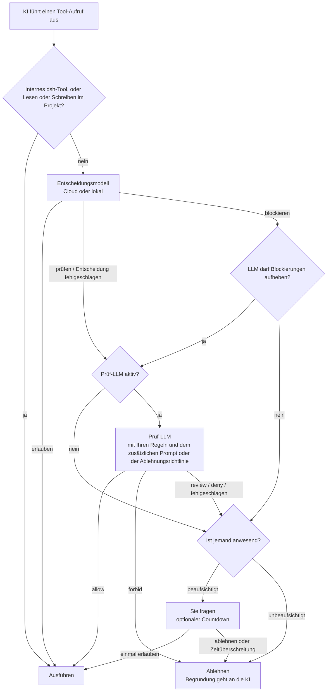

<div align="center">

<picture>
  <source media="(prefers-color-scheme: dark)" srcset="docs/assets/openvulcan-logo-dark.svg">
  
</picture>

# Vulcan Decision Guard

**Eine Berechtigungsentscheidung für jeden Tool-Aufruf Ihres KI-Coding-Agenten**

Ein spezielles Entscheidungsmodell · Optionale LLM-Prüfung · Sie behalten das letzte Wort

[](LICENSE)
[](https://www.npmjs.com/package/@openvulcan/dsh-decision-guard)

[简体中文](README.md) | [English](README.en.md) | [繁體中文](README.zh-TW.md) | [日本語](README.ja.md) | [한국어](README.ko.md) | [Español](README.es.md) | [Français](README.fr.md) | **Deutsch** | [Русский](README.ru.md) | [Português](README.pt-BR.md)

</div>

---

## Über das Projekt

Vulcan Decision Guard ist ein Plugin zur Berechtigungsüberwachung für KI-Coding-Tools. Bevor der KI-Agent ein Tool
ausführt, beurteilt das Vulcan-Decision-Modell den Aufruf: Routinearbeit läuft durch, unsichere Aufrufe gehen an
ein Prüf-LLM oder an Sie, und gefährliche werden gestoppt.

Unterstützt wird derzeit DeepSeek harness (dsh `0.2.1-rc.2` oder neuer, unterhalb von `0.3.0`). Installiert wird
nur ein einziges Paket:

```sh
dsh plugin add @openvulcan/dsh-decision-guard
```

> **Unser Versprechen: Das Cloud-Entscheidungsmodell für Befehle ist dauerhaft kostenlos.** (27. Oktober 2026)

> **Status: v1-Vorschau.** Die Entscheidungen werden noch kalibriert. Dies ist eine zusätzliche Schicht über einer
> Sandbox, kein Ersatz für sie. Lokale Modelle werden von Hugging Face oder ModelScope (China-Website) heruntergeladen
> oder aus einem lokalen Ordner installiert; die internationale ModelScope-Website folgt später. Hinweise zu Entwurf
> und Verifikation: [docs/architecture.md](docs/architecture.md).

## 🤔 Warum ein Entscheidungsmodell

Ein KI-Agent führt für eine einzige Aufgabe oft Dutzende bis Hunderte von Tool-Aufrufen aus. Es gibt zwei einfache
Wege, damit umzugehen, und beide sind schlecht:

- **Jedes Mal bei Ihnen nachfragen**: Man ermüdet schnell und klickt am Ende ohne zu lesen auf „Allow“ (Erlauben),
  sodass die Nachfrage nichts mehr bedeutet.
- **Alles erlauben**: Meistens ist das in Ordnung, aber eine Löschung im falschen Ordner oder eine geleerte
  Produktionsdatenbank lässt sich nicht rückgängig machen.

Auch ein allgemeines LLM jeden Aufruf prüfen zu lassen, ist nicht ideal: Jeder Aufruf wartet mehrere Sekunden und
verbraucht Tokens, und das LLM liest dieselbe Konversation, sodass es sich von demselben Kontext überzeugen lassen
kann, der den Agenten in die Irre geführt hat.

Das Entscheidungsmodell ist ein kleines Modell (0,2B bis 0,75B), das für genau diese eine Aufgabe trainiert wurde.
Es sieht nur drei Dinge: den Projektordner, den Tool-Namen und die tatsächlichen Argumente. Die Konversation und die
Erklärungen der KI liest es nie. Es antwortet mit einer von drei Entscheidungen: **erlauben**, **prüfen** oder
**blockieren**. Dadurch gilt:

- Alltägliche Aufrufe wie Dateien lesen, Tests ausführen, `git status` und Builds gehen innerhalb eines
  Netzwerk-Roundtrips oder einer lokalen Inferenz durch, und Sie bemerken es kaum;
- Nur die wenigen unsicheren oder gefährlichen Aufrufe gehen an das Prüf-LLM oder an Sie, sodass sich das erneute
  Lesen einer Nachfrage lohnt;
- Die KI kann sich nicht am Entscheidungsmodell vorbeireden, denn das Entscheidungsmodell sieht das Argument nie.

## 🎯 Wovor es schützt und wovor nicht

### Der Schwerpunkt: Fehler der KI beim Ausführen von Befehlen

Das Entscheidungsmodell zielt auf Dinge, die die KI **versehentlich** falsch macht, zum Beispiel:

- Den falschen Pfad löschen: Eine leere Variable macht aus `rm -rf "$DIR/"*` eine Löschung eine Ebene höher, oder
  ein rekursives Löschen erreicht einen Ordner außerhalb des Projekts;
- Datenbankunfälle: `DROP DATABASE`, `TRUNCATE` oder ein `DELETE` ohne Bedingung gegen die Produktion;
- Das Projekt oder seinen Verlauf zerstören: das ganze Projekt löschen, `git reset --hard`, ein Force-Push, der das
  Remote überschreibt, `.git` löschen;
- In ein anderes Projekt schreiben: Dateien in einem anderen Repository ändern statt im aktuellen;
- In die falsche Richtung spiegeln oder synchronisieren, einen Probelauf-Befehl echt ausführen und so weiter.

Wie drei dieser Kategorien behandelt werden, legen Sie fest (die „category grants“ (Kategorie-Freigaben) auf der
Schnellkarte):

| Kategorie | Angehakt (freigegeben) | Nicht angehakt | Standard |
| --- | --- | --- | --- |
| Schreiben außerhalb des Projekts | Direkt erlaubt | Braucht Prüfung | Angehakt |
| Datenbanken löschen oder leeren | Direkt erlaubt | Muss bestätigt werden | Nicht angehakt |
| Das gesamte Projekt zurücksetzen | Direkt erlaubt | Muss bestätigt werden | Nicht angehakt |

### Nicht abgedeckt: Die KI umgeht die Prüfung absichtlich

Wenn die KI die Prüfung **gezielt** umgehen will, kann das Entscheidungsmodell sie nicht aufhalten, und ebenso
wenig jeder ähnliche Ansatz. Das einfachste Beispiel:

1. Die KI schreibt mit dem Dateischreib-Tool die Datei `cleanup.py` mit dem Inhalt `shutil.rmtree("/")`;
2. Danach führt sie `python cleanup.py` aus.

Das Entscheidungsmodell sieht nur „eine Datei im Projekt schreiben“ und „ein Python-Skript im Projekt ausführen“.
Einzeln betrachtet sind beides gewöhnliche Entwicklungsschritte. Es gibt viele Varianten: ein Skript in
`package.json` ändern und dann `npm run` ausführen, ein Makefile oder einen Git-Hook bearbeiten, einen Befehl
kodieren und zur Laufzeit dekodieren, Code während der Ausführung aus dem Netz laden …

Um solche Fälle zu erkennen, müsste ein LLM **jede** von der KI geschriebene Datei dauerhaft analysieren und vor
jeder Ausführung die gesamte auszuführende Datei, jedes importierte Modul, jedes aufgerufene Programm und alles,
was zur Laufzeit erzeugt oder heruntergeladen wird. Das bei jeder Ausführung zu tun, ist langsam und teuer und
deckt trotzdem keinen Code ab, der erst zur Laufzeit entsteht. Das ist schlicht nicht praktikabel.

Das Plugin hat deshalb einen klaren Geltungsbereich: **Es verringert die Fehler der KI; es bekämpft nicht ihre
Absicht**. Gegen Absicht schützt nur Isolation:

- Verwenden Sie eine Sandbox. Mit der Integration „standalone switch“ (eigenständiger Schalter) bleibt die Sandbox
  der von Ihnen gewählten Berechtigungsvorgabe erhalten;
- Geben Sie der Entwicklungsumgebung nur die minimal nötigen Rechte, und bewahren Sie Zugangsdaten für
  Produktionsdatenbanken oder Cloud-Konten dort auf, wo die KI sie nicht lesen kann;
- Führen Sie nicht vertrauenswürdige Aufgaben in einem Container oder einer virtuellen Maschine aus.

Beachten Sie außerdem: In dsh laufen das äußere `run_code` und Node-Nebeneffekte, die direkt in einem PTC-Programm
entstehen, nicht durch das Tool-Aufruf-Gate. Das dsh-eigene Auto review hat dieselbe Einschränkung.

## ⚠️ Die automatische Genehmigung garantiert nicht, dass jedes Risiko abgelehnt wird

Kein Modell erkennt alles, und dieses ist keine Ausnahme:

- Das Entscheidungsmodell macht Fehler. In der Auswertung unten ist „erlaubt, obwohl eine Prüfung nötig war“ selbst
  bei stark trainierten Fragen nicht null, und bei Fragetypen, die wir nicht trainiert haben, gibt es mehr Fehler;
- Das Prüf-LLM bearbeitet nur Aufrufe, die das Entscheidungsmodell **nicht erlaubt** hat. Ein vom
  Entscheidungsmodell erlaubter Aufruf wird sofort ausgeführt, und die Prüfung kann ihn nicht zurückholen;
- Regeln, zusätzliche Prompts und Richtlinien für den unbeaufsichtigten Betrieb sind natürliche Sprache, die von
  einem LLM umgesetzt wird, und können ebenfalls falsch verstanden werden.

Betrachten Sie es als eine Schicht, die die Wahrscheinlichkeit eines Unfalls senkt, nicht als Versicherung. Wir
empfehlen außerdem: häufig in Git committen, wichtige Daten sichern, „Dropping or emptying databases“ (Datenbanken
löschen oder leeren) und „Resetting the whole project“ (Das gesamte Projekt zurücksetzen) nicht anhaken und keine
Produktions-Zugangsdaten in der Entwicklungsumgebung ablegen. Wenn Sie eine falsche Entscheidung bemerken,
markieren Sie in den Entscheidungsprotokollen die richtige, um das Modell verbessern zu helfen.

## 🔀 Der Gesamtablauf



1. **Host-Übersetzung**: Das Plugin wandelt den Tool-Aufruf von dsh in die Form um, die das Modell im Training
   gesehen hat. Interne dsh-Tools (Fragen, To-dos, Nachrichten von Sub-Agenten usw.) sowie Lese- oder
   Schreibzugriffe im aktuellen Projekt werden direkt erlaubt und erreichen das Modell nie.
2. **Entscheidungsmodell**: antwortet erlauben, prüfen oder blockieren.
3. **Prüf-LLM** (abschaltbar): bearbeitet „prüfen“ und fehlgeschlagene Entscheidungen; blockierte Aufrufe erreichen
   es nur, wenn Sie „Let the LLM overturn blocks“ (LLM darf Blockierungen aufheben) einschalten.
4. **Sie**: nur wenn jemand anwesend ist. Unbeaufsichtigte Sitzungen fragen nie; alles, was nicht erlaubt ist, wird
   abgelehnt.

Ein abgelehnter Aufruf gibt seine Begründung an die KI zurück, die ihren Zweck erklären und es erneut versuchen
kann. **Kein Fehler wird jemals als Erlaubnis behandelt**: nicht angemeldet, Netzwerkfehler, fehlendes Runtime-Pack
oder Modell, fehlgeschlagene Prüfung oder eine Antwort im falschen Format gelten alle als nicht erlaubt.

## ⚖️ Wie Entscheidungen getroffen werden

Die Eingabe des Entscheidungsmodells besteht nur aus diesen drei Zeilen, genau wie im Training, ohne hinzugefügte
Aufgabenbeschreibung, Nachrichtenverlauf oder Dateiinhalte:

```text
Project: <project root>
Tool: <tool name>
Arguments: <compact JSON of the actual arguments>
```

zuzüglich der drei oben genannten Kategorie-Freigaben. Was jede Entscheidung nach sich zieht:

| Entscheidungsmodell | Bedeutung | Nächster Schritt |
| --- | --- | --- |
| erlauben | Routinearbeit | Wird direkt ausgeführt |
| prüfen | Kann Nebeneffekte haben; Kontext ist nötig | Geht an das Prüf-LLM, dann zur Tabelle unten |
| blockieren | Sehr wahrscheinlich ein Fehler oder eine Überschreitung | Fragt standardmäßig direkt Sie (unbeaufsichtigt abgelehnt); mit „Let the LLM overturn blocks“ geht es zuerst zur Prüfung |

Wie die Antwort des Prüf-LLM umgesetzt wird:

| Antwort des Prüf-LLM | Beaufsichtigt | Unbeaufsichtigt |
| --- | --- | --- |
| allow | Ausführen | Ausführen |
| review (nur beaufsichtigt) | Sie fragen, Fokus auf „Allow“ | — |
| deny | Sie fragen, Fokus auf „Deny“ (Ablehnen) | Ablehnen |
| forbid (nur beaufsichtigt) | Ablehnen ohne Nachfrage | — |
| Fehlgeschlagen, Prüfung abgeschaltet oder nicht zur Prüfung geschickt | Sie fragen; Fokus auf „Allow“, wenn die Entscheidung „prüfen“ war, sonst auf „Deny“ | Ablehnen |

Die Fragekarte kann einen Countdown haben; läuft er ab, wird der Aufruf abgelehnt. 0 bedeutet, unbegrenzt auf Ihre
Antwort zu warten.

## 🧑‍⚖️ Wie die LLM-Prüfung funktioniert

- **Welches Modell**: das Modell der aktuellen Sitzung, ein in den Einstellungen gewählter Dienst samt Modell,
  oder aus. Die Temperatur ist 0, und Prüfanfragen werden nicht in den Sitzungsverlauf geschrieben.
- **Was die Prüfung sieht**:
  - Die Umgebung: den Projektordner und die drei Kategorie-Freigaben;
  - Ihre Regeln: drei Gruppen natürlichsprachlicher Regeln, „Forbidden“ (Verboten), „Deny“ (Ablehnen) und „Allow“
    (Erlauben), mit der Priorität forbid > deny > allow. Sie gelten nur für Aufrufe, die das Entscheidungsmodell
    nicht erlaubt hat;
  - Den „additional review prompt“ (zusätzlicher Prüf-Prompt), wenn jemand anwesend ist, oder die „deny policy“
    (Ablehnungsrichtlinie) im unbeaufsichtigten Betrieb;
  - Die letzten 6 Anweisungen von Benutzer und Agent in der Konversation und die letzten 12 Tool-Aufrufe;
  - Jede Absichtserklärung, die die KI über `explain_tool_call` abgegeben hat (eine Behauptung, keine Berechtigung);
  - Den ausstehenden Aufruf selbst und das Urteil des Entscheidungsmodells.
- **Wie sie antworten darf**: beaufsichtigt nur allow / review / deny / forbid; unbeaufsichtigt nur allow / deny,
  und ihr wird mitgeteilt, dass es keine menschliche Prüfung gibt. Die Antwort muss JSON einer festen Form sein,
  mit einer Begründung von höchstens 300 Zeichen in der Sprache der Oberfläche. Alles andere zählt als
  fehlgeschlagene Prüfung.
- **Zusätzlicher Prompt**: Ist jemand anwesend, liest die Prüfung nach den Regeln den „additional review prompt“.
  Er kann die Prüfung strenger machen oder beschreiben, was Ihnen wichtig ist, aber er **kann die Regeln oder die
  Kategorie-Freigaben nicht lockern**. Die Einstellungen enthalten den Systemstandard; jede Sitzung kann auf der
  Schnellkarte einen eigenen schreiben oder dem Standard folgen (oder
  `/vulcan-review-prompt set <prompt> | default` verwenden).
- **Unbeaufsichtigt**: Das Einschalten auf der Schnellkarte bedeutet, eine deny policy zu bestätigen (vorausgefüllt
  mit der Standard-Ablehnungsrichtlinie des Systems), gespeichert pro Sitzung (oder
  `/vulcan-unattended on [deny policy] | off` verwenden). Sitzungen, deren Genehmigungsrichtlinie `never` ist,
  werden ebenfalls als unbeaufsichtigt behandelt, mit der Standard-Ablehnungsrichtlinie des Systems.
- **Absicht erklären**: Solange die Prüfung aktiv ist, kann die KI `explain_tool_call` aufrufen, um den Zweck ihres
  nächsten Aufrufs anzugeben. Die Erklärung geht nur an das Prüf-LLM und an die Fragekarte, nie an das
  Entscheidungsmodell, und sie kann niemals allein eine Berechtigung erteilen.

## 📊 Auswertung

Im Oktober 2026 haben wir einen einmaligen Vergleich auf einer einzigen eingefrorenen Fragensammlung durchgeführt:
**`vulcan-decision-shell-v1`** (0.75B) gegen zwei externe Entscheidungsdienste, JEV 1.14.0 und das
Entscheidungsmodell von Alibaba Cloud Bailian `bailian-decision-preview`. Alle drei erhielten dieselbe feste englische
Richtlinie, dieselben vollständigen Tool-Argumente, denselben Projektordner und dieselben festen
Freigabeoptionen, ohne Aufgabenbeschreibung; es wurde die Entscheidung mit der höchsten Bewertung genommen, und
Schwellenwerte wurden nicht angepasst.

Zuerst die Grenzen dieser Zahlen:

- Die gelabelten Fragen stammen aus unserer eigenen Trainings- und Testsammlung, und **ein großer Teil davon sind
  Fragen, auf die wir trainiert haben**, was uns klar begünstigt;
- Die Referenzlabels stammen von uns; sie sind keine absolute Wahrheit für die Produktion;
- Die Zahlen gelten nur für `vulcan-decision-shell-v1`, das Cloud-Standardmodell. `vulcan-decision-shell-v1-flash` (0.36B) und `vulcan-decision-shell-v1-mini` (0.2B) verhalten sich
  anders und sind hier nicht vertreten;
- Externe Ergebnisse spiegeln die damals verfügbaren Versionen wider. Über den Dienst-Alias von Alibaba Cloud
  können wir nicht prüfen, welche Gewichte dahinterstehen.

**Gelabelte Sammlung (106,501 Eingaben)**

| Kennzahl | `vulcan-decision-shell-v1` | JEV 1.14.0 | Alibaba Cloud |
| --- | --- | --- | --- |
| Routinearbeit direkt erlaubt (höher ist besser) | 99.07% | 73.10% | 96.60% |
| Erlaubt, obwohl Prüfung nötig war (niedriger ist besser) | 2.40% | 17.03% | 90.92% |
| Erlaubt, obwohl blockiert werden sollte (niedriger ist besser) | 0.04% | 2.99% | 76.85% |
| Davon schwere Fehler erlaubt | 0 / 16,613 | 2.43% | 76.88% |
| Harmlos, aber blockiert (niedriger ist besser) | 0.20% | 8.11% | 1.79% |

**Echte Befehle (415,194 verschiedene Aufrufe, ohne Label pro Aufruf)**: gewichtet danach, wie oft jeder tatsächlich
vorkam, erlaubten die drei 99.76%, 99.69% und 99.99% direkt. Das zeigt nur, wie oft Sie unterbrochen würden, nicht,
ob die Entscheidungen richtig waren.

**Fragetypen, auf die wir nicht trainiert haben**: Bei einem Entwicklungs-Holdout aus bedingten Schutzprüfungen,
Variablenkopien und Aufräumvorgängen (keiner der drei darauf trainiert) lag der Anteil „erlaubt, obwohl
blockiert werden sollte“ bei 43.75% für `vulcan-decision-shell-v1`, 1.88% für JEV und 100% für Alibaba Cloud; „harmlos, aber
blockiert“ lag bei 15.36%, 4.82% und 0%. Bei Fragetypen, die wir noch nicht abdecken, ist JEV deutlich besser als
wir.

Wie diese Zahlen zu lesen sind:

- **JEV wurde erkennbar für Befehlsentscheidungen trainiert**, und es schneidet nicht schlecht ab. Unser Vorteil
  konzentriert sich auf die Fehlerarten, auf die wir gezielt trainiert haben, etwa das Verfolgen von
  Variablenketten und Löschzielen, die Richtung und Probeläufe beim Spiegeln und Synchronisieren sowie lange
  Befehle; außerhalb dieser Bereiche kann die Fehlerquote von JEV niedriger sein als unsere;
- **Das Entscheidungsmodell von Alibaba Cloud dient breiteren, allgemeinen Zwecken** und wurde wahrscheinlich nicht
  gezielt auf Fehler trainiert, die Coding-Agenten beim Ausführen von Befehlen machen, daher neigt es bei dieser
  Sammlung zum Erlauben. Das macht es nicht schlecht: Es ist für das Gesamtbild gebaut, während wir uns auf diese
  eine Sache spezialisieren;
- Wir werden die Lücken weiter mit Beispielen füllen, die aus den Entscheidungsprotokollen exportiert werden.

## 🚀 Installation und Verwendung (dsh)

```sh
dsh plugin add @openvulcan/dsh-decision-guard
```

Dieses eine Paket genügt: Die Entscheidungs-Engine ist darin gebündelt, ohne native Abhängigkeiten und ohne
Installationsskripte.

1. Öffnen Sie in dsh „Settings › Auto approval“ (Einstellungen › Automatische Genehmigung) (auch die Schaltfläche
   „Open auto approval settings“ (Einstellungen für automatische Genehmigung öffnen) auf der Plugin-Seite führt
   dorthin) und melden Sie sich bei einem OpenVulcan-Konto an (China-Site oder globale Site), um Cloud-Entscheidungen
   zu nutzen. Wenn Tool-Aufrufe Ihren Rechner nicht verlassen dürfen, wechseln Sie zu „Local model“ (Lokales Modell)
   und installieren Sie ein Runtime-Pack und ein Modell gemäß den Vorschlägen für Ihre Hardware.
2. Wählen Sie Auto review in der Berechtigungsauswahl von dsh, oder stellen Sie die Integration in den
   Einstellungen auf „Standalone switch“ um:

   | Integration | Welche Sitzungen beurteilt werden | Sandbox |
   | --- | --- | --- |
   | „Auto preset“ (automatische Vorgabe) | Sitzungen, deren Vorgabe Auto review ist | Keine (voller Zugriff) |
   | Standalone switch | Jede Sitzung, zusätzlich zur gewählten Vorgabe | Die Sandbox der gewählten Vorgabe bleibt erhalten |

3. Bestätigen Sie mit „Try a decision“ (Entscheidung ausprobieren) in den Einstellungen, dass Entscheidungen
   funktionieren.

Das Label „Auto approval“ (Automatische Genehmigung) links neben der Modellauswahl des Eingabefelds öffnet die
Schnellkarte: Haken Sie die drei Kategorie-Freigaben an, legen Sie den zusätzlichen Prüf-Prompt und den
unbeaufsichtigten Modus dieser Sitzung fest und passen Sie Entscheidungsmodell, Endpunkt, Prüfung und
Frage-Countdown an. Dieses Plugin ersetzt das experimentelle Auto-review-Plugin von dsh; beide können nicht
gleichzeitig aktiviert sein.

## ☁️ Cloud und lokal

Cloud-Entscheidungen sind der Standard, und auf Ihrem Rechner wird nichts installiert. **Das Cloud-Entscheidungsmodell
für Befehle ist dauerhaft kostenlos** (zugesagt am 27. Oktober 2026); Sie benötigen nur ein OpenVulcan-Konto. Das
Prüf-LLM nutzt den von Ihnen gewählten Modelldienst und wird nach den Bedingungen dieses Dienstes abgerechnet.
OpenVulcan stellt die verfügbaren Entscheidungsmodelle und Endpunkte pro Konto bereit; die Endpunkttabelle in den
Einstellungen zeigt Netzwerk- und Rechenzeit jedes Endpunkts, und Sie können einen Endpunkt festlegen oder einen
Anfragetest dagegen ausführen.

Wenn Tool-Aufrufe Ihren Rechner nicht verlassen dürfen, installieren Sie bei Bedarf ein **Runtime-Pack**:

| Runtime-Pack | Für | Download Windows x64 |
| --- | --- | --- |
| `onnx-cpu` | Jeder Computer, führt ONNX-Modelle aus | 56 MiB |
| `onnx-cuda` | NVIDIA-GPUs (RTX 20-Serie und neuer), führt ONNX-Modelle aus | 1307 MiB |
| `torch-cpu` | Jeder Computer, führt veröffentlichte PyTorch-Modelle aus | 173 MiB |
| `torch-cu128` | NVIDIA-GPUs (RTX 20-Serie und neuer), führt veröffentlichte PyTorch-Modelle aus | 2797 MiB |

Runtime-Packs sind ein vorgebautes Python plus offizielle Wheels, und jede Datei wird gegen einen fest hinterlegten
SHA-256 geprüft. **Es wird nichts kompiliert, und es wird kein Treiber installiert oder aktualisiert.** GPUs ohne
fertige Runtime (AMD, Intel, Apple) nutzen ein CPU-Pack oder die Cloud. Die Einstellungen erkennen Ihre GPU, Ihren
Treiber und die Compute Capability und schlagen ein Pack vor; Nutzer in Festlandchina können die
China-Spiegel-Downloadquelle wählen.

`vulcan-decision-shell-v1` gibt es in drei Größen, sowohl in der Cloud als auch lokal verfügbar:

| Größe | Modell | Parameter | Hinweise |
| --- | --- | --- | --- |
| mini | `vulcan-decision-shell-v1-mini` | 0.2B | |
| flash | `vulcan-decision-shell-v1-flash` | 0.36B | |
| standard | `vulcan-decision-shell-v1` | 0.75B | Cloud-Standard. Das oben ausgewertete Modell; basiert auf Qwen3.5-0.8B-Base |

## 🔒 Entscheidungsprotokolle und Datenschutz

- **Cloud-Entscheidungen**: Die drei oben genannten Eingabezeilen (Projektordner, Tool-Name, Argumente) und die
  Kategorie-Freigaben werden an einen OpenVulcan-Entscheidungsendpunkt gesendet. Bei Nutzung eines lokalen Modells
  wird nichts gesendet.
- **Prüf-LLM**: Die Prüfeingabe (einschließlich der letzten Anweisungen und Tool-Aufrufe aus der Konversation) wird
  an den von Ihnen gewählten Prüfmodell-Dienst gesendet, unter denselben Datenbedingungen, die Sie bereits mit
  diesem Dienst haben. Bei abgeschalteter Prüfung wird nichts gesendet.
- **Entscheidungsprotokolle**: „Record decisions“ (Entscheidungen aufzeichnen) in den Einstellungen ist
  standardmäßig aus. Wenn aktiviert, wird jede Entscheidung, an der das Entscheidungsmodell oder die Prüfung
  beteiligt war, mit dem ursprünglichen Befehl und den Pfaden in
  `$DSH_HOME/vulcan-decision/records.v1.jsonl` auf Ihrem Rechner gespeichert, wobei die letzten 5000 Einträge für
  höchstens 30 Tage behalten werden; sie werden nie hochgeladen. Mit „View records“ (Protokolle ansehen) können Sie
  nach Entscheidung und Arbeitsbereich filtern, falsche Entscheidungen markieren, die markierten Einträge als
  Trainingsbeispiele exportieren oder alles löschen.
- **Zugangsdaten**: Die OpenVulcan-Anmeldung wird im eigenen Zugangsdatenspeicher von dsh abgelegt, und Tokens
  erscheinen nie in der Oberfläche oder in Logs.

## 📦 Pakete

| Paket | Rolle |
| --- | --- |
| [`@openvulcan/dsh-decision-guard`](packages/dsh-decision-guard) | dsh-Plugin: fängt Tool-Aufrufe ab, übersetzt die Eingabe, setzt Entscheidungen um, stellt die Einstellungsseite und die Schnellkarte bereit; wird mit gebündelter Entscheidungs-Engine ausgeliefert |
| [`@openvulcan/vulcan-decision`](packages/vulcan-decision) | Entscheidungs-Engine (Cloud und lokal), Konto, Verwaltung von Runtime-Packs und Modellen, Kommandozeile `npx @openvulcan/vulcan-decision --help` |

Beide sind reine Node-Pakete (Node ≥ 20.19).

## 🛠️ Entwicklung

```sh
pnpm install
pnpm -r run typecheck
pnpm test
pnpm run pack:dsh   # erzeugt dist/openvulcan-dsh-decision-guard-<version>.tgz
```

Die Lock-Dateien der Runtime-Packs werden mit `python -I -B scripts/lock_runtime.py` erzeugt (erfordert uv).

## 🙏 Danksagungen

Vulcan Decision Guard baut auf den folgenden Open-Source-Projekten auf. Danke an deren Autorinnen, Autoren und Communities.

**Plugin-Host**

- [DeepSeek harness (dsh)](https://github.com/deepseek-ai/deepseek-harness): der Plugin-Host und der Berechtigungspfad für Tool-Aufrufe
- [Cordis](https://github.com/cordiverse/cordis) und [Schemastery](https://github.com/shigma/schemastery): das Plugin-Framework und das Einstellungsschema, bereitgestellt von dsh
- [React](https://react.dev/): Einstellungsseite und Schnellkarte, bereitgestellt von der dsh-Seite

**Lokale Laufzeitpakete (nur heruntergeladen, wenn Sie das lokale Modell wählen und ein Paket installieren)**

- [CPython](https://www.python.org/) (vorkompiliert von [python-build-standalone](https://github.com/astral-sh/python-build-standalone)): der Python-Interpreter
- [ONNX Runtime](https://onnxruntime.ai/): führt die ONNX-Modelle aus
- [PyTorch](https://pytorch.org/): führt die PyTorch-Release-Modelle aus
- Hugging Face [Transformers](https://github.com/huggingface/transformers), [Tokenizers](https://github.com/huggingface/tokenizers), [Safetensors](https://github.com/huggingface/safetensors): Laden der Modelle und Tokenisierung
- [NumPy](https://numpy.org/): Numerik
- [NVIDIA CUDA](https://developer.nvidia.com/cuda-toolkit) und [cuDNN](https://developer.nvidia.com/cudnn): die offiziellen Wheels in den GPU-Paketen

**Entwicklungswerkzeuge**

- [TypeScript](https://www.typescriptlang.org/), [pnpm](https://pnpm.io/) und [uv](https://github.com/astral-sh/uv) zum Erzeugen der Lock-Dateien der Laufzeitpakete

**Modell**

- [Qwen3.5-0.8B-Base](https://huggingface.co/Qwen/Qwen3.5-0.8B-Base): das Basismodell von `vulcan-decision-shell-v1`

**Community**

- [LINUX DO](https://linux.do/): Dank an die LINUX-DO-Community für Unterstützung und Austausch

Herkunft und SHA-256 jeder Datei eines Laufzeitpakets stehen in den Lock-Dateien unter [`packages/vulcan-decision/runtime-packs/`](packages/vulcan-decision/runtime-packs). Jede Datei wird damit geprüft und unverändert installiert; jede Komponente wird unter der mitgelieferten Lizenz verwendet.

## 📄 Lizenz

[MIT](LICENSE)
