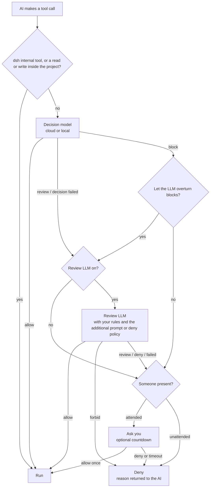

<div align="center">

<picture>
  <source media="(prefers-color-scheme: dark)" srcset="docs/assets/openvulcan-logo-dark.svg">
  
</picture>

# Vulcan Decision Guard

**A permission decision for every tool call your AI coding agent makes**

A dedicated decision model · Optional LLM review · You keep the final say

[](LICENSE)
[](https://www.npmjs.com/package/@openvulcan/dsh-decision-guard)

[简体中文](README.md) | **English** | [繁體中文](README.zh-TW.md) | [日本語](README.ja.md) | [한국어](README.ko.md) | [Español](README.es.md) | [Français](README.fr.md) | [Deutsch](README.de.md) | [Русский](README.ru.md) | [Português](README.pt-BR.md)

</div>

---

## About

Vulcan Decision Guard is a permission guard plugin for AI coding tools. Before the AI agent runs a tool, the
Vulcan Decision model judges the call: routine work goes through, uncertain calls go to a review LLM or to you,
and dangerous ones are stopped.

It currently supports DeepSeek harness (dsh `0.2.1-rc.2` or later, below `0.3.0`). One package is all you install:

```sh
dsh plugin add @openvulcan/dsh-decision-guard
```

> **Our commitment: the cloud command decision model is free, permanently.** (October 27, 2026)

> **Status: v1 preview.** The decisions are still being calibrated. This is one layer on top of a sandbox, not a
> replacement for it. Local models download from Hugging Face or ModelScope (China site), or install from a local
> folder; the ModelScope international site follows later. Design and verification notes:
> [docs/architecture.md](docs/architecture.md).

## 🤔 Why a decision model

An AI agent often makes dozens to hundreds of tool calls to finish one task. There are two simple ways to handle
them, and both are bad:

- **Ask you every time**: you tire quickly and end up clicking "Allow" without reading, so asking means nothing.
- **Allow everything**: fine most of the time, but one deletion in the wrong folder or one wiped production
  database cannot be undone.

Having a general LLM review every call is not ideal either: each call waits several seconds and spends tokens,
and the LLM reads the same conversation, so it can be talked round by the same context that led the agent astray.

The decision model is a small model (0.2B to 0.8B) trained for this one job. It sees only three things: the
project folder, the tool name and the actual arguments. It never reads the conversation or the AI's
explanations. It answers with one of three decisions: **allow**, **review** or **block**. As a result:

- Everyday calls such as reading files, running tests, `git status` and builds go through within one network
  round trip or one local inference, and you barely notice it;
- Only the few uncertain or dangerous calls go to the review LLM or to you, so a question is worth reading again;
- The AI cannot argue its way past the decision model, because the decision model never sees the argument.

## 🎯 What it protects against, and what it does not

### The focus: mistakes the AI makes while running commands

The decision model targets things the AI gets wrong **by accident**, for example:

- Deleting the wrong path: an empty variable turns `rm -rf "$DIR/"*` into a deletion one level up, or a
  recursive delete reaches a folder outside the project;
- Database accidents: `DROP DATABASE`, `TRUNCATE` or a `DELETE` without a condition against production;
- Destroying the project or its history: deleting the whole project, `git reset --hard`, force-pushing over the
  remote, deleting `.git`;
- Writing into another project: changing files in a different repository instead of the current one;
- Mirroring or syncing in the wrong direction, running a dry-run command for real, and so on.

You decide how three of these categories are handled (the "category grants" in the quick card):

| Category | Checked (granted) | Unchecked | Default |
| --- | --- | --- | --- |
| Writes outside the project | Allowed directly | Needs review | Checked |
| Dropping or emptying databases | Allowed directly | Must be confirmed | Unchecked |
| Resetting the whole project | Allowed directly | Must be confirmed | Unchecked |

### Not covered: the AI deliberately getting around it

If the AI **sets out** to get around the check, the decision model cannot stop it, and neither can any similar
approach. The simplest example:

1. The AI uses the file-writing tool to write `cleanup.py` containing `shutil.rmtree("/")`;
2. Then it runs `python cleanup.py`.

All the decision model sees is "write a file in the project" and "run a Python script in the project". Taken one
at a time, both are ordinary development steps. There are many variations: changing a script in `package.json` and
then running `npm run`, editing a Makefile or a Git hook, encoding a command and decoding it at run time,
downloading code from the network while running…

Catching these would require an LLM to analyze **every** file the AI writes, all the time, and, before every
execution, to analyze the whole file being run, every module it imports, every program it calls, and anything
generated or downloaded at run time. Doing that for every execution is slow and expensive, and it still cannot
cover code that only appears at run time. It is simply not practical.

So the plugin has a clear scope: **it reduces the AI's mistakes; it does not fight the AI's intent**. Defending
against intent takes isolation:

- Use a sandbox. With the "standalone switch" integration, the sandbox of the permission preset you chose stays in
  place;
- Give the development environment the least privilege it needs, and keep credentials for production databases or
  cloud accounts where the AI cannot read them;
- Run untrusted tasks in a container or virtual machine.

Also note that in dsh, the outer `run_code` and Node side effects made directly inside a PTC program do not pass
through the tool call gate. dsh's own Auto review has the same limitation.

## ⚠️ Auto approval does not guarantee that every risk is refused

No model can catch everything, and this one is no exception:

- The decision model makes mistakes. In the evaluation below, "allowed although it needed review" is not zero
  even on questions we trained on heavily, and there are more errors on question types we have not trained on;
- The review LLM only handles calls the decision model **did not allow**. A call the decision model allowed runs
  right away, and review cannot bring it back;
- Rules, additional prompts and unattended policies are natural language, carried out by an LLM, and can be
  misread as well.

Treat it as a layer that lowers the odds of an accident, not as insurance. We also recommend: commit to Git often,
back up important data, leave "Dropping or emptying databases" and "Resetting the whole project" unchecked, and keep
production credentials out of your development environment. When you spot a wrong decision, mark the correct
one in the decision records to help improve the model.

## 🔀 The overall flow



1. **Host translation**: the plugin turns dsh's tool call into the shape the model saw in training. dsh's internal
   tools (questions, to-dos, sub-agent messages and so on) and reads or writes inside the current project are
   allowed directly and never reach the model.
2. **Decision model**: answers allow, review or block.
3. **Review LLM** (can be turned off): handles review and failed decisions; blocked calls only reach it when you
   turn on "Let the LLM overturn blocks".
4. **You**: only when someone is present. Unattended sessions never ask; anything not allowed is denied.

A denied call returns its reason to the AI, which may explain its purpose and try again. **No error is ever
treated as allow**: not signed in, a network failure, a missing runtime pack or model, a failed review or an
answer in the wrong format are all treated as not allowed.

## ⚖️ How decisions are made

The decision model's input is only these three lines, exactly as in training, with no task description, message
history or file contents added:

```text
Project: <project root>
Tool: <tool name>
Arguments: <compact JSON of the actual arguments>
```

plus the three category grants above. What each decision leads to:

| Decision model | Meaning | Next step |
| --- | --- | --- |
| allow | Routine work | Runs directly |
| review | May have side effects; context is needed | Goes to the review LLM, then the table below |
| block | Very likely a mistake or an overreach | By default asks you directly (denied when unattended); with "Let the LLM overturn blocks" it goes to review first |

How the review LLM's answer is carried out:

| Review LLM answer | Attended | Unattended |
| --- | --- | --- |
| allow | Run | Run |
| review (attended only) | Ask you, focus on "Allow" | — |
| deny | Ask you, focus on "Deny" | Deny |
| forbid (attended only) | Deny without asking | — |
| Failed, review turned off, or not sent to review | Ask you; focus on "Allow" when the decision was review, otherwise "Deny" | Deny |

The question card can have a countdown; when it runs out the call is denied. 0 means wait for your answer
indefinitely.

## 🧑‍⚖️ How the LLM review works

- **Which model**: the current session's model, a service and model chosen in settings, or off. Temperature is 0,
  and review requests are not written to the session history.
- **What the review sees**:
  - The environment: the project folder and the three category grants;
  - Your rules: three groups of natural-language rules, "Forbidden", "Deny" and "Allow", with priority
    forbid > deny > allow. They apply only to calls the decision model did not allow;
  - The "additional review prompt" when someone is present, or the "deny policy" when unattended;
  - The last 6 user and agent instructions in the conversation, and the last 12 tool calls;
  - Any statement of intent the AI gave through `explain_tool_call` (a claim, not a permission);
  - The pending call itself, and the decision model's verdict.
- **How it may answer**: when attended, only allow / review / deny / forbid; when unattended, only allow / deny,
  and it is told that no human review exists. The answer must be JSON of a fixed shape, with a reason of up to
  300 characters written in the interface language. Anything else counts as a failed review.
- **Additional prompt**: when someone is present, the review reads the "additional review prompt" after the
  rules. It can make the review stricter or describe what you care about, but it **cannot loosen** the rules or
  the category grants. Settings hold the system default; each session can write its own in the quick card or
  follow the default (or use `/vulcan-review-prompt set <prompt> | default`).
- **Unattended**: turning it on in the quick card means confirming a deny policy (prefilled with the system default
  deny policy), saved per session (or use `/vulcan-unattended on [deny policy] | off`). Sessions whose approval
  policy is `never` are treated as unattended too, with the system default deny policy.
- **Stating intent**: while review is on, the AI can call `explain_tool_call` to state the purpose of its next
  call. The statement goes only to the review LLM and to the question card, never to the decision model, and it
  can never grant permission by itself.

## 📊 Evaluation

In October 2026 we ran a one-off comparison on a single frozen question bank between **`vulcan-decision-shell-v1`** (0.8B) and two external decision services: JEV 1.14.0 and Alibaba Cloud's decision model
`decision-model-preview`. All three used the same fixed English policy, the same complete tool arguments, project
folder and fixed authorization options, with no task description; the highest-scoring decision was taken and no
thresholds were tuned.

First, the limits of these numbers:

- The labeled questions come from our own training and test bank, and **a large share of them are questions we
  trained on**, which clearly favors us;
- The reference labels are ours; they are not absolute truth for production;
- The numbers are for `vulcan-decision-shell-v1` only. The default cloud `vulcan-decision-shell-v1-mini` (0.2B) and `vulcan-decision-shell-v1-flash` (0.35B) perform differently and
  are not represented here;
- External results reflect the versions available at the time. Alibaba Cloud's service alias does not let us check
  which weights are behind it.

**Labeled bank (106,501 inputs)**

| Metric | `vulcan-decision-shell-v1` | JEV 1.14.0 | Alibaba Cloud |
| --- | --- | --- | --- |
| Routine work allowed directly (higher is better) | 99.07% | 73.10% | 96.60% |
| Allowed although it needed review (lower is better) | 2.40% | 17.03% | 90.92% |
| Allowed although it should be blocked (lower is better) | 0.04% | 2.99% | 76.85% |
| Of which, serious mistakes allowed | 0 / 16,613 | 2.43% | 76.88% |
| Harmless but blocked (lower is better) | 0.20% | 8.11% | 1.79% |

**Real commands (415,194 distinct calls, without per-call labels)**: weighted by how often each actually occurred,
the three allowed 99.76%, 99.69% and 99.99% directly. This only shows how often you would be interrupted, not
whether the decisions were right.

**Question types we have not trained on**: on a development holdout of conditional guards, variable copies and
cleanups (none of the three trained on it), the share allowed although it should be blocked was 43.75% for
`vulcan-decision-shell-v1`, 1.88% for JEV and 100% for Alibaba Cloud; harmless but blocked was 15.36%, 4.82% and 0%. On question types
we do not cover yet, JEV is clearly better than we are.

How to read these numbers:

- **JEV has clearly been trained for command decisions**, and it does not perform badly. Our advantage is
  concentrated in the kinds of mistakes we trained on specifically, such as tracking variable chains and deletion
  targets, the direction and dry runs of mirroring and syncing, and long commands; outside those areas JEV's error
  rate can be lower than ours;
- **Alibaba Cloud's decision model serves broader, general purposes** and has probably not been trained
  specifically on mistakes coding agents make when running commands, so it leans toward allowing on this bank.
  That does not make it bad: it is built for the whole picture, while we specialize in this one thing;
- We will keep filling the gaps with samples exported from decision records.

## 🚀 Installation and use (dsh)

```sh
dsh plugin add @openvulcan/dsh-decision-guard
```

This one package is all you need: the decision engine is bundled inside, with no native dependencies and no
install scripts.

1. Open dsh's "Settings › Auto approval" (the "Open auto approval settings" button on the plugin page goes there
   too) and sign in to an OpenVulcan account (China site or global site) to use cloud decisions. If tool calls must
   not leave your machine, switch to "Local model" and install a runtime pack and a model as suggested for your
   hardware.
2. Choose "Auto review" in dsh's permission picker, or change the integration to "Standalone switch" in settings:

   | Integration | Which sessions are judged | Sandbox |
   | --- | --- | --- |
   | Auto preset | Sessions whose preset is "Auto review" | None (full access) |
   | Standalone switch | Every session, on top of the chosen preset | The chosen preset's sandbox stays |

3. Use "Try a decision" in settings to confirm that decisions work.

The "Auto approval" label to the left of the composer's model picker opens the quick card: check the three
category grants, set this session's additional review prompt and unattended mode, and adjust the decision model,
endpoint, review and question countdown. This plugin replaces dsh's experimental Auto review plugin; the two cannot
be enabled together.

## ☁️ Cloud and local

Cloud decisions are the default, and nothing is installed on your machine. **The cloud command decision model is
free, permanently** (committed on October 27, 2026); all you need is an OpenVulcan account. The review LLM uses the
model service you choose and is billed under that service's terms. OpenVulcan provides the available decision
models and endpoints per account; the endpoint table in settings shows each endpoint's network and compute time,
and you can lock an endpoint or run a request test against one.

If tool calls must not leave your machine, install a **runtime pack** when you need it:

| Runtime pack | For | Windows x64 download |
| --- | --- | --- |
| `onnx-cpu` | Any computer, runs ONNX models | 56 MiB |
| `onnx-cuda` | NVIDIA GPUs (RTX 20 series and newer), runs ONNX models | 1307 MiB |
| `torch-cpu` | Any computer, runs PyTorch release models | 173 MiB |
| `torch-cu128` | NVIDIA GPUs (RTX 20 series and newer), runs PyTorch release models | 2797 MiB |

Runtime packs are a prebuilt Python plus official wheels, and every file is checked against a locked SHA-256.
**Nothing is compiled, and no driver is installed or updated.** GPUs without a ready-made runtime (AMD, Intel,
Apple) use a CPU pack or the cloud. Settings detect your GPU, driver and compute capability and suggest a pack;
users in mainland China can pick the China mirror download source.

`vulcan-decision-shell-v1` comes in three sizes, available both in the cloud and locally:

| Size | Model | Parameters | Notes |
| --- | --- | --- | --- |
| mini | `vulcan-decision-shell-v1-mini` | 0.2B | Cloud default |
| flash | `vulcan-decision-shell-v1-flash` | 0.35B | |
| standard | `vulcan-decision-shell-v1` | 0.8B | The model evaluated above; based on Qwen3.5-0.8B-Base |

## 🔒 Decision records and privacy

- **Cloud decisions**: the three input lines above (project folder, tool name, arguments) and the category grants
  are sent to an OpenVulcan decision endpoint. Nothing is sent when you use a local model.
- **Review LLM**: the review input (including recent instructions and tool calls from the conversation) is sent to
  the review model service you chose, under the same data terms you already have with that service. Nothing is
  sent when review is off.
- **Decision records**: "Record decisions" in settings is off by default. When on, every decision the decision
  model or the review took part in is saved with the original command and paths in
  `$DSH_HOME/vulcan-decision/records.v1.jsonl` on your machine, keeping the latest 5000 records for at most 30 days,
  and is never uploaded. "View records" lets you filter by decision and workspace, mark wrong decisions, export the
  marked records as training samples, or clear everything.
- **Credentials**: the OpenVulcan sign-in is stored in dsh's own credential store, and tokens never appear in the
  interface or logs.

## 📦 Packages

| Package | Role |
| --- | --- |
| [`@openvulcan/dsh-decision-guard`](packages/dsh-decision-guard) | dsh plugin: intercepts tool calls, translates the input, carries out decisions, provides the settings page and quick card; ships with the decision engine bundled |
| [`@openvulcan/vulcan-decision`](packages/vulcan-decision) | Decision engine (cloud and local), account, runtime pack and model management, command line `npx @openvulcan/vulcan-decision --help` |

Both are pure Node packages (Node ≥ 20.19).

## 🛠️ Development

```sh
pnpm install
pnpm -r run typecheck
pnpm test
pnpm run pack:dsh   # builds dist/openvulcan-dsh-decision-guard-<version>.tgz
```

The runtime pack lock files are generated by `python -I -B scripts/lock_runtime.py` (requires uv).

## 🙏 Acknowledgments

Vulcan Decision Guard is built on the open-source projects below. Thanks to their authors and communities.

**Plugin host**

- [DeepSeek harness (dsh)](https://github.com/deepseek-ai/deepseek-harness): the plugin host and the permission path for tool calls
- [Cordis](https://github.com/cordiverse/cordis) and [Schemastery](https://github.com/shigma/schemastery): the plugin framework and settings schema, provided by dsh
- [React](https://react.dev/): the settings page and quick card, provided by the dsh page

**Local runtime packs (downloaded only when you pick the local model and install a pack)**

- [CPython](https://www.python.org/) (prebuilt by [python-build-standalone](https://github.com/astral-sh/python-build-standalone)): the Python interpreter
- [ONNX Runtime](https://onnxruntime.ai/): runs the ONNX models
- [PyTorch](https://pytorch.org/): runs the PyTorch release models
- Hugging Face [Transformers](https://github.com/huggingface/transformers), [Tokenizers](https://github.com/huggingface/tokenizers), [Safetensors](https://github.com/huggingface/safetensors): model loading and tokenization
- [NumPy](https://numpy.org/): numerics
- [NVIDIA CUDA](https://developer.nvidia.com/cuda-toolkit) and [cuDNN](https://developer.nvidia.com/cudnn): the official wheels in the GPU packs

**Development tools**

- [TypeScript](https://www.typescriptlang.org/), [pnpm](https://pnpm.io/), and [uv](https://github.com/astral-sh/uv) for generating the runtime pack locks

**Model**

- [Qwen3.5-0.8B-Base](https://huggingface.co/Qwen/Qwen3.5-0.8B-Base): the base model of `vulcan-decision-shell-v1`

**Community**

- [LINUX DO](https://linux.do/): thanks to the LINUX DO community for its support and discussions

The source and SHA-256 of every file in a runtime pack are in the lock files under [`packages/vulcan-decision/runtime-packs/`](packages/vulcan-decision/runtime-packs). Each file is checked against it and installed unchanged, and every component is used under the license that ships with it.

## 📄 License

[MIT](LICENSE)
