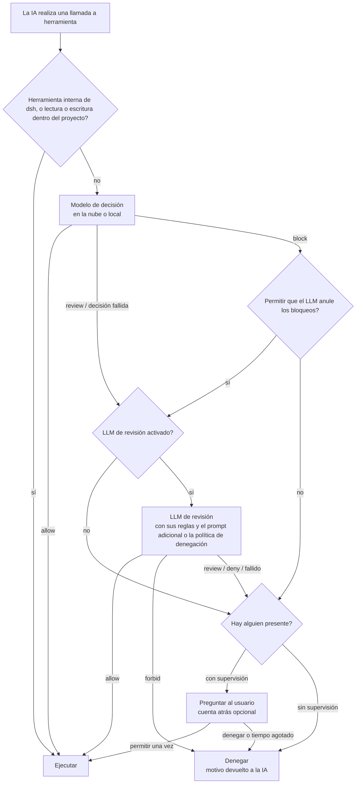

<div align="center">

<picture>
  <source media="(prefers-color-scheme: dark)" srcset="docs/assets/openvulcan-logo-dark.svg">
  
</picture>

# Vulcan Decision Guard

**Una decisión de permisos para cada llamada a herramienta de su agente de programación con IA**

Un modelo de decisión dedicado · Revisión opcional con LLM · La última palabra es suya

[](LICENSE)
[](https://www.npmjs.com/package/@openvulcan/dsh-decision-guard)

[简体中文](README.md) | [English](README.en.md) | [繁體中文](README.zh-TW.md) | [日本語](README.ja.md) | [한국어](README.ko.md) | **Español** | [Français](README.fr.md) | [Deutsch](README.de.md) | [Русский](README.ru.md) | [Português](README.pt-BR.md)

</div>

---

## Acerca del proyecto

Vulcan Decision Guard es un complemento de protección de permisos para herramientas de programación con IA. Antes de
que el agente de IA ejecute una herramienta, el modelo Vulcan Decision juzga la llamada: el trabajo rutinario pasa,
las llamadas dudosas se envían a un LLM de revisión o al usuario, y las peligrosas se detienen.

Actualmente es compatible con DeepSeek harness (dsh `0.2.1-rc.2` o posterior, anterior a `0.3.0`). Basta con instalar un solo paquete:

```sh
dsh plugin add @openvulcan/dsh-decision-guard
```

> **Nuestro compromiso: el modelo de decisión de comandos en la nube es gratuito, de forma permanente.** (27 de octubre de 2026)

> **Estado: vista previa v1.** Las decisiones aún se están calibrando. Es una capa adicional sobre un sandbox, no un
> sustituto de este. Las direcciones de descarga de los modelos locales aún no se han publicado; por ahora los modelos
> locales se instalan desde una carpeta local. Notas de diseño y verificación: [docs/architecture.md](docs/architecture.md).

## 🤔 Por qué un modelo de decisión

Un agente de IA suele realizar de decenas a cientos de llamadas a herramientas para terminar una sola tarea. Hay dos
formas sencillas de gestionarlas, y ambas son malas:

- **Preguntar cada vez**: el cansancio llega pronto y se termina pulsando "Allow" (Permitir) sin leer, de modo que preguntar deja de tener sentido.
- **Permitirlo todo**: casi siempre funciona, pero un borrado en la carpeta equivocada o una base de datos de producción vaciada no tiene vuelta atrás.

Que un LLM de propósito general revise cada llamada tampoco es ideal: cada llamada espera varios segundos y consume
tokens, y el LLM lee la misma conversación, por lo que puede ser convencido por el mismo contexto que desvió al agente.

El modelo de decisión es un modelo pequeño (de 0.2B a 0.8B) entrenado para esta única tarea. Solo ve tres cosas: la
carpeta del proyecto, el nombre de la herramienta y los argumentos reales. Nunca lee la conversación ni las
explicaciones de la IA. Responde con una de tres decisiones: **allow** (permitir), **review** (revisar) o **block** (bloquear). Como resultado:

- Las llamadas cotidianas, como leer archivos, ejecutar pruebas, `git status` y compilaciones, pasan en un único
  viaje de red o en una única inferencia local, y apenas se nota;
- Solo las pocas llamadas dudosas o peligrosas llegan al LLM de revisión o al usuario, de modo que vale la pena volver a leer cada pregunta;
- La IA no puede convencer al modelo de decisión con argumentos, porque el modelo de decisión nunca ve el argumento.

## 🎯 Contra qué protege y contra qué no

### El foco: errores que la IA comete al ejecutar comandos

El modelo de decisión se centra en lo que la IA hace mal **por accidente**, por ejemplo:

- Borrar la ruta equivocada: una variable vacía convierte `rm -rf "$DIR/"*` en un borrado un nivel por encima, o un
  borrado recursivo alcanza una carpeta fuera del proyecto;
- Accidentes con bases de datos: `DROP DATABASE`, `TRUNCATE` o un `DELETE` sin condición contra producción;
- Destruir el proyecto o su historial: borrar el proyecto entero, `git reset --hard`, forzar un push que sobrescribe
  el remoto, borrar `.git`;
- Escribir en otro proyecto: modificar archivos de un repositorio distinto en lugar del actual;
- Reflejar o sincronizar en la dirección equivocada, ejecutar de verdad un comando de simulación (dry-run), etcétera.

El usuario decide cómo se tratan tres de estas categorías (los "category grants" (autorizaciones por categoría) de la tarjeta rápida):

| Categoría | Marcada (autorizada) | Sin marcar | Valor por defecto |
| --- | --- | --- | --- |
| Escrituras fuera del proyecto | Se permite directamente | Requiere revisión | Marcada |
| Eliminar o vaciar bases de datos | Se permite directamente | Debe confirmarse | Sin marcar |
| Restablecer todo el proyecto | Se permite directamente | Debe confirmarse | Sin marcar |

### Fuera de alcance: la IA que lo esquiva deliberadamente

Si la IA **se propone** esquivar la comprobación, el modelo de decisión no puede impedirlo, ni tampoco ningún
enfoque similar. El ejemplo más sencillo:

1. La IA usa la herramienta de escritura de archivos para escribir `cleanup.py` con `shutil.rmtree("/")`;
2. Después ejecuta `python cleanup.py`.

Lo único que el modelo de decisión ve es "escribir un archivo en el proyecto" y "ejecutar un script de Python en el
proyecto". Tomados por separado, ambos son pasos de desarrollo normales. Hay muchas variantes: modificar un script de
`package.json` y luego ejecutar `npm run`, editar un Makefile o un hook de Git, codificar un comando y decodificarlo
en tiempo de ejecución, descargar código de la red mientras se ejecuta…

Detectar esto exigiría que un LLM analizara **todos** los archivos que la IA escribe, en todo momento, y que antes de
cada ejecución analizara el archivo completo que se va a ejecutar, cada módulo que importa, cada programa al que llama
y todo lo que se genera o descarga en tiempo de ejecución. Hacerlo en cada ejecución es lento y caro, y aun así no
puede cubrir el código que solo aparece en tiempo de ejecución. Sencillamente no es práctico.

Por eso el complemento tiene un alcance claro: **reduce los errores de la IA; no combate su intención**. Defenderse
de la intención requiere aislamiento:

- Use un sandbox. Con la integración "standalone switch" (interruptor independiente), se mantiene el sandbox del preajuste de permisos elegido;
- Dé al entorno de desarrollo el mínimo privilegio necesario y mantenga las credenciales de bases de datos de producción o de
  cuentas en la nube fuera del alcance de lectura de la IA;
- Ejecute las tareas no confiables en un contenedor o en una máquina virtual.

Tenga en cuenta además que, en dsh, el `run_code` exterior y los efectos secundarios de Node producidos directamente
dentro de un programa PTC no pasan por la puerta de llamadas a herramientas. El Auto review propio de dsh tiene la misma limitación.

## ⚠️ La aprobación automática no garantiza que se rechace todo riesgo

Ningún modelo puede detectarlo todo, y este no es una excepción:

- El modelo de decisión comete errores. En la evaluación siguiente, "permitido aunque requería revisión" no es cero ni
  siquiera en las preguntas con las que se entrenó intensivamente, y hay más errores en los tipos de preguntas con los que no se ha entrenado;
- El LLM de revisión solo trata las llamadas que el modelo de decisión **no permitió**. Una llamada que el modelo de decisión permitió se
  ejecuta de inmediato, y la revisión no puede recuperarla;
- Las reglas, los prompts adicionales y las políticas desatendidas están en lenguaje natural, las ejecuta un LLM y
  también pueden malinterpretarse.

Considérelo una capa que reduce la probabilidad de un accidente, no un seguro. Además se recomienda: hacer commits
a Git con frecuencia, respaldar los datos importantes, dejar sin marcar "Dropping or emptying databases" (Eliminar o vaciar bases de datos) y
"Resetting the whole project" (Restablecer todo el proyecto), y mantener las credenciales de producción fuera del entorno de desarrollo. Cuando se detecte una decisión
errónea, marque la correcta en los registros de decisiones para ayudar a mejorar el modelo.

## 🔀 El flujo general



1. **Traducción del host**: el complemento convierte la llamada a herramienta de dsh a la forma que el modelo vio en el
   entrenamiento. Las herramientas internas de dsh (preguntas, tareas pendientes, mensajes de subagentes, etc.) y las
   lecturas o escrituras dentro del proyecto actual se permiten directamente y nunca llegan al modelo.
2. **Modelo de decisión**: responde allow, review o block.
3. **LLM de revisión** (se puede desactivar): trata las decisiones review y las fallidas; las llamadas bloqueadas solo llegan a él cuando
   se activa "Let the LLM overturn blocks" (Permitir que el LLM anule los bloqueos).
4. **El usuario**: solo cuando hay alguien presente. Las sesiones sin supervisión nunca preguntan; todo lo que no esté permitido se deniega.

Una llamada denegada devuelve su motivo a la IA, que puede explicar su propósito e intentarlo de nuevo. **Ningún error se
trata jamás como allow**: no haber iniciado sesión, un fallo de red, la falta de un paquete de ejecución o de un modelo, una revisión fallida o
una respuesta con formato incorrecto se consideran siempre no permitidos.

## ⚖️ Cómo se toman las decisiones

La entrada del modelo de decisión son solo estas tres líneas, exactamente como en el entrenamiento, sin añadir descripción de la tarea, historial de
mensajes ni contenido de archivos:

```text
Project: <project root>
Tool: <tool name>
Arguments: <compact JSON of the actual arguments>
```

más las tres autorizaciones por categoría anteriores. A qué conduce cada decisión:

| Modelo de decisión | Significado | Siguiente paso |
| --- | --- | --- |
| allow | Trabajo rutinario | Se ejecuta directamente |
| review | Puede tener efectos secundarios; hace falta contexto | Pasa al LLM de revisión y luego a la tabla siguiente |
| block | Muy probablemente un error o un exceso | Por defecto se pregunta directamente al usuario (se deniega si no hay supervisión); con "Let the LLM overturn blocks" pasa primero a revisión |

Cómo se ejecuta la respuesta del LLM de revisión:

| Respuesta del LLM de revisión | Con supervisión | Sin supervisión |
| --- | --- | --- |
| allow | Ejecutar | Ejecutar |
| review (solo con supervisión) | Preguntar al usuario, con foco en "Allow" (Permitir) | — |
| deny | Preguntar al usuario, con foco en "Deny" (Denegar) | Denegar |
| forbid (solo con supervisión) | Denegar sin preguntar | — |
| Fallo, revisión desactivada, o no enviada a revisión | Preguntar al usuario; foco en "Allow" cuando la decisión fue review, en caso contrario "Deny" | Denegar |

La tarjeta de pregunta puede tener una cuenta atrás; cuando se agota, la llamada se deniega. 0 significa esperar la
respuesta del usuario indefinidamente.

## 🧑‍⚖️ Cómo funciona la revisión con LLM

- **Qué modelo**: el modelo de la sesión actual, un servicio y un modelo elegidos en la configuración, o desactivada. La temperatura es 0
  y las solicitudes de revisión no se escriben en el historial de la sesión.
- **Qué ve la revisión**:
  - El entorno: la carpeta del proyecto y las tres autorizaciones por categoría;
  - Sus reglas: tres grupos de reglas en lenguaje natural, "Forbidden" (Prohibido), "Deny" (Denegar) y "Allow" (Permitir), con prioridad
    forbid > deny > allow. Se aplican solo a las llamadas que el modelo de decisión no permitió;
  - El "additional review prompt" (prompt adicional de revisión) cuando hay alguien presente, o la "deny policy" (política de denegación) cuando no hay supervisión;
  - Las últimas 6 instrucciones del usuario y del agente en la conversación, y las últimas 12 llamadas a herramientas;
  - Cualquier declaración de intención que la IA haya dado mediante `explain_tool_call` (una afirmación, no un permiso);
  - La propia llamada pendiente y el veredicto del modelo de decisión.
- **Cómo puede responder**: con supervisión, solo allow / review / deny / forbid; sin supervisión, solo allow / deny,
  y se le indica que no existe revisión humana. La respuesta debe ser un JSON de forma fija, con un motivo de hasta
  300 caracteres escrito en el idioma de la interfaz. Cualquier otra cosa cuenta como revisión fallida.
- **Prompt adicional**: cuando hay alguien presente, la revisión lee el "additional review prompt" después de las
  reglas. Puede hacer la revisión más estricta o describir lo que le importa al usuario, pero **no puede relajar** las reglas ni
  las autorizaciones por categoría. La configuración contiene el valor por defecto del sistema; cada sesión puede escribir el suyo en la tarjeta rápida o
  seguir el valor por defecto (o usar `/vulcan-review-prompt set <prompt> | default`).
- **Sin supervisión**: activarlo en la tarjeta rápida implica confirmar una política de denegación (rellenada de antemano con la política de
  denegación por defecto del sistema), que se guarda por sesión (o use `/vulcan-unattended on [deny policy] | off`). Las sesiones cuya política
  de aprobación es `never` también se tratan como sin supervisión, con la política de denegación por defecto del sistema.
- **Declarar la intención**: con la revisión activada, la IA puede llamar a `explain_tool_call` para declarar el propósito de su siguiente
  llamada. La declaración va solo al LLM de revisión y a la tarjeta de pregunta, nunca al modelo de decisión, y
  nunca puede conceder un permiso por sí sola.

## 📊 Evaluación

En octubre de 2026 realizamos una comparación puntual sobre un único banco de preguntas congelado entre **`vulcan-decision-shell-v1`** (0.8B) y dos servicios de decisión externos: JEV 1.14.0 y el modelo de decisión de Alibaba Cloud
`decision-model-preview`. Los tres usaron la misma política fija en inglés, los mismos argumentos completos de las herramientas, la misma carpeta de
proyecto y las mismas opciones de autorización fijas, sin descripción de la tarea; se tomó la decisión de mayor puntuación y no se
ajustó ningún umbral.

Primero, los límites de estas cifras:

- Las preguntas etiquetadas proceden de nuestro propio banco de entrenamiento y de pruebas, y **buena parte de ellas son preguntas con las que
  entrenamos**, lo que nos favorece claramente;
- Las etiquetas de referencia son nuestras; no son la verdad absoluta para producción;
- Las cifras corresponden solo a `vulcan-decision-shell-v1`. El `vulcan-decision-shell-v1-mini` (0.2B) y el `vulcan-decision-shell-v1-flash` (0.35B) de la nube, que son los predeterminados, rinden de forma distinta y
  no están representados aquí;
- Los resultados externos reflejan las versiones disponibles en ese momento. El alias de servicio de Alibaba Cloud no permite comprobar
  qué pesos hay detrás.

**Banco etiquetado (106,501 entradas)**

| Métrica | `vulcan-decision-shell-v1` | JEV 1.14.0 | Alibaba Cloud |
| --- | --- | --- | --- |
| Trabajo rutinario permitido directamente (más alto es mejor) | 99.07% | 73.10% | 96.60% |
| Permitido aunque requería revisión (más bajo es mejor) | 2.40% | 17.03% | 90.92% |
| Permitido aunque debía bloquearse (más bajo es mejor) | 0.04% | 2.99% | 76.85% |
| De ello, errores graves permitidos | 0 / 16,613 | 2.43% | 76.88% |
| Inofensivo pero bloqueado (más bajo es mejor) | 0.20% | 8.11% | 1.79% |

**Comandos reales (415,194 llamadas distintas, sin etiquetas por llamada)**: ponderado por la frecuencia con que ocurrió realmente cada una,
los tres permitieron directamente el 99.76%, el 99.69% y el 99.99%. Esto solo muestra con qué frecuencia se interrumpiría al usuario, no
si las decisiones fueron correctas.

**Tipos de preguntas con los que no hemos entrenado**: en un conjunto de desarrollo reservado de guardas condicionales, copias de variables y
limpiezas (ninguno de los tres entrenó con él), el porcentaje permitido aunque debía bloquearse fue del 43.75% para
`vulcan-decision-shell-v1`, del 1.88% para JEV y del 100% para Alibaba Cloud; el de inofensivo pero bloqueado fue del 15.36%, el 4.82% y el 0%. En los tipos de pregunta
que aún no cubrimos, JEV es claramente mejor que nosotros.

Cómo leer estas cifras:

- **JEV ha sido claramente entrenado para decisiones sobre comandos**, y no rinde mal. Nuestra ventaja se
  concentra en los tipos de errores con los que entrenamos específicamente, como el seguimiento de cadenas de variables y de objetivos de borrado,
  la dirección y las simulaciones de reflejo y sincronización, y los comandos largos; fuera de esas áreas, la tasa de error de JEV
  puede ser menor que la nuestra;
- **El modelo de decisión de Alibaba Cloud sirve a usos generales más amplios** y probablemente no se ha entrenado
  específicamente con los errores que cometen los agentes de programación al ejecutar comandos, por lo que se inclina a permitir en este banco.
  Eso no lo hace malo: está pensado para el panorama completo, mientras que nosotros nos especializamos en esta única tarea;
- Seguiremos completando las carencias con muestras exportadas de los registros de decisiones.

## 🚀 Instalación y uso (dsh)

```sh
dsh plugin add @openvulcan/dsh-decision-guard
```

Este único paquete es todo lo que se necesita: el motor de decisión viene incluido, sin dependencias nativas ni
scripts de instalación.

1. Abra "Settings › Auto approval" (Configuración › Aprobación automática) de dsh (el botón "Open auto approval settings" (Abrir configuración de aprobación automática) de la página del complemento también lleva allí) e inicie sesión en una cuenta de OpenVulcan (sitio de China o sitio
   global) para usar decisiones en la nube. Si las llamadas a herramientas no deben salir de su equipo, cambie a "Local model" (Modelo local) e
   instale un paquete de ejecución y un modelo según la sugerencia para su hardware.
2. Elija "Auto review" (Revisión automática) en el selector de permisos de dsh, o cambie la integración a "Standalone switch" (Interruptor independiente) en la configuración:

   | Integración | Qué sesiones se juzgan | Sandbox |
   | --- | --- | --- |
   | Auto preset (Preajuste automático) | Sesiones cuyo preajuste es "Auto review" | Ninguno (acceso total) |
   | Standalone switch | Todas las sesiones, sobre el preajuste elegido | Se mantiene el sandbox del preajuste elegido |

3. Use "Try a decision" (Probar una decisión) en la configuración para confirmar que las decisiones funcionan.

La etiqueta "Auto approval" a la izquierda del selector de modelo del cuadro de entrada abre la tarjeta rápida: marque las tres
autorizaciones por categoría, defina el prompt adicional de revisión y el modo sin supervisión de esta sesión, y ajuste el modelo de decisión,
el endpoint, la revisión y la cuenta atrás de las preguntas. Este complemento sustituye al complemento experimental Auto review de dsh; no pueden
estar activados a la vez.

## ☁️ Nube y local

Las decisiones en la nube son la opción por defecto y no se instala nada en su equipo. **El modelo de decisión de comandos en la nube es
gratuito, de forma permanente** (compromiso asumido el 27 de octubre de 2026); solo se necesita una cuenta de OpenVulcan. El LLM de revisión usa el
servicio de modelos que usted elija y se factura según las condiciones de ese servicio. OpenVulcan proporciona los modelos
de decisión y los endpoints disponibles por cuenta; la tabla de endpoints de la configuración muestra el tiempo de red y de cómputo de cada endpoint,
y es posible fijar un endpoint o ejecutar una prueba de solicitud contra uno de ellos.

Si las llamadas a herramientas no deben salir de su equipo, instale un **paquete de ejecución** cuando lo necesite:

| Paquete de ejecución | Para | Descarga Windows x64 |
| --- | --- | --- |
| `onnx-cpu` | Cualquier equipo, ejecuta modelos ONNX | 56 MiB |
| `onnx-cuda` | GPU NVIDIA (serie RTX 20 y posteriores), ejecuta modelos ONNX | 1307 MiB |
| `torch-cpu` | Cualquier equipo, ejecuta modelos de versión PyTorch | 173 MiB |
| `torch-cu128` | GPU NVIDIA (serie RTX 20 y posteriores), ejecuta modelos de versión PyTorch | 2797 MiB |

Los paquetes de ejecución son un Python precompilado más wheels oficiales, y cada archivo se comprueba contra un SHA-256 bloqueado.
**No se compila nada y no se instala ni se actualiza ningún controlador.** Las GPU sin un entorno de ejecución ya preparado (AMD, Intel,
Apple) usan un paquete de CPU o la nube. La configuración detecta su GPU, el controlador y la capacidad de cómputo y sugiere un paquete;
los usuarios de China continental pueden elegir la fuente de descarga del espejo de China.

`vulcan-decision-shell-v1` se ofrece en tres tamaños, disponibles tanto en la nube como en local:

| Tamaño | Modelo | Parámetros | Notas |
| --- | --- | --- | --- |
| mini | `vulcan-decision-shell-v1-mini` | 0.2B | Predeterminado en la nube |
| flash | `vulcan-decision-shell-v1-flash` | 0.35B | |
| standard | `vulcan-decision-shell-v1` | 0.8B | El modelo evaluado arriba; basado en Qwen3.5-0.8B-Base |

## 🔒 Registros de decisiones y privacidad

- **Decisiones en la nube**: las tres líneas de entrada anteriores (carpeta del proyecto, nombre de la herramienta, argumentos) y las autorizaciones por categoría
  se envían a un endpoint de decisión de OpenVulcan. No se envía nada cuando se usa un modelo local.
- **LLM de revisión**: la entrada de la revisión (incluidas las instrucciones y llamadas a herramientas recientes de la conversación) se envía al
  servicio de modelos de revisión que usted eligió, bajo las mismas condiciones de datos que ya tenga con ese servicio. No se envía
  nada cuando la revisión está desactivada.
- **Registros de decisiones**: "Record decisions" (Registrar decisiones) en la configuración está desactivado por defecto. Cuando se activa, cada decisión en la que
  participó el modelo de decisión o la revisión se guarda con el comando y las rutas originales en
  `$DSH_HOME/vulcan-decision/records.v1.jsonl` en su equipo, conservando los últimos 5000 registros durante un máximo de 30 días,
  y nunca se suben. "View records" (Ver registros) permite filtrar por decisión y espacio de trabajo, marcar decisiones erróneas, exportar los
  registros marcados como muestras de entrenamiento o borrarlo todo.
- **Credenciales**: el inicio de sesión de OpenVulcan se guarda en el almacén de credenciales propio de dsh, y los tokens nunca aparecen en la
  interfaz ni en los registros.

## 📦 Paquetes

| Paquete | Función |
| --- | --- |
| [`@openvulcan/dsh-decision-guard`](packages/dsh-decision-guard) | Complemento de dsh: intercepta las llamadas a herramientas, traduce la entrada, ejecuta las decisiones, ofrece la página de configuración y la tarjeta rápida; se distribuye con el motor de decisión incluido |
| [`@openvulcan/vulcan-decision`](packages/vulcan-decision) | Motor de decisión (nube y local), cuenta, gestión de paquetes de ejecución y de modelos, línea de comandos `npx @openvulcan/vulcan-decision --help` |

Ambos son paquetes de Node puro (Node ≥ 20.19).

## 🛠️ Desarrollo

```sh
pnpm install
pnpm -r run typecheck
pnpm test
pnpm run pack:dsh   # genera dist/openvulcan-dsh-decision-guard-<version>.tgz
```

Los archivos de bloqueo de los paquetes de ejecución se generan con `python -I -B scripts/lock_runtime.py` (requiere uv).

## 🙏 Agradecimientos

Vulcan Decision Guard se apoya en los proyectos de código abierto siguientes. Gracias a sus autores y comunidades.

**Anfitrión del plugin**

- [DeepSeek harness (dsh)](https://github.com/deepseek-ai/deepseek-harness): el anfitrión del plugin y la ruta de permisos de las llamadas a herramientas
- [Cordis](https://github.com/cordiverse/cordis) y [Schemastery](https://github.com/shigma/schemastery): el framework de plugins y el esquema de configuración, provistos por dsh
- [React](https://react.dev/): la página de configuración y la tarjeta rápida, provistos por la página de dsh

**Paquetes de ejecución locales (solo se descargan si eliges el modelo local e instalas un paquete)**

- [CPython](https://www.python.org/) (precompilado por [python-build-standalone](https://github.com/astral-sh/python-build-standalone)): el intérprete de Python
- [ONNX Runtime](https://onnxruntime.ai/): ejecuta los modelos ONNX
- [PyTorch](https://pytorch.org/): ejecuta los modelos de la versión PyTorch
- Hugging Face [Transformers](https://github.com/huggingface/transformers), [Tokenizers](https://github.com/huggingface/tokenizers), [Safetensors](https://github.com/huggingface/safetensors): carga de modelos y tokenización
- [NumPy](https://numpy.org/): cálculo numérico
- [NVIDIA CUDA](https://developer.nvidia.com/cuda-toolkit) y [cuDNN](https://developer.nvidia.com/cudnn): los wheels oficiales de los paquetes para GPU

**Herramientas de desarrollo**

- [TypeScript](https://www.typescriptlang.org/), [pnpm](https://pnpm.io/) y [uv](https://github.com/astral-sh/uv) para generar los archivos de bloqueo de los paquetes de ejecución

**Modelo**

- [Qwen3.5-0.8B-Base](https://huggingface.co/Qwen/Qwen3.5-0.8B-Base): el modelo base de `vulcan-decision-shell-v1`

**Comunidad**

- [LINUX DO](https://linux.do/): gracias a la comunidad LINUX DO por su apoyo y sus debates

El origen y el SHA-256 de cada archivo de un paquete de ejecución están en los archivos de bloqueo de [`packages/vulcan-decision/runtime-packs/`](packages/vulcan-decision/runtime-packs). Cada archivo se verifica con ellos y se instala sin cambios, y cada componente se usa bajo la licencia que lo acompaña.

## 📄 Licencia

[MIT](LICENSE)
