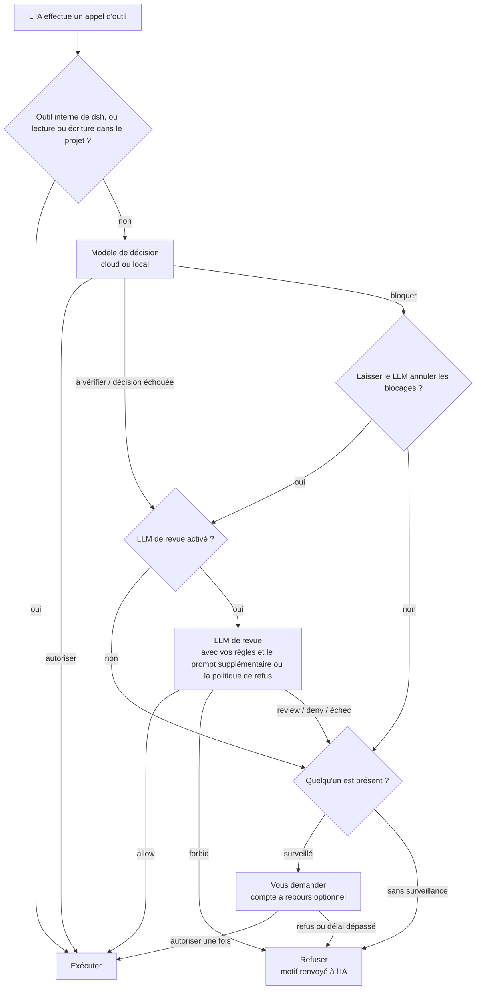

<div align="center">

<picture>
  <source media="(prefers-color-scheme: dark)" srcset="docs/assets/openvulcan-logo-dark.svg">
  
</picture>

# Vulcan Decision Guard

**Une décision de permission pour chaque appel d'outil de votre agent de codage IA**

Un modèle de décision dédié · Revue par LLM optionnelle · Vous gardez le dernier mot

[](LICENSE)
[](https://www.npmjs.com/package/@openvulcan/dsh-decision-guard)

[简体中文](README.md) | [English](README.en.md) | [繁體中文](README.zh-TW.md) | [日本語](README.ja.md) | [한국어](README.ko.md) | [Español](README.es.md) | **Français** | [Deutsch](README.de.md) | [Русский](README.ru.md) | [Português](README.pt-BR.md)

</div>

---

## À propos

Vulcan Decision Guard est un plugin de garde des permissions pour les outils de codage IA. Avant que l'agent IA
n'exécute un outil, le modèle Vulcan Decision juge l'appel : le travail courant passe, les appels incertains sont
envoyés à un LLM de revue ou à vous, et les appels dangereux sont arrêtés.

Il prend actuellement en charge DeepSeek harness (dsh `0.2.1-rc.2` ou plus récent, en dessous de `0.3.0`). Un seul
paquet suffit à installer :

```sh
dsh plugin add @openvulcan/dsh-decision-guard
```

> **Notre engagement : le modèle cloud de décision sur les commandes est gratuit, de façon permanente.** (27 octobre 2026)

> **Statut : préversion v1.** Les décisions sont encore en cours de calibrage. C'est une couche de plus au-dessus d'un
> bac à sable, pas un remplacement de celui-ci. Les modèles locaux se téléchargent depuis Hugging Face ou ModelScope
> (site chinois), ou s'installent depuis un dossier local ; le site international de ModelScope suivra. Notes de
> conception et de vérification : [docs/architecture.md](docs/architecture.md).

## 🤔 Pourquoi un modèle de décision

Pour mener à bien une seule tâche, un agent IA effectue souvent des dizaines, voire des centaines d'appels d'outils.
Il existe deux façons simples de les gérer, et toutes deux sont mauvaises :

- **Vous demander à chaque fois** : on se lasse vite et on finit par cliquer sur « Allow » (Autoriser) sans lire,
  si bien que la demande ne signifie plus rien.
- **Tout autoriser** : cela convient la plupart du temps, mais une suppression dans le mauvais dossier ou une base
  de données de production effacée est irréversible.

Faire examiner chaque appel par un LLM généraliste n'est pas idéal non plus : chaque appel attend plusieurs
secondes et consomme des tokens, et le LLM lit la même conversation, de sorte qu'il peut être convaincu par le même
contexte qui a égaré l'agent.

Le modèle de décision est un petit modèle (0,2B à 0,8B) entraîné pour cette seule tâche. Il ne voit que trois
choses : le dossier du projet, le nom de l'outil et les arguments réels. Il ne lit jamais la conversation ni les
explications de l'IA. Il répond par l'une de trois décisions : **autoriser**, **à vérifier** ou **bloquer**. Ainsi :

- Les appels courants, comme lire des fichiers, lancer des tests, `git status` et les compilations, passent en un
  aller-retour réseau ou une inférence locale, et vous le remarquez à peine ;
- Seuls les rares appels incertains ou dangereux sont envoyés au LLM de revue ou à vous, de sorte qu'une question
  vaut la peine d'être relue ;
- L'IA ne peut pas contourner le modèle de décision par l'argumentation, car il ne voit jamais l'argument.

## 🎯 Ce contre quoi il protège, et ce qu'il ne couvre pas

### L'objectif : les erreurs de l'IA lors de l'exécution de commandes

Le modèle de décision cible les erreurs que l'IA commet **par accident**, par exemple :

- Supprimer le mauvais chemin : une variable vide transforme `rm -rf "$DIR/"*` en suppression un niveau plus haut,
  ou une suppression récursive atteint un dossier extérieur au projet ;
- Accidents de base de données : `DROP DATABASE`, `TRUNCATE` ou un `DELETE` sans condition sur la production ;
- Détruire le projet ou son historique : supprimer tout le projet, `git reset --hard`, un push forcé qui écrase le
  dépôt distant, supprimer `.git` ;
- Écrire dans un autre projet : modifier des fichiers d'un autre dépôt au lieu du dépôt courant ;
- Mettre en miroir ou synchroniser dans le mauvais sens, exécuter pour de bon une commande prévue en simulation, etc.

Vous décidez comment trois de ces catégories sont traitées (les « category grants » (autorisations par catégorie)
de la carte rapide) :

| Catégorie | Cochée (autorisée) | Non cochée | Par défaut |
| --- | --- | --- | --- |
| Écritures hors du projet | Autorisées directement | Nécessitent une revue | Cochée |
| Suppression ou vidage de bases de données | Autorisés directement | Doivent être confirmés | Non cochée |
| Réinitialisation de tout le projet | Autorisée directement | Doit être confirmée | Non cochée |

### Hors périmètre : l'IA qui contourne délibérément le contrôle

Si l'IA **cherche** à contourner le contrôle, le modèle de décision ne peut pas l'en empêcher, pas plus que toute
approche similaire. L'exemple le plus simple :

1. L'IA utilise l'outil d'écriture de fichiers pour écrire `cleanup.py` contenant `shutil.rmtree("/")` ;
2. Puis elle exécute `python cleanup.py`.

Tout ce que voit le modèle de décision, c'est « écrire un fichier dans le projet » et « exécuter un script Python
du projet ». Pris isolément, ce sont deux étapes de développement ordinaires. Les variantes sont nombreuses :
modifier un script de `package.json` puis lancer `npm run`, modifier un Makefile ou un hook Git, encoder une
commande et la décoder à l'exécution, télécharger du code depuis le réseau pendant l'exécution…

Pour les détecter, il faudrait qu'un LLM analyse **chaque** fichier écrit par l'IA, en permanence, et, avant chaque
exécution, analyse le fichier exécuté en entier, chaque module qu'il importe, chaque programme qu'il appelle et tout
ce qui est généré ou téléchargé à l'exécution. Faire cela à chaque exécution est lent et coûteux, et ne couvre
toujours pas le code qui n'apparaît qu'à l'exécution. Ce n'est tout simplement pas réaliste.

Le plugin a donc un périmètre clair : **il réduit les erreurs de l'IA ; il ne combat pas ses intentions**. Se
défendre contre les intentions passe par l'isolation :

- Utilisez un bac à sable. Avec l'intégration « standalone switch » (interrupteur autonome), le bac à sable du
  préréglage de permissions que vous avez choisi reste en place ;
- Donnez à l'environnement de développement le minimum de privilèges nécessaires, et gardez les identifiants des
  bases de données de production ou des comptes cloud hors de portée de l'IA ;
- Exécutez les tâches non fiables dans un conteneur ou une machine virtuelle.

Notez aussi que, dans dsh, le `run_code` externe et les effets de bord Node produits directement dans un programme
PTC ne passent pas par la porte d'appel d'outil. Auto review, propre à dsh, a la même limite.

## ⚠️ L'approbation automatique ne garantit pas le refus de tous les risques

Aucun modèle ne peut tout détecter, et celui-ci ne fait pas exception :

- Le modèle de décision se trompe. Dans l'évaluation ci-dessous, « autorisé alors qu'il fallait une revue » n'est
  pas nul, même sur les questions sur lesquelles nous avons beaucoup entraîné, et il y a davantage d'erreurs sur les
  types de questions que nous n'avons pas entraînés ;
- Le LLM de revue ne traite que les appels que le modèle de décision **n'a pas autorisés**. Un appel autorisé par le
  modèle de décision s'exécute immédiatement, et la revue ne peut pas le rattraper ;
- Les règles, les prompts supplémentaires et les politiques sans surveillance sont en langage naturel, exécutés par
  un LLM, et peuvent eux aussi être mal compris.

Considérez-le comme une couche qui réduit le risque d'accident, pas comme une assurance. Nous recommandons aussi :
commitez souvent dans Git, sauvegardez les données importantes, laissez « Dropping or emptying databases »
(Suppression ou vidage de bases de données) et « Resetting the whole project » (Réinitialisation de tout le projet)
non cochés, et gardez les identifiants de production hors de votre environnement de développement. Lorsque vous
repérez une mauvaise décision, indiquez la bonne dans les enregistrements de décisions pour aider à améliorer le
modèle.

## 🔀 Le flux général



1. **Traduction hôte** : le plugin transforme l'appel d'outil de dsh dans la forme que le modèle a vue à
   l'entraînement. Les outils internes de dsh (questions, tâches à faire, messages de sous-agents, etc.) et les
   lectures ou écritures dans le projet courant sont autorisés directement et n'atteignent jamais le modèle.
2. **Modèle de décision** : répond autoriser, à vérifier ou bloquer.
3. **LLM de revue** (désactivable) : traite les décisions « à vérifier » et les décisions échouées ; les appels
   bloqués ne lui parviennent que si vous activez « Let the LLM overturn blocks » (Laisser le LLM annuler les
   blocages).
4. **Vous** : seulement si quelqu'un est présent. Les sessions sans surveillance ne posent jamais de question ; tout
   ce qui n'est pas autorisé est refusé.

Un appel refusé renvoie son motif à l'IA, qui peut expliquer son objectif et réessayer. **Aucune erreur n'est
jamais traitée comme une autorisation** : absence de connexion, échec réseau, pack d'exécution ou modèle manquant,
revue échouée ou réponse au mauvais format sont tous traités comme non autorisés.

## ⚖️ Comment les décisions sont prises

L'entrée du modèle de décision se limite à ces trois lignes, exactement comme à l'entraînement, sans description de
tâche, historique de messages ni contenu de fichier ajouté :

```text
Project: <project root>
Tool: <tool name>
Arguments: <compact JSON of the actual arguments>
```

auxquelles s'ajoutent les trois autorisations par catégorie ci-dessus. Ce à quoi mène chaque décision :

| Modèle de décision | Signification | Étape suivante |
| --- | --- | --- |
| autoriser | Travail courant | S'exécute directement |
| à vérifier | Peut avoir des effets de bord ; il faut du contexte | Va au LLM de revue, puis au tableau ci-dessous |
| bloquer | Très probablement une erreur ou un dépassement | Par défaut, vous interroge directement (refusé sans surveillance) ; avec « Let the LLM overturn blocks », passe d'abord par la revue |

Comment la réponse du LLM de revue est appliquée :

| Réponse du LLM de revue | Surveillé | Sans surveillance |
| --- | --- | --- |
| allow | Exécuter | Exécuter |
| review (uniquement surveillé) | Vous demander, focus sur « Allow » | — |
| deny | Vous demander, focus sur « Deny » (Refuser) | Refuser |
| forbid (uniquement surveillé) | Refuser sans demander | — |
| Échec, revue désactivée ou non envoyée en revue | Vous demander ; focus sur « Allow » quand la décision était « à vérifier », sinon sur « Deny » | Refuser |

La carte de question peut avoir un compte à rebours ; à son expiration, l'appel est refusé. 0 signifie attendre
votre réponse indéfiniment.

## 🧑‍⚖️ Fonctionnement de la revue par LLM

- **Quel modèle** : le modèle de la session en cours, un service et un modèle choisis dans les paramètres, ou
  désactivée. La température est 0, et les requêtes de revue ne sont pas écrites dans l'historique de la session.
- **Ce que voit la revue** :
  - L'environnement : le dossier du projet et les trois autorisations par catégorie ;
  - Vos règles : trois groupes de règles en langage naturel, « Forbidden » (Interdit), « Deny » (Refuser) et « Allow »
    (Autoriser), avec la priorité forbid > deny > allow. Elles ne s'appliquent qu'aux appels que le modèle de
    décision n'a pas autorisés ;
  - Le « additional review prompt » (prompt supplémentaire de revue) quand quelqu'un est présent, ou la « deny
    policy » (politique de refus) en l'absence de surveillance ;
  - Les 6 dernières instructions de l'utilisateur et de l'agent dans la conversation, et les 12 derniers appels
    d'outils ;
  - Toute déclaration d'intention donnée par l'IA via `explain_tool_call` (une affirmation, pas une permission) ;
  - L'appel en attente lui-même, et le verdict du modèle de décision.
- **Comment elle peut répondre** : avec surveillance, uniquement allow / review / deny / forbid ; sans surveillance,
  uniquement allow / deny, et on lui indique qu'aucune revue humaine n'existe. La réponse doit être un JSON de forme
  fixe, avec un motif de 300 caractères au plus rédigé dans la langue de l'interface. Toute autre réponse compte
  comme une revue échouée.
- **Prompt supplémentaire** : quand quelqu'un est présent, la revue lit le « additional review prompt » après les
  règles. Il peut rendre la revue plus stricte ou décrire ce qui vous importe, mais il **ne peut pas assouplir** les
  règles ni les autorisations par catégorie. Les paramètres contiennent la valeur par défaut du système ; chaque
  session peut écrire la sienne dans la carte rapide ou suivre la valeur par défaut (ou utiliser
  `/vulcan-review-prompt set <prompt> | default`).
- **Sans surveillance** : l'activer dans la carte rapide revient à confirmer une deny policy (préremplie avec la
  politique de refus par défaut du système), enregistrée par session (ou utiliser
  `/vulcan-unattended on [deny policy] | off`). Les sessions dont la politique d'approbation est `never` sont
  également traitées comme sans surveillance, avec la politique de refus par défaut du système.
- **Déclarer l'intention** : tant que la revue est active, l'IA peut appeler `explain_tool_call` pour indiquer le
  but de son prochain appel. La déclaration va uniquement au LLM de revue et à la carte de question, jamais au
  modèle de décision, et elle ne peut jamais accorder une permission à elle seule.

## 📊 Évaluation

En octobre 2026, nous avons mené une comparaison ponctuelle sur une seule banque de questions figée entre
**`vulcan-decision-shell-v1`** (0.8B) et deux services de décision externes : JEV 1.14.0 et le modèle de
décision d'Alibaba Cloud `decision-model-preview`. Les trois ont reçu la même politique anglaise fixe, les mêmes
arguments d'outil complets, le même dossier de projet et les mêmes options d'autorisation fixes, sans description de
tâche ; la décision au score le plus élevé a été retenue et aucun seuil n'a été ajusté.

Voici d'abord les limites de ces chiffres :

- Les questions étiquetées proviennent de notre propre banque d'entraînement et de test, et **une grande partie
  d'entre elles sont des questions sur lesquelles nous avons entraîné**, ce qui nous avantage nettement ;
- Les étiquettes de référence sont les nôtres ; ce ne sont pas une vérité absolue pour la production ;
- Les chiffres valent pour `vulcan-decision-shell-v1` uniquement. Le `vulcan-decision-shell-v1-mini` cloud par défaut (0.2B) et `vulcan-decision-shell-v1-flash` (0.35B) se
  comportent différemment et ne sont pas représentés ici ;
- Les résultats externes reflètent les versions disponibles à l'époque. L'alias de service d'Alibaba Cloud ne nous
  permet pas de vérifier quels poids se trouvent derrière.

**Banque étiquetée (106,501 entrées)**

| Indicateur | `vulcan-decision-shell-v1` | JEV 1.14.0 | Alibaba Cloud |
| --- | --- | --- | --- |
| Travail courant autorisé directement (plus c'est haut, mieux c'est) | 99.07% | 73.10% | 96.60% |
| Autorisé alors qu'il fallait une revue (plus c'est bas, mieux c'est) | 2.40% | 17.03% | 90.92% |
| Autorisé alors qu'il fallait bloquer (plus c'est bas, mieux c'est) | 0.04% | 2.99% | 76.85% |
| Dont erreurs graves autorisées | 0 / 16,613 | 2.43% | 76.88% |
| Inoffensif mais bloqué (plus c'est bas, mieux c'est) | 0.20% | 8.11% | 1.79% |

**Commandes réelles (415,194 appels distincts, sans étiquette par appel)** : pondérés par la fréquence réelle de
chacun, les trois ont autorisé directement 99.76%, 99.69% et 99.99%. Cela montre seulement à quelle fréquence vous
seriez interrompu, pas si les décisions étaient justes.

**Types de questions sur lesquels nous n'avons pas entraîné** : sur un jeu de développement mis de côté composé de
gardes conditionnelles, de copies de variables et de nettoyages (aucun des trois n'a été entraîné dessus), la part
d'appels autorisés alors qu'ils devaient être bloqués était de 43.75% pour `vulcan-decision-shell-v1`, 1.88% pour JEV et 100% pour
Alibaba Cloud ; la part d'appels inoffensifs mais bloqués était de 15.36%, 4.82% et 0%. Sur les types de questions
que nous ne couvrons pas encore, JEV est nettement meilleur que nous.

Comment lire ces chiffres :

- **JEV a clairement été entraîné pour la décision sur les commandes**, et il ne se comporte pas mal. Notre
  avantage se concentre sur les types d'erreurs sur lesquels nous avons spécifiquement entraîné, comme le suivi des
  chaînes de variables et des cibles de suppression, le sens et les simulations de la mise en miroir et de la
  synchronisation, et les longues commandes ; en dehors de ces domaines, le taux d'erreur de JEV peut être
  inférieur au nôtre ;
- **Le modèle de décision d'Alibaba Cloud sert des usages plus larges et généraux** et n'a probablement pas été
  entraîné spécifiquement sur les erreurs que commettent les agents de codage en exécutant des commandes, il
  penche donc vers l'autorisation sur cette banque. Cela ne le rend pas mauvais : il est conçu pour l'ensemble,
  alors que nous nous spécialisons dans cette seule tâche ;
- Nous continuerons à combler les lacunes avec des échantillons exportés depuis les enregistrements de décisions.

## 🚀 Installation et utilisation (dsh)

```sh
dsh plugin add @openvulcan/dsh-decision-guard
```

Ce seul paquet suffit : le moteur de décision y est intégré, sans dépendances natives ni scripts d'installation.

1. Ouvrez « Settings › Auto approval » (Paramètres › Approbation automatique) de dsh (le bouton « Open auto
   approval settings » (Ouvrir les paramètres d'approbation automatique) de la page du plugin y mène aussi) et
   connectez-vous à un compte OpenVulcan (site chinois ou site international) pour utiliser les décisions cloud.
   Si les appels d'outils ne doivent pas quitter votre machine, passez à « Local model » (Modèle local) et
   installez un pack d'exécution et un modèle selon les suggestions pour votre matériel.
2. Choisissez Auto review dans le sélecteur de permissions de dsh, ou changez l'intégration en « Standalone switch »
   dans les paramètres :

   | Intégration | Sessions jugées | Bac à sable |
   | --- | --- | --- |
   | « Auto preset » (préréglage automatique) | Sessions dont le préréglage est Auto review | Aucun (accès complet) |
   | Standalone switch | Toutes les sessions, en plus du préréglage choisi | Le bac à sable du préréglage choisi est conservé |

3. Utilisez « Try a decision » (Essayer une décision) dans les paramètres pour confirmer que les décisions
   fonctionnent.

L'étiquette « Auto approval » (Approbation automatique) à gauche du sélecteur de modèle de la zone de saisie ouvre
la carte rapide : cochez les trois autorisations par catégorie, définissez le prompt supplémentaire de revue et le
mode sans surveillance de cette session, et ajustez le modèle de décision, le point de terminaison, la revue et le
compte à rebours des questions. Ce plugin remplace le plugin expérimental Auto review de dsh ; les deux ne peuvent
pas être activés ensemble.

## ☁️ Cloud et local

Les décisions cloud sont le mode par défaut, et rien n'est installé sur votre machine. **Le modèle cloud de décision
sur les commandes est gratuit, de façon permanente** (engagement pris le 27 octobre 2026) ; il suffit d'un compte
OpenVulcan. Le LLM de revue utilise le service de modèles que vous choisissez et est facturé selon les conditions de
ce service. OpenVulcan fournit, par compte, les modèles de décision et les points de terminaison disponibles ; le
tableau des points de terminaison dans les paramètres indique le temps réseau et le temps de calcul de chacun, et
vous pouvez verrouiller un point de terminaison ou lui envoyer une requête de test.

Si les appels d'outils ne doivent pas quitter votre machine, installez un **pack d'exécution** quand vous en avez
besoin :

| Pack d'exécution | Pour | Téléchargement Windows x64 |
| --- | --- | --- |
| `onnx-cpu` | N'importe quel ordinateur, exécute des modèles ONNX | 56 MiB |
| `onnx-cuda` | GPU NVIDIA (RTX série 20 et plus récentes), exécute des modèles ONNX | 1307 MiB |
| `torch-cpu` | N'importe quel ordinateur, exécute des modèles PyTorch de version publiée | 173 MiB |
| `torch-cu128` | GPU NVIDIA (RTX série 20 et plus récentes), exécute des modèles PyTorch de version publiée | 2797 MiB |

Les packs d'exécution sont un Python précompilé plus des wheels officielles, et chaque fichier est vérifié par
rapport à un SHA-256 verrouillé. **Rien n'est compilé, et aucun pilote n'est installé ni mis à jour.** Les GPU sans
runtime prêt à l'emploi (AMD, Intel, Apple) utilisent un pack CPU ou le cloud. Les paramètres détectent votre GPU,
votre pilote et sa capacité de calcul, et suggèrent un pack ; les utilisateurs de Chine continentale peuvent choisir
la source de téléchargement par miroir chinois.

`vulcan-decision-shell-v1` existe en trois tailles, disponibles à la fois dans le cloud et en local :

| Taille | Modèle | Paramètres | Remarques |
| --- | --- | --- | --- |
| mini | `vulcan-decision-shell-v1-mini` | 0.2B | Par défaut dans le cloud |
| flash | `vulcan-decision-shell-v1-flash` | 0.35B | |
| standard | `vulcan-decision-shell-v1` | 0.8B | Le modèle évalué ci-dessus ; basé sur Qwen3.5-0.8B-Base |

## 🔒 Enregistrements de décisions et confidentialité

- **Décisions cloud** : les trois lignes d'entrée ci-dessus (dossier du projet, nom de l'outil, arguments) et les
  autorisations par catégorie sont envoyées à un point de terminaison de décision OpenVulcan. Rien n'est envoyé si
  vous utilisez un modèle local.
- **LLM de revue** : l'entrée de la revue (y compris les instructions et appels d'outils récents de la conversation)
  est envoyée au service de modèles de revue que vous avez choisi, selon les mêmes conditions de données que celles
  que vous avez déjà avec ce service. Rien n'est envoyé si la revue est désactivée.
- **Enregistrements de décisions** : « Record decisions » (Enregistrer les décisions) dans les paramètres est
  désactivé par défaut. Une fois activé, chaque décision à laquelle le modèle de décision ou la revue a participé
  est enregistrée, avec la commande et les chemins d'origine, dans `$DSH_HOME/vulcan-decision/records.v1.jsonl` sur
  votre machine, en conservant les 5000 derniers enregistrements pendant 30 jours au plus, et n'est jamais envoyée.
  « View records » (Voir les enregistrements) permet de filtrer par décision et par espace de travail, de marquer
  les décisions erronées, d'exporter les enregistrements marqués comme échantillons d'entraînement, ou de tout
  effacer.
- **Identifiants** : la connexion OpenVulcan est stockée dans le magasin d'identifiants propre à dsh, et les tokens
  n'apparaissent jamais dans l'interface ni dans les journaux.

## 📦 Paquets

| Paquet | Rôle |
| --- | --- |
| [`@openvulcan/dsh-decision-guard`](packages/dsh-decision-guard) | Plugin dsh : intercepte les appels d'outils, traduit l'entrée, applique les décisions, fournit la page de paramètres et la carte rapide ; livré avec le moteur de décision intégré |
| [`@openvulcan/vulcan-decision`](packages/vulcan-decision) | Moteur de décision (cloud et local), compte, gestion des packs d'exécution et des modèles, ligne de commande `npx @openvulcan/vulcan-decision --help` |

Les deux sont de purs paquets Node (Node ≥ 20.19).

## 🛠️ Développement

```sh
pnpm install
pnpm -r run typecheck
pnpm test
pnpm run pack:dsh   # génère dist/openvulcan-dsh-decision-guard-<version>.tgz
```

Les fichiers de verrouillage des packs d'exécution sont générés par `python -I -B scripts/lock_runtime.py`
(nécessite uv).

## 🙏 Remerciements

Vulcan Decision Guard repose sur les projets open source ci-dessous. Merci à leurs auteurs et à leurs communautés.

**Hôte du plugin**

- [DeepSeek harness (dsh)](https://github.com/deepseek-ai/deepseek-harness) : l'hôte du plugin et le circuit d'autorisation des appels d'outils
- [Cordis](https://github.com/cordiverse/cordis) et [Schemastery](https://github.com/shigma/schemastery) : le framework de plugins et le schéma des paramètres, fournis par dsh
- [React](https://react.dev/) : la page de paramètres et la carte rapide, fournis par la page de dsh

**Paquets d'exécution locaux (téléchargés uniquement si vous choisissez le modèle local et installez un paquet)**

- [CPython](https://www.python.org/) (précompilé par [python-build-standalone](https://github.com/astral-sh/python-build-standalone)) : l'interpréteur Python
- [ONNX Runtime](https://onnxruntime.ai/) : exécute les modèles ONNX
- [PyTorch](https://pytorch.org/) : exécute les modèles de la version PyTorch
- Hugging Face [Transformers](https://github.com/huggingface/transformers), [Tokenizers](https://github.com/huggingface/tokenizers), [Safetensors](https://github.com/huggingface/safetensors) : chargement des modèles et tokenisation
- [NumPy](https://numpy.org/) : calcul numérique
- [NVIDIA CUDA](https://developer.nvidia.com/cuda-toolkit) et [cuDNN](https://developer.nvidia.com/cudnn) : les wheels officiels des paquets GPU

**Outils de développement**

- [TypeScript](https://www.typescriptlang.org/), [pnpm](https://pnpm.io/) et [uv](https://github.com/astral-sh/uv) pour générer les fichiers de verrouillage des paquets d'exécution

**Modèle**

- [Qwen3.5-0.8B-Base](https://huggingface.co/Qwen/Qwen3.5-0.8B-Base) : le modèle de base de `vulcan-decision-shell-v1`

**Communauté**

- [LINUX DO](https://linux.do/) : merci à la communauté LINUX DO pour son soutien et ses échanges

La source et le SHA-256 de chaque fichier d'un paquet d'exécution figurent dans les fichiers de verrouillage de [`packages/vulcan-decision/runtime-packs/`](packages/vulcan-decision/runtime-packs). Chaque fichier est vérifié par rapport à eux et installé tel quel, et chaque composant est utilisé sous la licence qui l'accompagne.

## 📄 Licence

[MIT](LICENSE)
