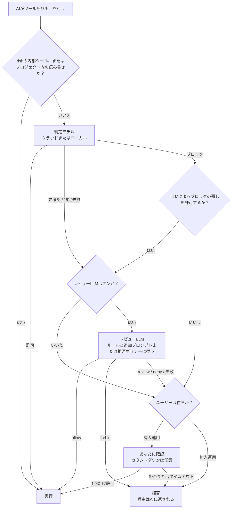

<div align="center">

<picture>
  <source media="(prefers-color-scheme: dark)" srcset="docs/assets/openvulcan-logo-dark.svg">
  
</picture>

# Vulcan Decision Guard

**AI コーディングエージェントのすべてのツール呼び出しに、権限判定を**

専用の判定モデル · 任意の LLM レビュー · 最終決定権はあなたに

[](LICENSE)
[](https://www.npmjs.com/package/@openvulcan/dsh-decision-guard)

[简体中文](README.md) | [English](README.en.md) | [繁體中文](README.zh-TW.md) | **日本語** | [한국어](README.ko.md) | [Español](README.es.md) | [Français](README.fr.md) | [Deutsch](README.de.md) | [Русский](README.ru.md) | [Português](README.pt-BR.md)

</div>

---

## プロジェクトについて

Vulcan Decision Guard は、AI コーディングツール向けの権限ガードプラグインです。AI エージェントがツールを実行する前に、
Vulcan Decision 判定モデルがその呼び出しを判定します。通常の作業はそのまま通し、判断がつかないものはレビュー LLM
またはあなたに確認し、危険なものは止めます。

現在は DeepSeek harness（dsh `0.2.1-rc.2` 以上、`0.3.0` 未満）に対応しています。インストールするパッケージは 1 つだけです。

```sh
dsh plugin add @openvulcan/dsh-decision-guard
```

> **お約束：クラウドのコマンド判定モデルは、永久に無料で提供します。**（2026年10月27日）

> **ステータス：v1 プレビュー版。** 判定はまだ調整中です。これはサンドボックスの上に重ねる 1 層であり、
> サンドボックスの代わりにはなりません。ローカルモデルは Hugging Face または ModelScope（中国サイト）
> からダウンロードでき、ローカルフォルダーからもインストールできます。ModelScope 国際サイトは後日公開します。
> 設計と検証の記録は [docs/architecture.md](docs/architecture.md) を参照してください。

## 🤔 なぜ判定モデルが必要か

AI エージェントは 1 つのタスクを終えるまでに、数十から数百回のツール呼び出しを行うことがよくあります。これらの扱い方には
単純な方法が 2 つありますが、どちらも良くありません。

- **毎回あなたに尋ねる**：すぐに疲れてしまい、内容を読まずに "Allow"（許可）を押すようになり、確認の意味がなくなります。
- **すべて許可する**：ほとんどの場合は問題ありませんが、フォルダーを間違えて削除したり、本番データベースを誤って消去したりすると、
  取り返しがつきません。

汎用の LLM にすべての呼び出しをレビューさせるのも理想的ではありません。呼び出しのたびに数秒待たされてトークンを消費しますし、
LLM は同じ会話を読むため、エージェントを誤らせたのと同じ文脈に説得されてしまうことがあります。

判定モデルは、この 1 つの仕事のためだけに訓練された小さなモデル（0.2B〜0.75B）です。見るのは 3 つだけで、
プロジェクトフォルダー、ツール名、実際の引数です。会話も AI の説明も読みません。そして次の 3 つの判定のいずれかを返します。
**許可**、**要確認**、**ブロック**。これにより、次のようになります。

- ファイルの読み取り、テストの実行、`git status`、ビルドといった日常的な呼び出しは、ネットワークの 1 往復またはローカル推論 1 回の
  うちにそのまま通るため、ほとんど意識することがありません。
- 判断がつかない、または危険な少数の呼び出しだけがレビュー LLM やあなたに回るので、確認の質問をもう一度しっかり読む価値が生まれます。
- AI がうまい言い分で判定モデルを通過させることはできません。判定モデルにはその言い分が見えないからです。

## 🎯 防ぐもの、防がないもの

### 主な対象：AI がコマンド実行時に犯すミス

判定モデルが対象とするのは、AI が**うっかり**間違えるものです。たとえば次のようなものです。

- 削除パスの間違い：変数が空になって `rm -rf "$DIR/"*` が 1 つ上の階層を削除してしまう、再帰削除がプロジェクト外のフォルダーに及ぶ。
- データベースの事故：本番に対する `DROP DATABASE`、`TRUNCATE`、条件のない `DELETE`。
- プロジェクトや履歴の破壊：プロジェクト全体の削除、`git reset --hard`、リモートへの強制プッシュによる上書き、`.git` の削除。
- 別のプロジェクトへの書き込み：現在のプロジェクトを変更するつもりが、別のリポジトリのファイルを変更してしまう。
- ミラーや同期の方向の取り違え、ドライラン用のコマンドを本番実行してしまう、など。

このうち 3 つのカテゴリーの扱いは、あなたが決められます（クイックカードの "category grants"（カテゴリー許可））。

| カテゴリー | チェックあり（許可） | チェックなし | 既定 |
| --- | --- | --- | --- |
| プロジェクト外への書き込み | そのまま許可 | 要確認 | チェックあり |
| データベースの削除・消去 | そのまま許可 | 必ず確認 | チェックなし |
| プロジェクト全体のリセット | そのまま許可 | 必ず確認 | チェックなし |

### 対象外：AI が意図的に回避すること

AI が**わざと**チェックを回避しようとした場合、判定モデルには止められません。同種のどんな方式でも止められません。
最も単純な例は次のとおりです。

1. AI がファイル書き込みツールで、`shutil.rmtree("/")` を含む `cleanup.py` を書く。
2. 続けて `python cleanup.py` を実行する。

判定モデルに見えるのは「プロジェクト内にファイルを書く」と「プロジェクト内の Python スクリプトを実行する」だけで、
1 つずつ見ればどちらも普通の開発作業です。バリエーションは多数あります。`package.json` のスクリプトを書き換えてから `npm run` する、
Makefile や Git フックを編集する、コマンドをエンコードして実行時にデコードする、実行中にネットワークからコードをダウンロードする……

これを捕まえるには、LLM が AI の書いた**すべての**ファイルを常時分析し、さらに実行のたびに、実行されるファイル全体、
それがインポートするすべてのモジュール、呼び出すすべてのプログラム、実行時に生成またはダウンロードされるものまで分析する必要が
あります。実行のたびにこれを行うのは遅くて高価で、しかも実行時にしか現れないコードまでは網羅できません。現実的ではありません。

そのため、このプラグインの守備範囲は明確です。**AI のミスを減らすもので、AI の意図とは戦いません**。意図への対策には隔離が必要です。

- サンドボックスを使う。連携方法で "standalone switch"（単独スイッチ）を選ぶと、選択した権限プリセットのサンドボックスはそのまま維持されます。
- 開発環境には必要最小限の権限だけを与え、本番データベースやクラウドアカウントの認証情報は AI が読めない場所に置く。
- 信頼できないタスクは、コンテナーまたは仮想マシンの中で実行する。

また、dsh では、外側の `run_code` や PTC プログラム内で直接発生する Node の副作用はツール呼び出しゲートを通りません。
dsh 自身の Auto review にも同じ制限があります。

## ⚠️ 自動承認はすべてのリスクの拒否を保証しません

どんなモデルにも見逃しをゼロにすることはできず、このモデルも例外ではありません。

- 判定モデルは間違えます。下の評価では、十分に訓練した問題でさえ、「要確認なのに許可された」割合はゼロではなく、
  訓練していない種類の問題ではさらにミスが増えます。
- レビュー LLM が扱うのは、判定モデルが**許可しなかった**呼び出しだけです。判定モデルが許可した呼び出しはすぐに実行され、
  レビューでは取り戻せません。
- ルール、追加プロンプト、無人運用ポリシーは自然言語で、LLM が解釈して実行するため、同様に解釈を誤ることがあります。

事故の確率を下げる 1 層として考え、保険とは考えないでください。あわせて、こまめに Git にコミットする、大事なデータはバックアップする、
"Dropping or emptying databases"（データベースの削除・消去）と "Resetting the whole project"（プロジェクト全体のリセット）はチェックを外したままにする、
開発環境に本番の認証情報を置かない、ことをおすすめします。誤判定を見つけたら、判定記録で正しい判定を付けると、モデルの改善に役立ちます。

## 🔀 全体の流れ



1. **ホスト側の変換**：プラグインは dsh のツール呼び出しを、モデルが訓練時に見た形に変換します。dsh の内部ツール
   （質問、ToDo、サブエージェント間メッセージなど）と、現在のプロジェクト内の読み書きは、そのまま許可され、モデルには届きません。
2. **判定モデル**：許可、要確認、ブロックのいずれかを返します。
3. **レビュー LLM**（オフにできます）：要確認と判定失敗の呼び出しを扱います。ブロックされた呼び出しは、
   "Let the LLM overturn blocks"（LLM によるブロックの覆しを許可）をオンにした場合にだけ、ここに回ります。
4. **あなた**：ユーザーが在席している場合のみです。無人運用のセッションでは尋ねることはなく、許可されなかったものはすべて拒否されます。

拒否された呼び出しは、その理由が AI に返され、AI は目的を説明して再試行できます。**エラーが許可として扱われることは一切ありません**。
未サインイン、ネットワーク障害、ランタイムパックやモデルの欠落、レビューの失敗、形式が不正な回答は、いずれも許可されなかったものとして扱われます。

## ⚖️ 判定の仕組み

判定モデルへの入力は次の 3 行だけです。訓練時とまったく同じ形式で、タスクの説明、メッセージ履歴、ファイルの内容は追加しません。

```text
Project: <プロジェクトルート>
Tool: <ツール名>
Arguments: <実際の引数をコンパクトにした JSON>
```

これに上記 3 つのカテゴリー許可が加わります。各判定の行き先は次のとおりです。

| 判定モデル | 意味 | 次のステップ |
| --- | --- | --- |
| 許可 | 通常の作業 | そのまま実行 |
| 要確認 | 副作用の可能性があり、文脈が必要 | レビュー LLM に回し、下の表に従う |
| ブロック | ミスまたは権限の逸脱の可能性が高い | 既定ではあなたに直接確認（無人運用では拒否）。"Let the LLM overturn blocks" をオンにすると、先にレビューに回る |

レビュー LLM の回答がどのように実行されるかは次のとおりです。

| レビュー LLM の回答 | 有人運用 | 無人運用 |
| --- | --- | --- |
| allow | 実行 | 実行 |
| review（有人運用のときのみ） | あなたに確認。フォーカスは "Allow" | — |
| deny | あなたに確認。フォーカスは "Deny"（拒否） | 拒否 |
| forbid（有人運用のときのみ） | 確認せずに拒否 | — |
| 失敗、レビューがオフ、またはレビューに回されなかった場合 | あなたに確認。判定が要確認だったときのフォーカスは "Allow"、それ以外は "Deny" | 拒否 |

確認カードにはカウントダウンを設定でき、時間切れになると拒否されます。0 にすると、あなたが答えるまで無期限に待ちます。

## 🧑‍⚖️ LLM レビューの仕組み

- **使うモデル**：現在のセッションのモデル、設定で選んだサービスとモデル、またはオフです。温度は 0 で、レビューのリクエストは
  セッション履歴に書き込まれません。
- **レビューが見るもの**：
  - 環境：プロジェクトフォルダーと 3 つのカテゴリー許可。
  - あなたのルール：自然言語のルール 3 グループ、"Forbidden"（絶対禁止）、"Deny"、"Allow" と、優先順位 forbid > deny > allow。
    判定モデルが許可しなかった呼び出しにだけ適用されます。
  - 有人運用のときは "additional review prompt"（レビュー追加プロンプト）、無人運用のときは "deny policy"（拒否ポリシー）。
  - 会話の直近 6 件のユーザーとエージェントの指示、および直近 12 件のツール呼び出し。
  - AI が `explain_tool_call` で示した意図の説明（主張であり、許可ではありません）。
  - 判定対象の呼び出し自体と、判定モデルの判定結果。
- **回答できる内容**：有人運用のときは allow / review / deny / forbid のみ、無人運用のときは allow / deny のみで、
  人によるレビューは存在しないと伝えられます。回答は決まった形の JSON でなければならず、理由は最大 300 文字で、
  インターフェースの言語で書かれます。それ以外はレビュー失敗として扱われます。
- **追加プロンプト**：有人運用のとき、レビューはルールの後に "additional review prompt" を読みます。レビューをより厳しくしたり、
  あなたが気にしている点を伝えたりできますが、ルールやカテゴリー許可を**緩めることはできません**。システム既定値は設定に保存され、
  各セッションはクイックカードで独自に書くか、既定値に従うことができます（`/vulcan-review-prompt set <プロンプト> | default` も使えます）。
- **無人運用**：クイックカードでオンにするときに、拒否ポリシー（システム既定の拒否ポリシーが入力済み）を確認します。セッションごとに保存されます
  （`/vulcan-unattended on [拒否ポリシー] | off` も使えます）。承認ポリシーが `never` のセッションも無人運用として扱われ、
  システム既定の拒否ポリシーが使われます。
- **意図の表明**：レビューがオンの間、AI は `explain_tool_call` を呼んで、次の呼び出しの目的を伝えられます。この表明が渡されるのは
  レビュー LLM と確認カードだけで、判定モデルには渡されず、それだけで許可になることもありません。

## 📊 評価

2026年10月に、凍結した同一の問題集を使って、**`vulcan-decision-shell-v1`**（0.75B）と、外部の 2 つの判定サービス、
JEV 1.14.0 と Alibaba Cloud Bailian の判定モデル `bailian-decision-preview` を 1 回限りで比較しました。3 者とも、固定の同じ英語ポリシー、
同じ完全なツール引数、プロジェクトフォルダー、固定の許可オプションを使い、タスクの説明は付けず、最高スコアの判定を採用し、
しきい値の調整は行っていません。

まず、この数字の限界を明らかにしておきます。

- ラベル付きの問題は私たち自身の訓練・テスト用の問題集から取っており、**その大部分は私たちが訓練した問題**です。これは私たちに明らかに有利です。
- 正解ラベルは私たちが定めたもので、本番環境での絶対的な真実ではありません。
- 数字はクラウドの既定である `vulcan-decision-shell-v1` のみのものです。`vulcan-decision-shell-v1-flash`（0.36B）と `vulcan-decision-shell-v1-mini`（0.2B）は挙動が異なり、ここには反映されていません。
- 外部の結果は、その時点で利用できたバージョンのものです。Alibaba Cloud のサービスエイリアスでは、背後にあるウェイトを確認できません。

**ラベル付き問題集（106,501 件の入力）**

| 指標 | `vulcan-decision-shell-v1` | JEV 1.14.0 | Alibaba Cloud |
| --- | --- | --- | --- |
| 通常の作業をそのまま許可（高いほど良い） | 99.07% | 73.10% | 96.60% |
| 要確認なのに許可（低いほど良い） | 2.40% | 17.03% | 90.92% |
| ブロックすべきなのに許可（低いほど良い） | 0.04% | 2.99% | 76.85% |
| うち、重大なミスを許可 | 0 / 16,613 | 2.43% | 76.88% |
| 無害なのにブロック（低いほど良い） | 0.20% | 8.11% | 1.79% |

**実際のコマンド（異なる呼び出し 415,194 件、1 件ごとのラベルなし）**：実際の発生頻度で重み付けすると、3 者がそのまま許可した割合は
それぞれ 99.76%、99.69%、99.99% でした。これは確認で中断される頻度を示すだけで、判定が正しかったかどうかは示しません。

**訓練していない種類の問題**：条件付きガード、変数のコピー、クリーンアップに関する開発用ホールドアウト（3 者とも訓練していません）では、
ブロックすべきなのに許可した割合は、`vulcan-decision-shell-v1` が 43.75%、JEV が 1.88%、Alibaba Cloud が 100% で、無害なのにブロックした割合は
15.36%、4.82%、0% でした。まだ対応できていない種類の問題では、JEV のほうが私たちよりはっきり優れています。

この数字の読み方は次のとおりです。

- **JEV は明らかにコマンド判定向けに訓練されており**、性能が悪いわけではありません。私たちの強みは、変数チェーンや削除対象の追跡、
  ミラーや同期の方向とドライラン、長いコマンドなど、特に訓練したミスの種類に集中しています。それ以外の領域では、JEV の誤判定率のほうが
  私たちより低いことがあります。
- **Alibaba Cloud の判定モデルは、より幅広い汎用的な用途を対象としています**。コーディングエージェントがコマンド実行時に犯すミスを
  特に訓練しているとは考えにくく、そのためこの問題集では許可に傾いています。これは出来が悪いということではありません。全体を見渡すことを
  目的としたモデルであり、私たちはこの 1 つのことに特化している、というだけです。
- 判定記録からエクスポートしたサンプルで、カバーできていない種類の問題を引き続き補っていきます。

## 🚀 インストールと使い方（dsh）

```sh
dsh plugin add @openvulcan/dsh-decision-guard
```

必要なのはこの 1 つのパッケージだけです。判定エンジンは同梱されており、ネイティブ依存関係もインストールスクリプトもありません。

1. dsh の "Settings › Auto approval"（設定 › 自動承認）を開き（プラグインページの "Open auto approval settings"（自動承認設定を開く）ボタンからも移動できます）、
   OpenVulcan アカウント（中国サイトまたはグローバルサイト）にサインインすると、クラウド判定を利用できます。ツール呼び出しの内容を
   マシンの外に出したくない場合は、"Local model"（ローカルモデル）に切り替え、ハードウェアに合わせた案内に従ってランタイムパックとモデルをインストールしてください。
2. dsh の権限ピッカーで "Auto review"（自動レビュー）を選ぶか、設定で連携方法を "Standalone switch" に変更します。

   | 連携方法 | 判定の対象セッション | サンドボックス |
   | --- | --- | --- |
   | 自動プリセット | プリセットが "Auto review" のセッション | なし（フルアクセス） |
   | 単独スイッチ | すべてのセッション（選択したプリセットに上乗せ） | 選択したプリセットのサンドボックスを維持 |

3. 設定の "Try a decision"（試し判定）で、判定が動作することを確認します。

コンポーザーのモデルピッカーの左にある "Auto approval"（自動承認）ラベルからクイックカードを開けます。ここでは、3 つのカテゴリー許可のチェック、
このセッションの追加レビュープロンプトと無人運用の設定、判定モデル、エンドポイント、レビュー、確認カードのカウントダウンの調整ができます。
このプラグインは dsh の実験的な Auto review プラグインを置き換えるもので、両方を同時に有効にすることはできません。

## ☁️ クラウドとローカル

既定はクラウド判定で、お使いのマシンには何もインストールしません。**クラウドのコマンド判定モデルは永久に無料**です
（2026年10月27日にお約束）。必要なのは OpenVulcan アカウントだけです。レビュー LLM は、あなたが選んだモデルサービスを使い、
そのサービスの規約に従って課金されます。利用可能な判定モデルとエンドポイントはアカウントごとに OpenVulcan が提供します。
設定のエンドポイント表には、各エンドポイントのネットワーク時間と計算時間が表示され、エンドポイントを固定したり、
エンドポイントごとにリクエストテストを実行したりできます。

ツール呼び出しの内容をマシンの外に出したくない場合は、必要に応じて**ランタイムパック**をインストールします。

| ランタイムパック | 用途 | Windows x64 ダウンロードサイズ |
| --- | --- | --- |
| `onnx-cpu` | どのコンピューターでも、ONNX モデルを実行 | 56 MiB |
| `onnx-cuda` | NVIDIA GPU（RTX 20 シリーズ以降）、ONNX モデルを実行 | 1307 MiB |
| `torch-cpu` | どのコンピューターでも、PyTorch リリース版モデルを実行 | 173 MiB |
| `torch-cu128` | NVIDIA GPU（RTX 20 シリーズ以降）、PyTorch リリース版モデルを実行 | 2797 MiB |

ランタイムパックはビルド済みの Python と公式 wheel で、すべてのファイルがロックされた SHA-256 で検証されます。
**何かをコンパイルすることはなく、ドライバーのインストールや更新も行いません。** 用意されたランタイムのない GPU（AMD、Intel、Apple）は、
CPU パックまたはクラウドを使います。設定では GPU、ドライバー、計算能力を検出して、パックを提案します。中国本土のユーザーは、
中国ミラーのダウンロード元を選べます。

`vulcan-decision-shell-v1` には 3 つのサイズがあり、クラウドでもローカルでも利用できます。

| サイズ | モデル名 | パラメーター数 | 備考 |
| --- | --- | --- | --- |
| mini | `vulcan-decision-shell-v1-mini` | 0.2B | |
| flash | `vulcan-decision-shell-v1-flash` | 0.36B | |
| standard | `vulcan-decision-shell-v1` | 0.75B | クラウドの既定。上で評価したモデル、Qwen3.5-0.8B-Base ベース |

## 🔒 判定記録とプライバシー

- **クラウド判定**：上記の 3 行の入力（プロジェクトフォルダー、ツール名、引数）とカテゴリー許可が、OpenVulcan の判定エンドポイントに送信されます。
  ローカルモデルを使う場合は何も送信されません。
- **レビュー LLM**：レビューの入力（会話の直近の指示とツール呼び出しを含む）は、あなたが選んだレビューモデルサービスに送信されます。
  そのサービスとの間で既にあるデータの取り決めと同じ条件が適用されます。レビューがオフのときは何も送信されません。
- **判定記録**：設定の "Record decisions"（判定を記録）は、既定ではオフです。オンにすると、判定モデルまたはレビューが関わったすべての判定が、
  元のコマンドとパスとともに、お使いのマシンの `$DSH_HOME/vulcan-decision/records.v1.jsonl` に保存されます。最新の 5000 件を最長 30 日間保持し、
  アップロードされることはありません。"View records"（記録を表示）では、判定とワークスペースで絞り込み、誤った判定にマークを付け、
  マークした記録を訓練サンプルとしてエクスポートしたり、すべて消去したりできます。
- **認証情報**：OpenVulcan のサインイン情報は dsh 自身の認証情報ストアに保存され、トークンがインターフェースやログに表示されることはありません。

## 📦 パッケージ

| パッケージ | 役割 |
| --- | --- |
| [`@openvulcan/dsh-decision-guard`](packages/dsh-decision-guard) | dsh プラグイン：ツール呼び出しの横取り、入力の変換、判定の実行、設定ページとクイックカードの提供。判定エンジンを同梱して配布されます |
| [`@openvulcan/vulcan-decision`](packages/vulcan-decision) | 判定エンジン（クラウドとローカル）、アカウント、ランタイムパックとモデルの管理、コマンドライン `npx @openvulcan/vulcan-decision --help` |

どちらも純粋な Node パッケージです（Node ≥ 20.19）。

## 🛠️ 開発

```sh
pnpm install
pnpm -r run typecheck
pnpm test
pnpm run pack:dsh   # dist/openvulcan-dsh-decision-guard-<version>.tgz を生成
```

ランタイムパックのロックファイルは `python -I -B scripts/lock_runtime.py` で生成されます（uv が必要です）。

## 🙏 謝辞

Vulcan Decision Guard は以下のオープンソースプロジェクトの上に成り立っています。各プロジェクトの作者とコミュニティに感謝します。

**プラグインホスト**

- [DeepSeek harness (dsh)](https://github.com/deepseek-ai/deepseek-harness)：プラグインホストとツール呼び出しの権限経路
- [Cordis](https://github.com/cordiverse/cordis) と [Schemastery](https://github.com/shigma/schemastery)：プラグインフレームワークと設定スキーマ（dsh が提供）
- [React](https://react.dev/)：設定ページとクイックカードの UI（dsh のページが提供）

**ローカルランタイムパック（ローカルモデルを選んでパックをインストールしたときだけダウンロード）**

- [CPython](https://www.python.org/)（[python-build-standalone](https://github.com/astral-sh/python-build-standalone) によるビルド済み）：Python インタープリター
- [ONNX Runtime](https://onnxruntime.ai/)：ONNX モデルの実行
- [PyTorch](https://pytorch.org/)：PyTorch リリース版モデルの実行
- Hugging Face [Transformers](https://github.com/huggingface/transformers), [Tokenizers](https://github.com/huggingface/tokenizers), [Safetensors](https://github.com/huggingface/safetensors)：モデルの読み込みとトークン化
- [NumPy](https://numpy.org/)：数値計算
- [NVIDIA CUDA](https://developer.nvidia.com/cuda-toolkit) と [cuDNN](https://developer.nvidia.com/cudnn)：GPU パックに含まれる公式 wheel

**開発ツール**

- [TypeScript](https://www.typescriptlang.org/)、[pnpm](https://pnpm.io/)、ランタイムパックのロックファイル生成に使う [uv](https://github.com/astral-sh/uv)

**モデル**

- [Qwen3.5-0.8B-Base](https://huggingface.co/Qwen/Qwen3.5-0.8B-Base)：`vulcan-decision-shell-v1` のベースモデル

**コミュニティ**

- [LINUX DO](https://linux.do/)：LINUX DO コミュニティの支援と交流に感謝します

ランタイムパックの各ファイルの取得元と SHA-256 は [`packages/vulcan-decision/runtime-packs/`](packages/vulcan-decision/runtime-packs) のロックファイルにあります。インストール時に各ファイルを照合して変更せずに導入し、各コンポーネントはそれぞれに同梱されたライセンスに従って使用されます。

## 📄 ライセンス

[MIT](LICENSE)
