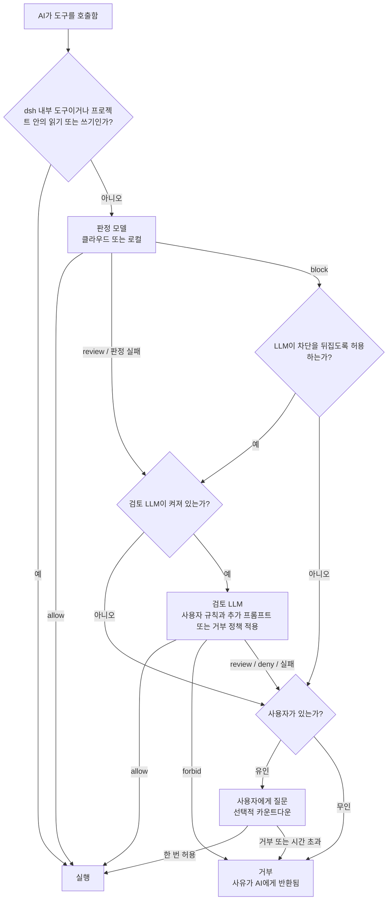

<div align="center">

<picture>
  <source media="(prefers-color-scheme: dark)" srcset="docs/assets/openvulcan-logo-dark.svg">
  
</picture>

# Vulcan Decision Guard

**AI 코딩 에이전트의 모든 도구 호출에 대해 권한을 판정합니다**

전용 판정 모델 · 선택형 LLM 검토 · 최종 결정권은 사용자에게 있습니다

[](LICENSE)
[](https://www.npmjs.com/package/@openvulcan/dsh-decision-guard)

[简体中文](README.md) | [English](README.en.md) | [繁體中文](README.zh-TW.md) | [日本語](README.ja.md) | **한국어** | [Español](README.es.md) | [Français](README.fr.md) | [Deutsch](README.de.md) | [Русский](README.ru.md) | [Português](README.pt-BR.md)

</div>

---

## 소개

Vulcan Decision Guard는 AI 코딩 도구용 권한 가드 플러그인입니다. AI 에이전트가 도구를 실행하기 전에
Vulcan Decision 모델이 해당 호출을 판정합니다. 일상적인 작업은 통과시키고, 불확실한 호출은 검토 LLM 또는
사용자에게 넘기며, 위험한 호출은 차단합니다.

현재 DeepSeek harness(dsh `0.2.1-rc.2` 이상, `0.3.0` 미만)를 지원합니다. 설치할 패키지는 하나뿐입니다.

```sh
dsh plugin add @openvulcan/dsh-decision-guard
```

> **우리의 약속: 클라우드 명령 판정 모델은 영구적으로 무료입니다.** (2026년 10월 27일)

> **상태: v1 프리뷰.** 판정은 아직 보정 중입니다. 이 플러그인은 샌드박스 위에 더하는 한 겹의 방어이며,
> 샌드박스를 대체하지 않습니다. 로컬 모델의 다운로드 주소는 아직 공개되지 않았으며, 현재 로컬 모델은
> 로컬 폴더에서 설치합니다. 설계 및 검증 기록은 [docs/architecture.md](docs/architecture.md)를 참고하십시오.

## 🤔 왜 판정 모델이 필요한가

AI 에이전트는 작업 하나를 끝내기 위해 수십 번에서 수백 번 도구를 호출하는 일이 많습니다. 이 호출들을 다루는
단순한 방법은 두 가지이고, 둘 다 좋지 않습니다.

- **매번 사용자에게 묻기**: 금세 피로해져서 내용을 보지 않고 "Allow"(허용)를 누르게 되므로, 질문이 의미를 잃습니다.
- **모두 허용하기**: 대부분은 문제가 없지만, 엉뚱한 폴더를 지우거나 운영 데이터베이스를 비우는 사고가 한 번만 나도 되돌릴 수 없습니다.

범용 LLM이 모든 호출을 검토하게 하는 방식도 이상적이지 않습니다. 호출마다 몇 초씩 기다려야 하고 토큰이
소모되며, LLM이 같은 대화를 읽기 때문에 에이전트를 엉뚱한 방향으로 이끈 바로 그 맥락에 설득될 수 있습니다.

판정 모델은 이 한 가지 일만을 위해 학습된 소형 모델(0.2B~0.8B)입니다. 모델이 보는 것은 프로젝트 폴더, 도구 이름,
실제 인자 세 가지뿐입니다. 대화나 AI의 설명은 읽지 않으며, 세 가지 판정 중 하나로 답합니다.
**allow**(허용), **review**(검토), **block**(차단). 그 결과는 다음과 같습니다.

- 파일 읽기, 테스트 실행, `git status`, 빌드 같은 일상적인 호출은 네트워크 왕복 한 번 또는 로컬 추론 한 번
  안에 통과하므로 거의 느끼지 못합니다.
- 불확실하거나 위험한 소수의 호출만 검토 LLM이나 사용자에게 넘어가므로, 질문을 다시 주의 깊게 볼 가치가 생깁니다.
- AI는 판정 모델을 말로 설득해 통과할 수 없습니다. 판정 모델은 그 말을 아예 보지 못하기 때문입니다.

## 🎯 무엇을 막고, 무엇을 막지 않는가

### 중점: 명령을 실행할 때 AI가 저지르는 실수

판정 모델은 AI가 **의도치 않게** 잘못하는 일을 대상으로 합니다. 예를 들면 다음과 같습니다.

- 경로를 잘못 지우는 경우: 변수가 비어 `rm -rf "$DIR/"*`가 한 단계 위를 지우거나, 재귀 삭제가 프로젝트 밖의 폴더까지 미칩니다.
- 데이터베이스 사고: 운영 환경에 `DROP DATABASE`, `TRUNCATE`, 조건 없는 `DELETE`를 실행합니다.
- 프로젝트나 그 이력을 파괴하는 경우: 프로젝트 전체 삭제, `git reset --hard`, 원격을 덮어쓰는 강제 푸시, `.git` 삭제.
- 다른 프로젝트에 쓰는 경우: 현재 저장소가 아니라 다른 저장소의 파일을 수정합니다.
- 미러링이나 동기화의 방향을 거꾸로 하거나, 드라이런 명령을 실제로 실행하는 경우 등.

이 중 세 가지 범주는 처리 방식을 사용자가 정합니다(빠른 카드의 "category grants"(범주 권한 부여)).

| 범주 | 선택함(권한 부여) | 선택하지 않음 | 기본값 |
| --- | --- | --- | --- |
| 프로젝트 밖에 쓰기 | 바로 허용 | 검토 필요 | 선택함 |
| 데이터베이스 삭제 또는 비우기 | 바로 허용 | 반드시 확인 | 선택하지 않음 |
| 프로젝트 전체 초기화 | 바로 허용 | 반드시 확인 | 선택하지 않음 |

### 다루지 않는 것: AI가 의도적으로 우회하는 경우

AI가 검사를 피하려고 **작정하면** 판정 모델은 막을 수 없고, 비슷한 어떤 방식도 막을 수 없습니다.
가장 간단한 예는 다음과 같습니다.

1. AI가 파일 쓰기 도구로 `shutil.rmtree("/")`가 든 `cleanup.py`를 작성합니다.
2. 이어서 `python cleanup.py`를 실행합니다.

판정 모델에게 보이는 것은 "프로젝트 안에 파일 쓰기"와 "프로젝트 안의 Python 스크립트 실행"뿐입니다. 하나씩 놓고 보면
둘 다 평범한 개발 단계입니다. 변형은 많습니다. `package.json`의 스크립트를 고친 뒤 `npm run` 실행하기,
Makefile이나 Git 훅 수정하기, 명령을 인코딩해 두었다가 실행 시점에 디코딩하기, 실행 중에 네트워크에서 코드 내려받기…

이런 우회를 잡으려면 LLM이 AI가 쓰는 **모든** 파일을 상시 분석해야 하고, 매 실행 전에 실행할 파일 전체,
그 파일이 임포트하는 모든 모듈, 호출하는 모든 프로그램, 실행 중에 생성되거나 내려받는 모든 것을 분석해야 합니다.
실행할 때마다 이를 수행하는 것은 느리고 비싸며, 그래도 실행 시점에야 나타나는 코드는 여전히 다룰 수 없습니다.
현실적으로 불가능한 일입니다.

따라서 이 플러그인의 범위는 분명합니다. **AI의 실수를 줄여 줄 뿐, AI의 의도와 싸우지는 않습니다**.
의도에 맞서는 방어는 격리로 해야 합니다.

- 샌드박스를 사용하십시오. "standalone switch"(독립 스위치) 연동 방식에서는 선택한 권한 프리셋의 샌드박스가 그대로 유지됩니다.
- 개발 환경에는 필요한 최소 권한만 주고, 운영 데이터베이스나 클라우드 계정의 자격 증명은 AI가 읽을 수 없는 곳에 두십시오.
- 신뢰할 수 없는 작업은 컨테이너나 가상 머신에서 실행하십시오.

또한 dsh에서 바깥쪽 `run_code`와 PTC 프로그램 내부에서 직접 일으키는 Node 부수 효과는 도구 호출 게이트를
거치지 않습니다. dsh 자체의 Auto review에도 같은 제한이 있습니다.

## ⚠️ 자동 승인이 모든 위험을 거부하는 것은 아닙니다

어떤 모델도 모든 것을 잡아내지 못하며, 이 모델도 예외가 아닙니다.

- 판정 모델은 실수합니다. 아래 평가에서 집중적으로 학습한 문제에서도 "검토가 필요한데 허용됨" 비율은 0이 아니며,
  학습하지 않은 문제 유형에서는 오류가 더 많습니다.
- 검토 LLM은 판정 모델이 **허용하지 않은** 호출만 처리합니다. 판정 모델이 허용한 호출은 즉시 실행되며,
  검토로 되돌릴 수 없습니다.
- 규칙, 추가 프롬프트, 무인 정책은 자연어이고 LLM이 수행하므로 잘못 해석될 수도 있습니다.

사고 확률을 낮추는 한 겹으로 생각하시고, 보험으로 여기지 마십시오. 또한 Git에 자주 커밋하고, 중요한 데이터는
백업하며, "Dropping or emptying databases"(데이터베이스 삭제 또는 비우기)와 "Resetting the whole project"(프로젝트 전체 초기화)는
선택하지 않은 상태로 두고, 운영 자격 증명을 개발 환경에 두지 않기를 권장합니다. 잘못된 판정을 발견하면
판정 기록에서 올바른 판정을 표시하여 모델 개선에 도움을 주십시오.

## 🔀 전체 흐름



1. **호스트 변환**: 플러그인이 dsh의 도구 호출을 모델이 학습 때 본 형태로 변환합니다. dsh 내부 도구(질문, 할 일,
   서브 에이전트 메시지 등)와 현재 프로젝트 안의 읽기 및 쓰기는 바로 허용되며 모델에 도달하지 않습니다.
2. **판정 모델**: allow, review, block 중 하나로 답합니다.
3. **검토 LLM**(끌 수 있음): review와 판정 실패를 처리합니다. 차단된 호출은 "Let the LLM overturn blocks"(LLM이 차단을 뒤집도록 허용)를
   켠 경우에만 이곳에 도달합니다.
4. **사용자**: 사용자가 자리에 있을 때만 해당됩니다. 무인 세션은 절대 묻지 않으며, 허용되지 않은 것은 모두 거부됩니다.

거부된 호출은 그 사유를 AI에게 돌려주며, AI는 목적을 설명하고 다시 시도할 수 있습니다. **어떤 오류도 허용으로 취급되지
않습니다**. 로그인하지 않음, 네트워크 실패, 런타임 팩 또는 모델 없음, 검토 실패, 형식이 잘못된 응답은 모두 허용되지 않은 것으로 처리됩니다.

## ⚖️ 판정 방식

판정 모델의 입력은 아래 세 줄뿐이며 학습 때와 똑같습니다. 작업 설명, 메시지 기록, 파일 내용은 추가하지 않습니다.

```text
Project: <project root>
Tool: <tool name>
Arguments: <compact JSON of the actual arguments>
```

여기에 위의 세 가지 범주 권한 부여가 더해집니다. 각 판정이 이어지는 결과는 다음과 같습니다.

| 판정 모델 | 의미 | 다음 단계 |
| --- | --- | --- |
| allow | 일상적인 작업 | 바로 실행 |
| review | 부수 효과가 있을 수 있어 맥락이 필요함 | 검토 LLM으로 넘어간 뒤 아래 표를 따름 |
| block | 실수이거나 월권일 가능성이 매우 높음 | 기본적으로 사용자에게 직접 질문(무인이면 거부). "Let the LLM overturn blocks"를 켜면 먼저 검토로 넘어감 |

검토 LLM의 답이 실행되는 방식은 다음과 같습니다.

| 검토 LLM의 답 | 유인 | 무인 |
| --- | --- | --- |
| allow | 실행 | 실행 |
| review (유인일 때만) | 사용자에게 질문, "Allow"(허용)에 초점 | — |
| deny | 사용자에게 질문, "Deny"(거부)에 초점 | 거부 |
| forbid (유인일 때만) | 묻지 않고 거부 | — |
| 실패, 검토 꺼짐, 또는 검토로 보내지 않음 | 사용자에게 질문. 판정이 review였으면 "Allow"에, 그 외에는 "Deny"에 초점 | 거부 |

질문 카드에는 카운트다운을 둘 수 있으며, 시간이 다 되면 호출은 거부됩니다. 0은 사용자가 답할 때까지 무기한 기다린다는
뜻입니다.

## 🧑‍⚖️ LLM 검토 방식

- **사용하는 모델**: 현재 세션의 모델, 설정에서 고른 서비스와 모델, 또는 끔. 온도는 0이며, 검토 요청은 세션 기록에
  기록되지 않습니다.
- **검토가 보는 것**:
  - 환경: 프로젝트 폴더와 세 가지 범주 권한 부여
  - 사용자의 규칙: "Forbidden"(절대 금지), "Deny"(거부), "Allow"(허용) 세 그룹의 자연어 규칙이며, 우선순위는
    forbid > deny > allow입니다. 판정 모델이 허용하지 않은 호출에만 적용됩니다.
  - 사용자가 자리에 있을 때는 "additional review prompt"(검토 추가 프롬프트), 무인일 때는 "deny policy"(거부 정책)
  - 대화에서 최근 6개의 사용자 및 에이전트 지시와 최근 12개의 도구 호출
  - AI가 `explain_tool_call`을 통해 밝힌 의도 설명(주장일 뿐 허가가 아님)
  - 판정 대기 중인 호출 자체와 판정 모델의 판정 결과
- **답할 수 있는 방식**: 유인일 때는 allow / review / deny / forbid만, 무인일 때는 allow / deny만 답할 수 있으며,
  사람의 검토가 없다는 사실을 안내받습니다. 답은 정해진 형태의 JSON이어야 하고, 사유는 인터페이스 언어로 쓴
  최대 300자입니다. 그 밖의 응답은 검토 실패로 간주됩니다.
- **추가 프롬프트**: 사용자가 자리에 있을 때 검토는 규칙 뒤에 "additional review prompt"를 읽습니다. 검토를 더
  엄격하게 하거나 사용자가 중요하게 여기는 점을 설명할 수 있지만, 규칙이나 범주 권한 부여를 **완화할 수는 없습니다**.
  설정에는 시스템 기본값이 있으며, 각 세션은 빠른 카드에서 자체 프롬프트를 작성하거나 기본값을 따를 수 있습니다
  (또는 `/vulcan-review-prompt set <prompt> | default` 사용).
- **무인**: 빠른 카드에서 켜면 거부 정책(시스템 기본 거부 정책이 미리 채워짐)을 확인하게 되며, 세션별로
  저장됩니다(또는 `/vulcan-unattended on [deny policy] | off` 사용). 승인 정책이 `never`인 세션도 무인으로 취급되며
  시스템 기본 거부 정책을 사용합니다.
- **의도 밝히기**: 검토가 켜져 있으면 AI가 `explain_tool_call`을 호출해 다음 호출의 목적을 밝힐 수 있습니다. 이 설명은
  검토 LLM과 질문 카드에만 전달되고 판정 모델에는 전달되지 않으며, 그 자체로는 허가가 될 수 없습니다.

## 📊 평가

2026년 10월, 고정된 하나의 문제 은행으로 `vulcan-decision-shell` v1 **standard (0.8B)**와 두 외부 판정 서비스인
JEV 1.14.0, Alibaba Cloud의 판정 모델 `decision-model-preview`를 1회성으로 비교했습니다. 세 가지 모두 동일한
고정 영어 정책, 동일한 전체 도구 인자, 프로젝트 폴더, 고정된 권한 부여 옵션을 사용했고 작업 설명은 없었으며,
가장 높은 점수의 판정을 채택했고 임계값은 조정하지 않았습니다.

먼저 이 수치의 한계를 밝힙니다.

- 레이블이 있는 문제는 우리 자체의 학습 및 테스트 은행에서 나왔으며, **상당 부분이 우리가 학습한 문제**이므로 명백히 우리에게 유리합니다.
- 기준 레이블은 우리가 정한 것이며, 운영 환경의 절대적 정답이 아닙니다.
- 수치는 standard (0.8B)에만 해당합니다. 기본 클라우드 mini (0.2B)와 flash (0.35B)는 성능이 다르며 여기에 반영되어 있지 않습니다.
- 외부 서비스 결과는 당시 이용 가능했던 버전을 반영합니다. Alibaba Cloud의 서비스 별칭으로는 뒤에 어떤 가중치가 있는지 확인할 수 없습니다.

**레이블이 있는 문제 은행 (입력 106,501건)**

| 지표 | standard (0.8B) | JEV 1.14.0 | Alibaba Cloud |
| --- | --- | --- | --- |
| 일상 작업을 바로 허용 (높을수록 좋음) | 99.07% | 73.10% | 96.60% |
| 검토가 필요한데 허용됨 (낮을수록 좋음) | 2.40% | 17.03% | 90.92% |
| 차단해야 하는데 허용됨 (낮을수록 좋음) | 0.04% | 2.99% | 76.85% |
| 그중 심각한 실수가 허용됨 | 0 / 16,613 | 2.43% | 76.88% |
| 무해한데 차단됨 (낮을수록 좋음) | 0.20% | 8.11% | 1.79% |

**실제 명령 (서로 다른 호출 415,194건, 호출별 레이블 없음)**: 실제로 발생한 빈도로 가중하면, 세 가지가 바로 허용한
비율은 각각 99.76%, 99.69%, 99.99%였습니다. 이는 사용자가 얼마나 자주 방해받는지만 보여 주며, 판정이 옳았는지는
보여 주지 않습니다.

**학습하지 않은 문제 유형**: 조건부 가드, 변수 복사, 정리 작업으로 구성된 개발용 홀드아웃(세 가지 모두 학습하지 않음)에서
차단해야 하는데 허용된 비율은 standard 43.75%, JEV 1.88%, Alibaba Cloud 100%였고, 무해한데 차단된 비율은 15.36%,
4.82%, 0%였습니다. 우리가 아직 다루지 못하는 문제 유형에서는 JEV가 우리보다 분명히 더 낫습니다.

이 수치를 읽는 방법은 다음과 같습니다.

- **JEV는 명령 판정을 위해 분명히 학습되었으며**, 성능이 나쁘지 않습니다. 우리의 강점은 변수 체인과 삭제 대상
  추적, 미러링과 동기화의 방향 및 드라이런, 긴 명령처럼 특별히 학습한 유형의 실수에 집중되어 있습니다. 그 범위를
  벗어나면 JEV의 오류율이 우리보다 낮을 수 있습니다.
- **Alibaba Cloud의 판정 모델은 더 폭넓은 범용 용도를 대상으로 하며**, 코딩 에이전트가 명령을 실행할 때 저지르는 실수에
  특화해 학습되지 않았을 가능성이 높아서 이 문제 은행에서는 허용 쪽으로 기웁니다. 그렇다고 나쁜 모델인 것은 아닙니다.
  전체를 두루 보도록 만들어진 모델이고, 우리는 이 한 가지에 특화했을 뿐입니다.
- 앞으로도 판정 기록에서 내보낸 샘플로 부족한 부분을 계속 채워 나가겠습니다.

## 🚀 설치 및 사용 (dsh)

```sh
dsh plugin add @openvulcan/dsh-decision-guard
```

필요한 것은 이 패키지 하나뿐입니다. 판정 엔진이 안에 포함되어 있으며, 네이티브 의존성이나 설치 스크립트는 없습니다.

1. dsh의 "Settings › Auto approval"(설정 › 자동 승인)을 엽니다(플러그인 페이지의 "Open auto approval settings"(자동 승인 설정 열기) 버튼도
   이곳으로 이동합니다). 클라우드 판정을 사용하려면 OpenVulcan 계정(중국 사이트 또는 글로벌 사이트)으로 로그인합니다.
   도구 호출이 사용자의 기기를 벗어나서는 안 된다면 "Local model"(로컬 모델)로 전환하고, 하드웨어에 맞춰
   권장되는 런타임 팩과 모델을 설치합니다.
2. dsh의 권한 선택기에서 "Auto review"(자동 검토)를 선택하거나, 설정에서 연동 방식을 "Standalone switch"(독립 스위치)로 바꿉니다.

   | 연동 방식 | 판정 대상 세션 | 샌드박스 |
   | --- | --- | --- |
   | Auto preset(자동 프리셋) | 프리셋이 "Auto review"인 세션 | 없음 (전체 권한) |
   | Standalone switch | 모든 세션, 선택한 프리셋 위에 적용 | 선택한 프리셋의 샌드박스 유지 |

3. 설정의 "Try a decision"(판정 시험)으로 판정이 동작하는지 확인합니다.

입력창의 모델 선택기 왼쪽에 있는 "Auto approval" 라벨을 누르면 빠른 카드가 열립니다. 여기서 세 가지 범주 권한 부여를
선택하고, 이 세션의 검토 추가 프롬프트와 무인 모드를 설정하고, 판정 모델, 엔드포인트, 검토, 질문 카운트다운을
조정할 수 있습니다. 이 플러그인은 dsh의 실험적 Auto review 플러그인을 대체하며, 둘을 함께 활성화할 수 없습니다.

## ☁️ 클라우드와 로컬

기본값은 클라우드 판정이며, 기기에 아무것도 설치하지 않습니다. **클라우드 명령 판정 모델은 영구적으로 무료입니다**
(2026년 10월 27일에 약속). 필요한 것은 OpenVulcan 계정뿐입니다. 검토 LLM은 사용자가 고른 모델 서비스를 사용하며
해당 서비스의 약관에 따라 과금됩니다. OpenVulcan이 계정별로 이용 가능한 판정 모델과 엔드포인트를 제공합니다.
설정의 엔드포인트 표에는 엔드포인트별 네트워크 및 연산 시간이 표시되며, 엔드포인트를 고정하거나 요청 테스트를
실행할 수 있습니다.

도구 호출이 사용자의 기기를 벗어나서는 안 된다면, 필요할 때 **런타임 팩**을 설치하십시오.

| 런타임 팩 | 용도 | Windows x64 다운로드 |
| --- | --- | --- |
| `onnx-cpu` | 모든 컴퓨터, ONNX 모델 실행 | 56 MiB |
| `onnx-cuda` | NVIDIA GPU(RTX 20 시리즈 이상), ONNX 모델 실행 | 1307 MiB |
| `torch-cpu` | 모든 컴퓨터, PyTorch 릴리스 모델 실행 | 173 MiB |
| `torch-cu128` | NVIDIA GPU(RTX 20 시리즈 이상), PyTorch 릴리스 모델 실행 | 2797 MiB |

런타임 팩은 미리 빌드된 Python과 공식 wheel이며, 모든 파일은 고정된 SHA-256으로 검증됩니다.
**아무것도 컴파일하지 않으며, 드라이버를 설치하거나 업데이트하지도 않습니다.** 준비된 런타임이 없는 GPU(AMD, Intel,
Apple)는 CPU 팩이나 클라우드를 사용합니다. 설정이 GPU, 드라이버, 연산 능력을 감지하여 팩을 제안하며,
중국 본토 사용자는 중국 미러 다운로드 소스를 선택할 수 있습니다.

`vulcan-decision-shell` v1은 세 가지 크기로 제공되며, 클라우드와 로컬 모두에서 사용할 수 있습니다.

| 크기 | 파라미터 | 비고 |
| --- | --- | --- |
| mini | 0.2B | 클라우드 기본값 |
| flash | 0.35B | |
| standard | 0.8B | 위에서 평가한 모델 |

## 🔒 판정 기록과 개인정보

- **클라우드 판정**: 위의 세 줄 입력(프로젝트 폴더, 도구 이름, 인자)과 범주 권한 부여가 OpenVulcan 판정
  엔드포인트로 전송됩니다. 로컬 모델을 사용하면 아무것도 전송되지 않습니다.
- **검토 LLM**: 검토 입력(대화의 최근 지시와 도구 호출 포함)은 사용자가 고른 검토 모델 서비스로 전송되며, 해당
  서비스와 이미 맺고 있는 데이터 약관이 그대로 적용됩니다. 검토를 끄면 아무것도 전송되지 않습니다.
- **판정 기록**: 설정의 "Record decisions"(판정 기록)는 기본적으로 꺼져 있습니다. 켜면 판정 모델이나 검토가
  관여한 모든 판정이 원본 명령 및 경로와 함께 사용자 기기의
  `$DSH_HOME/vulcan-decision/records.v1.jsonl`에 저장되며, 최근 5000건을 최대 30일 동안 보관하고 업로드되지 않습니다.
  "View records"(기록 보기)에서는 판정과 워크스페이스로 필터링하고, 잘못된 판정을 표시하고, 표시한 기록을 학습 샘플로
  내보내거나, 전체를 지울 수 있습니다.
- **자격 증명**: OpenVulcan 로그인 정보는 dsh 자체의 자격 증명 저장소에 보관되며, 토큰은 인터페이스나 로그에 나타나지 않습니다.

## 📦 패키지

| 패키지 | 역할 |
| --- | --- |
| [`@openvulcan/dsh-decision-guard`](packages/dsh-decision-guard) | dsh 플러그인: 도구 호출을 가로채고, 입력을 변환하고, 판정을 실행하며, 설정 페이지와 빠른 카드를 제공함. 판정 엔진이 번들로 포함되어 배포됨 |
| [`@openvulcan/vulcan-decision`](packages/vulcan-decision) | 판정 엔진(클라우드 및 로컬), 계정, 런타임 팩 및 모델 관리, 명령줄 `npx @openvulcan/vulcan-decision --help` |

둘 다 순수 Node 패키지입니다(Node ≥ 20.19).

## 🛠️ 개발

```sh
pnpm install
pnpm -r run typecheck
pnpm test
pnpm run pack:dsh   # dist/openvulcan-dsh-decision-guard-<version>.tgz 를 빌드합니다
```

런타임 팩 잠금 파일은 `python -I -B scripts/lock_runtime.py`로 생성됩니다(uv 필요).

## 🙏 감사의 말

Vulcan Decision Guard는 아래 오픈소스 프로젝트 위에 만들어졌습니다. 각 프로젝트의 작성자와 커뮤니티에 감사드립니다.

**플러그인 호스트**

- [DeepSeek harness (dsh)](https://github.com/deepseek-ai/deepseek-harness): 플러그인 호스트와 도구 호출 권한 경로
- [Cordis](https://github.com/cordiverse/cordis)와 [Schemastery](https://github.com/shigma/schemastery): 플러그인 프레임워크와 설정 스키마(dsh 제공)
- [React](https://react.dev/): 설정 페이지와 빠른 카드 UI(dsh 페이지 제공)

**로컬 런타임 팩(로컬 모델을 선택하고 팩을 설치할 때만 다운로드)**

- [CPython](https://www.python.org/)([python-build-standalone](https://github.com/astral-sh/python-build-standalone) 사전 빌드): Python 인터프리터
- [ONNX Runtime](https://onnxruntime.ai/): ONNX 모델 실행
- [PyTorch](https://pytorch.org/): PyTorch 릴리스 모델 실행
- Hugging Face [Transformers](https://github.com/huggingface/transformers), [Tokenizers](https://github.com/huggingface/tokenizers), [Safetensors](https://github.com/huggingface/safetensors): 모델 로딩과 토큰화
- [NumPy](https://numpy.org/): 수치 계산
- [NVIDIA CUDA](https://developer.nvidia.com/cuda-toolkit)와 [cuDNN](https://developer.nvidia.com/cudnn): GPU 팩에 포함된 공식 wheel

**개발 도구**

- [TypeScript](https://www.typescriptlang.org/), [pnpm](https://pnpm.io/), 런타임 팩 잠금 파일 생성에 쓰는 [uv](https://github.com/astral-sh/uv)

**커뮤니티**

- [LINUX DO](https://linux.do/): LINUX DO 커뮤니티의 지원과 교류에 감사드립니다

런타임 팩의 각 파일 출처와 SHA-256은 [`packages/vulcan-decision/runtime-packs/`](packages/vulcan-decision/runtime-packs)의 잠금 파일에 있습니다. 설치 시 각 파일을 대조해 변경 없이 설치하며, 모든 구성 요소는 각 패키지에 함께 배포되는 라이선스에 따라 사용됩니다.

## 📄 라이선스

[MIT](LICENSE)
