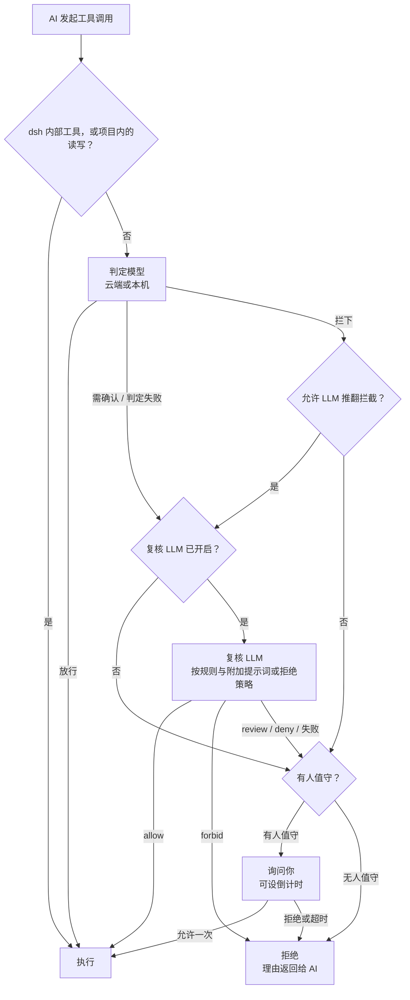

<div align="center">

<picture>
  <source media="(prefers-color-scheme: dark)" srcset="docs/assets/openvulcan-logo-dark.svg">
  
</picture>

# Vulcan Decision Guard

**为 AI 编码代理的每一次工具调用做权限判定**

专用判定模型 · 可选 LLM 复核 · 你保留最终决定权

[](LICENSE)
[](https://www.npmjs.com/package/@openvulcan/dsh-decision-guard)

**简体中文** | [English](README.en.md) | [繁體中文](README.zh-TW.md) | [日本語](README.ja.md) | [한국어](README.ko.md) | [Español](README.es.md) | [Français](README.fr.md) | [Deutsch](README.de.md) | [Русский](README.ru.md) | [Português](README.pt-BR.md)

</div>

---

## 关于项目

Vulcan Decision Guard 是 AI 编码工具的权限守卫插件。AI 代理每次调用工具前，先由 Vulcan Decision 判定模型
判断这次调用：常规操作直接放行，拿不准的交给复核 LLM 或由你确认，危险的拦下。

目前适配 DeepSeek harness（dsh `0.2.1-rc.2` 及以上、`0.3.0` 以下），安装一个包即可使用：

```sh
dsh plugin add @openvulcan/dsh-decision-guard
```

> **我们承诺：云端命令判定模型永久免费提供。**（2026 年 10 月 27 日）

> **状态：v1 预览版。** 判定仍在校准，它是沙箱之上的一道防线，不能取代沙箱。本机模型的下载地址尚未发布，
> 本机模型暂时从本地目录安装。设计与验证记录见 [docs/architecture.md](docs/architecture.md)。

## 🤔 为什么需要判定模型

AI 代理完成一个任务往往要调用几十到几百次工具。对这些调用只有两种简单做法，两种都不好：

- **每次都问你**：很快就会疲劳，最后不看内容就点“允许”，询问失去意义。
- **全部放开**：绝大多数时候没事，但一次删错目录或误清生产数据库就无法挽回。

让通用 LLM 逐条审查也不理想：每次调用都要等几秒、花一次 token，而且它读的是同一段对话，容易被把代理带偏的
同一段上下文说服。

判定模型是只为这一件事训练的小模型（0.2B 到 0.8B）。它只看三样东西：项目目录、工具名、实际参数，不读对话，
不读 AI 的解释，然后给出三个结论之一：**放行**、**需确认**、**拦下**。这样：

- 读文件、跑测试、`git status`、构建这类日常调用在一次网络往返或一次本机推理内直接放行，你几乎感觉不到它；
- 只有少数拿不准或危险的调用才交给复核 LLM 或你，询问因此重新变得值得认真看；
- AI 无法用一段说辞让判定模型放行，因为判定模型根本看不到说辞。

## 🎯 防范什么，不防范什么

### 重点防范：AI 执行命令时的失误

判定模型针对的是 AI **无意中**做错的事，例如：

- 删错路径：变量为空导致 `rm -rf "$DIR/"*` 删到上一级，或递归删除了项目之外的目录；
- 误操作数据库：对生产库执行 `DROP DATABASE`、`TRUNCATE`、不带条件的 `DELETE`；
- 毁掉项目或源码历史：删除整个项目、`git reset --hard`、强推覆盖远程、删除 `.git`；
- 写到别的项目里：本该改当前项目，却改了另一个仓库的文件；
- 镜像或同步方向写反、把预演参数当真执行，等等。

其中三类操作由你决定默认怎么处理（快捷卡中的“类别授权”）：

| 类别 | 勾选（授权） | 不勾选 | 默认 |
| --- | --- | --- | --- |
| 项目外的写入 | 直接放行 | 需确认 | 勾选 |
| 删除或清空数据库 | 直接放行 | 必须确认 | 不勾选 |
| 重置整个项目 | 直接放行 | 必须确认 | 不勾选 |

### 不防范：AI 刻意绕过

如果 AI **有意**绕过检查，判定模型拦不住，任何同类方案也拦不住。最简单的例子：

1. AI 先用写文件工具写一个 `cleanup.py`，里面是 `shutil.rmtree("/")`；
2. 再执行 `python cleanup.py`。

判定模型看到的只是“在项目里写一个文件”和“运行项目里的一个 Python 脚本”，两步单独看都是正常开发操作。
同样的手法还有很多：改 `package.json` 里的脚本再 `npm run`、改 Makefile 或 Git 钩子、把命令编码后再解码执行、
运行时从网络下载代码……

要拦住这类绕过，就必须让 LLM **全程**分析 AI 写下的每一个文件，并在每次执行前完整分析要执行的文件、它导入
的所有模块、它会调用的其他程序，以及运行时才生成或下载的内容。每次执行都要做一遍，又慢又贵，而且仍然无法
覆盖运行时才出现的代码。这本身是不现实的。

所以本插件的定位很明确：**减少 AI 的失误，不对抗 AI 的恶意**。对抗恶意要靠隔离：

- 使用沙箱。接入方式选“独立开关”时会保留你所选权限预设的沙箱；
- 给开发环境最小权限，不要把生产库、云账号的凭据放在 AI 能读到的地方；
- 在容器或虚拟机里运行不信任的任务。

另外，dsh 中外层 `run_code` 以及 PTC 程序内直接产生的 Node 副作用不经过工具调用闸门，这与 dsh 自带的 Auto
review 限制相同。

## ⚠️ 自动审批不保证拒绝一切风险

没有任何模型能做到零漏判，本插件也不例外：

- 判定模型会出错。下面的评测里，即使在大量训练过的题目上，“应确认却直接放行”也不是零；在没训练过的题型上
  错误更多；
- 复核 LLM 只处理判定模型**没有放行**的调用。判定模型已经放行的调用会直接执行，复核救不回来；
- 规则、附加提示词与无人值守策略都是自然语言，由 LLM 理解执行，同样可能理解偏差。

请把它当作降低事故概率的一层，而不是保险。建议同时做到：经常提交 Git、为重要数据做备份、“删除或清空数据库”
和“重置整个项目”保持不勾选、不在开发环境里放生产凭据。发现判错时，在判定记录里标记正确结论，帮助改进模型。

## 🔀 整体流程



1. **宿主换算**：插件把 dsh 的工具调用换算成模型训练时见过的形状。dsh 内部工具（提问、待办、子代理通信等）
   与当前项目内的读写直接放行，不进入模型。
2. **判定模型**：给出放行、需确认或拦下。
3. **复核 LLM**（可关闭）：处理需确认与判定失败的调用；拦下的调用只有在你打开“允许 LLM 推翻拦截”后才交给它。
4. **你**：只在有人值守时出现。无人值守的会话从不询问，未放行即拒绝。

被拒绝的调用会把理由返回给 AI，AI 可以说明目的后重试。**任何错误都不会被当作放行**：未登录、网络失败、
运行包或模型缺失、复核失败或回答不合格式，一律按未放行处理。

## ⚖️ 判定逻辑

判定模型的输入只有下面三行，与训练格式完全一致，不补充任务描述、历史消息或文件内容：

```text
Project: <项目根目录>
Tool: <工具名>
Arguments: <实际参数的紧凑 JSON>
```

再加上上面的三项类别授权。各结论的处理方式：

| 判定模型 | 含义 | 下一步 |
| --- | --- | --- |
| 放行 | 常规操作 | 直接执行 |
| 需确认 | 可能有副作用，需要看上下文 | 交复核 LLM，再按下表处理 |
| 拦下 | 很可能是失误或越权 | 默认直接询问你（无人值守时拒绝）；打开“允许 LLM 推翻拦截”后先交复核 |

复核 LLM 的结论如何执行：

| 复核 LLM 的结论 | 有人值守 | 无人值守 |
| --- | --- | --- |
| allow | 执行 | 执行 |
| review（仅有人值守时可答） | 询问你，默认焦点“允许” | — |
| deny | 询问你，默认焦点“拒绝” | 拒绝 |
| forbid（仅有人值守时可答） | 拒绝，不询问 | — |
| 失败、复核已关闭或未送复核 | 询问你；判定为需确认时默认焦点“允许”，否则“拒绝” | 拒绝 |

询问卡片可设倒计时，超时按拒绝处理；设为 0 表示一直等你回答。

## 🧑‍⚖️ LLM 复核方式

- **用哪个模型**：当前会话的模型、设置页指定的服务与模型，或关闭。温度为 0，复核请求不写入会话记录。
- **复核看到什么**：
  - 环境：项目目录与三项类别授权；
  - 你写的规则：“绝对禁止”“拒绝”“允许”三组自然语言规则，优先级 forbid > deny > allow，只作用于判定模型
    没有放行的调用；
  - 有人值守时的“复核附加提示词”，或无人值守时的“拒绝策略”；
  - 对话中最近 6 条用户与代理指令、最近 12 次工具调用；
  - AI 通过 `explain_tool_call` 给出的意图说明（只是声明，不是授权）；
  - 待判定的调用本身，以及判定模型给出的结论。
- **能怎么回答**：有人值守时只能答 allow / review / deny / forbid，无人值守时只能答 allow / deny，并被告知不存在
  人工复核。回答必须是固定形状的 JSON，理由最多 300 字符，按界面语言书写。不合格式即视为复核失败。
- **附加提示词**：有人值守时，复核在规则之后读取“复核附加提示词”。它可以让复核更严格、说明你在意的事项，
  但**不能放宽**规则或类别授权。设置页保存系统默认值，每个会话可以在快捷卡中另写一段或跟随默认值（也可用
  `/vulcan-review-prompt set <提示词> | default`）。
- **无人值守**：在快捷卡中开启时确认一段拒绝策略（预填系统默认拒绝策略），按会话保存（也可用
  `/vulcan-unattended on [拒绝策略] | off`）。会话审批策略为 `never` 时同样按无人值守处理，使用系统默认拒绝策略。
- **说明意图**：复核开启时，AI 可以调用 `explain_tool_call` 说明下一次调用的目的。说明只交给复核 LLM 并显示在
  询问卡片上，不交给判定模型，也不能单独构成授权。

## 📊 评测

2026 年 10 月，我们用同一个冻结的题库，对 **`vulcan-decision-shell-v1`**（0.8B）与两个外部判定服务
做了一次性对比：JEV 1.14.0 与阿里云判定模型 `decision-model-preview`。三者使用同一套固定英文策略、同样完整的
工具参数、项目目录与固定授权选项，不补充任务描述，取最高分结论，不调阈值。

先说清楚这组数字的局限：

- 有标签的题目来自我们自己的训练与测试题库，**其中很大一部分是我们训练过的题**，这对我们明显有利；
- 参考标签是我们定义的，不等于生产环境的绝对真值；
- 数字只代表 `vulcan-decision-shell-v1`。默认的云端 `vulcan-decision-shell-v1-mini`（0.2B）与 `vulcan-decision-shell-v1-flash`（0.35B）表现不同，这里不代表它们；
- 外部服务的结果只代表测试当时的版本。阿里云的服务别名无法核对背后的权重版本。

**有标签题库（106,501 条输入）**

| 指标 | `vulcan-decision-shell-v1` | JEV 1.14.0 | 阿里云 |
| --- | --- | --- | --- |
| 正常操作直接放行（越高越好） | 99.07% | 73.10% | 96.60% |
| 应确认却直接放行（越低越好） | 2.40% | 17.03% | 90.92% |
| 应拦下却直接放行（越低越好） | 0.04% | 2.99% | 76.85% |
| 其中严重误操作直接放行 | 0 / 16,613 | 2.43% | 76.88% |
| 无害却拦下（越低越好） | 0.20% | 8.11% | 1.79% |

**真实命令（415,194 条不同调用，没有逐条标签）**：按实际出现频次计，三者直接放行的比例分别是 99.76%、99.69%、
99.99%。这只说明日常使用中被打扰的多少，不说明判得对不对。

**我们没有训练过的题型**：在一组条件保护、变量复制与清理的开发保留题上（三方都没训练过），应拦下却直接放行的
比例是 `vulcan-decision-shell-v1` 43.75%、JEV 1.88%、阿里云 100%；无害却拦下的比例是 `vulcan-decision-shell-v1` 15.36%、JEV 4.82%、阿里云 0%。
在这类我们尚未覆盖的题型上，JEV 明显比我们好。

怎么理解这些数字：

- **JEV 明显针对命令判定做过训练**，并不是表现不好。我们的优势集中在专门训练过的那几类失误上，例如变量链与
  删除目标追踪、镜像同步的方向与预演、长命令；离开这些范围，JEV 的误判率可以比我们低；
- **阿里云的判定模型面向更广的通用用途**，很可能没有专门针对编码代理执行命令的失误做训练，所以在这个题库上
  倾向于放行。这不是它做得不好，而是它考虑的是整体，我们只专精这一件事；
- 我们会继续用判定记录导出的样本补足没有覆盖到的题型。

## 🚀 安装与使用（dsh）

```sh
dsh plugin add @openvulcan/dsh-decision-guard
```

只需要这一个包，判定引擎已经打包在里面，没有原生依赖和安装脚本。

1. 打开 dsh 的「设置 › 自动审批」（插件页的“打开自动审批设置”按钮也会跳到这里），登录 OpenVulcan 账号
   （中国站或国际站）即可使用云端判定。需要调用内容不出本机时，切到“本机模型”，按硬件建议安装运行包与模型。
2. 在 dsh 的权限选择器中选择“自动审查”，或在设置页把接入方式改为“独立开关”：

   | 接入方式 | 判定范围 | 沙箱 |
   | --- | --- | --- |
   | 自动预设 | 当前预设为“自动审查”的会话 | 无（完全权限） |
   | 独立开关 | 所有会话，叠加在所选预设之上 | 保留所选预设的沙箱 |

3. 用设置页的“试判定”确认判定可用。

输入框模型选择器左侧的“自动审批”标签打开快捷卡：勾选三项类别授权，设置本会话的复核附加提示词与无人值守，
调整判定模型、节点、复核与询问倒计时。本插件替代 dsh 自带的实验插件 Auto review，两者不能同时启用。

## ☁️ 云端与本机

默认使用云端判定，本机不安装任何运行库。**云端命令判定模型永久免费提供**（2026 年 10 月 27 日承诺），只需
登录 OpenVulcan 账号；复核 LLM 使用你自己选定的模型服务，按该服务的规则计费。可用的判定模型与节点由
OpenVulcan 按账号提供；设置页的端点表显示各
节点的网络与计算耗时，可以锁定节点，也可以对单个节点做请求测试。

需要调用内容不出本机时，可以按需安装一个**运行包**：

| 运行包 | 适用 | Windows x64 下载量 |
| --- | --- | --- |
| `onnx-cpu` | 任意电脑，运行 ONNX 模型 | 56 MiB |
| `onnx-cuda` | NVIDIA 显卡（RTX 20 系列及以上），运行 ONNX 模型 | 1307 MiB |
| `torch-cpu` | 任意电脑，运行 PyTorch 发布版模型 | 173 MiB |
| `torch-cu128` | NVIDIA 显卡（RTX 20 系列及以上），运行 PyTorch 发布版模型 | 2797 MiB |

运行包是预编译的 Python 与官方 wheel，每个文件按锁定的 SHA-256 校验；**不编译任何东西，也不安装或更新驱动**。
没有现成运行库的显卡（AMD、Intel、Apple）使用 CPU 运行包或云端。设置页会检测显卡、驱动与计算能力并给出
建议；国内网络可选“国内镜像”下载源。

`vulcan-decision-shell-v1` 有三个系列，云端与本机都可用：

| 系列 | 模型名 | 参数量 | 说明 |
| --- | --- | --- | --- |
| mini | `vulcan-decision-shell-v1-mini` | 0.2B | 云端默认 |
| flash | `vulcan-decision-shell-v1-flash` | 0.35B | |
| standard | `vulcan-decision-shell-v1` | 0.8B | 上面评测的模型，基于 Qwen3.5-0.8B-Base |

## 🔒 判定记录与隐私

- **云端判定**：把上面三行输入（项目目录、工具名、参数）与类别授权发送到 OpenVulcan 判定节点。选“本机模型”时
  不发送。
- **复核 LLM**：把复核输入（含最近的对话指令与工具调用）发给你选定的复核模型服务，与你和该服务之间原有的
  数据关系相同。关闭复核则不发送。
- **判定记录**：设置页的“记录判定”默认关闭。打开后，判定模型或复核参与的每次决定连同原始命令与路径保存在
  本机 `$DSH_HOME/vulcan-decision/records.v1.jsonl`，保留最近 5000 条、最长 30 天，不上传。“查看记录”可按结论与
  工作区筛选、标记判错的结论、把已标记记录导出为训练样本，或全部清除。
- **凭据**：OpenVulcan 登录凭据保存在 dsh 自己的凭据存储中，界面与日志不显示令牌。

## 📦 组成

| 包 | 作用 |
| --- | --- |
| [`@openvulcan/dsh-decision-guard`](packages/dsh-decision-guard) | dsh 插件：拦截工具调用、换算输入、执行结论，提供设置页与快捷卡；发布时内含判定引擎 |
| [`@openvulcan/vulcan-decision`](packages/vulcan-decision) | 判定引擎（云端与本机）、账号、运行包与模型管理、命令行 `npx @openvulcan/vulcan-decision --help` |

两者都是纯 Node 包（Node ≥ 20.19）。

## 🛠️ 开发

```sh
pnpm install
pnpm -r run typecheck
pnpm test
pnpm run pack:dsh   # 生成 dist/openvulcan-dsh-decision-guard-<版本>.tgz
```

运行包锁文件由 `python -I -B scripts/lock_runtime.py` 生成（需要 uv）。

## 🙏 致谢

Vulcan Decision Guard 构建在以下开源项目之上，感谢这些项目的作者和社区。

**插件宿主**

- [DeepSeek harness（dsh）](https://github.com/deepseek-ai/deepseek-harness)：插件宿主与工具调用的权限链路
- [Cordis](https://github.com/cordiverse/cordis) 与 [Schemastery](https://github.com/shigma/schemastery)：插件框架与设置 Schema，由 dsh 提供
- [React](https://react.dev/)：设置页与快捷卡界面，由 dsh 的页面提供

**本机运行包（仅在选用本机模型并安装运行包时下载）**

- [CPython](https://www.python.org/)（[python-build-standalone](https://github.com/astral-sh/python-build-standalone) 预编译）：Python 解释器
- [ONNX Runtime](https://onnxruntime.ai/)：运行 ONNX 模型
- [PyTorch](https://pytorch.org/)：运行 PyTorch 发布版模型
- Hugging Face [Transformers](https://github.com/huggingface/transformers)、[Tokenizers](https://github.com/huggingface/tokenizers)、[Safetensors](https://github.com/huggingface/safetensors)：模型加载与分词
- [NumPy](https://numpy.org/)：数值计算
- [NVIDIA CUDA](https://developer.nvidia.com/cuda-toolkit) 与 [cuDNN](https://developer.nvidia.com/cudnn)：GPU 运行包中的官方 wheel

**开发工具**

- [TypeScript](https://www.typescriptlang.org/)、[pnpm](https://pnpm.io/)，以及生成运行包锁文件的 [uv](https://github.com/astral-sh/uv)

**模型**

- [Qwen3.5-0.8B-Base](https://huggingface.co/Qwen/Qwen3.5-0.8B-Base)：`vulcan-decision-shell-v1` 的基础模型

**社区**

- [LINUX DO](https://linux.do/)：感谢 LINUX DO 社区的支持与交流

运行包中每个文件的来源与 SHA-256 见 [`packages/vulcan-decision/runtime-packs/`](packages/vulcan-decision/runtime-packs) 下的锁文件；安装时逐个校验、原样安装，各组件按其随包附带的许可证使用。

## 📄 许可证

[MIT](LICENSE)
