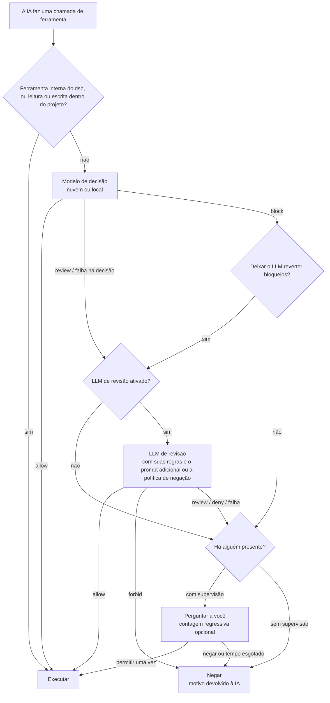

<div align="center">

<picture>
  <source media="(prefers-color-scheme: dark)" srcset="docs/assets/openvulcan-logo-dark.svg">
  
</picture>

# Vulcan Decision Guard

**Uma decisão de permissão para cada chamada de ferramenta do seu agente de programação com IA**

Um modelo de decisão dedicado · Revisão opcional por LLM · A palavra final continua sendo sua

[](LICENSE)
[](https://www.npmjs.com/package/@openvulcan/dsh-decision-guard)

[简体中文](README.md) | [English](README.en.md) | [繁體中文](README.zh-TW.md) | [日本語](README.ja.md) | [한국어](README.ko.md) | [Español](README.es.md) | [Français](README.fr.md) | [Deutsch](README.de.md) | [Русский](README.ru.md) | **Português**

</div>

---

## Sobre

O Vulcan Decision Guard é um plugin de proteção de permissões para ferramentas de programação com IA. Antes de o
agente de IA executar uma ferramenta, o modelo Vulcan Decision avalia a chamada: o trabalho de rotina passa, as
chamadas incertas vão para um LLM de revisão ou para você, e as perigosas são interrompidas.

Atualmente ele oferece suporte ao DeepSeek harness (dsh `0.2.1-rc.2` ou posterior, abaixo de `0.3.0`). Um único
pacote é tudo o que você precisa instalar:

```sh
dsh plugin add @openvulcan/dsh-decision-guard
```

> **Nosso compromisso: o modelo de decisão de comandos na nuvem é gratuito, para sempre.** (27 de outubro de 2026)

> **Status: prévia v1.** As decisões ainda estão sendo calibradas. Esta é uma camada adicional sobre um sandbox, e não
> um substituto para ele. Os modelos locais são baixados do Hugging Face ou do ModelScope (site da China), ou
> instalados a partir de uma pasta local; o site internacional do ModelScope virá depois. Notas de design e
> verificação: [docs/architecture.md](docs/architecture.md).

## 🤔 Por que um modelo de decisão

Um agente de IA costuma fazer de dezenas a centenas de chamadas de ferramentas para concluir uma única tarefa. Há
duas formas simples de lidar com elas, e ambas são ruins:

- **Perguntar a você toda vez**: você se cansa rápido e acaba clicando em "Allow" (permitir) sem ler, então a
  pergunta perde o sentido.
- **Permitir tudo**: na maior parte do tempo funciona, mas uma exclusão na pasta errada ou um banco de dados de
  produção apagado não tem volta.

Fazer um LLM genérico revisar cada chamada também não é o ideal: cada chamada espera vários segundos e gasta
tokens, e o LLM lê a mesma conversa, então pode ser convencido pelo mesmo contexto que desviou o agente.

O modelo de decisão é um modelo pequeno (de 0.2B a 0.8B) treinado para esta única tarefa. Ele vê apenas três
coisas: a pasta do projeto, o nome da ferramenta e os argumentos reais. Ele nunca lê a conversa nem as explicações
da IA. Ele responde com uma de três decisões: **allow**, **review** ou **block**. Como resultado:

- Chamadas do dia a dia, como ler arquivos, rodar testes, `git status` e builds, passam em uma ida e volta de rede
  ou em uma inferência local, e você quase não percebe;
- Apenas as poucas chamadas incertas ou perigosas vão para o LLM de revisão ou para você, então uma pergunta volta
  a valer a pena ser lida;
- A IA não consegue argumentar para passar pelo modelo de decisão, porque o modelo de decisão nunca vê o
  argumento.

## 🎯 Contra o que protege e contra o que não protege

### O foco: erros que a IA comete ao executar comandos

O modelo de decisão trata de coisas que a IA faz errado **por acidente**, por exemplo:

- Apagar o caminho errado: uma variável vazia transforma `rm -rf "$DIR/"*` em uma exclusão um nível acima, ou uma
  exclusão recursiva alcança uma pasta fora do projeto;
- Acidentes com bancos de dados: `DROP DATABASE`, `TRUNCATE` ou um `DELETE` sem condição contra a produção;
- Destruir o projeto ou o seu histórico: apagar o projeto inteiro, `git reset --hard`, push forçado sobre o
  remoto, apagar o `.git`;
- Escrever em outro projeto: alterar arquivos em um repositório diferente em vez do atual;
- Espelhar ou sincronizar na direção errada, executar de verdade um comando que era um ensaio (dry-run), e assim
  por diante.

Você decide como três dessas categorias são tratadas (as "category grants" (autorizações por categoria) do cartão
rápido):

| Categoria | Marcada (autorizada) | Desmarcada | Padrão |
| --- | --- | --- | --- |
| Gravações fora do projeto | Permitido diretamente | Precisa de revisão | Marcada |
| Apagar ou esvaziar bancos de dados | Permitido diretamente | Precisa ser confirmado | Desmarcada |
| Redefinir o projeto inteiro | Permitido diretamente | Precisa ser confirmado | Desmarcada |

### Não coberto: a IA contornando a proteção de propósito

Se a IA **decidir** contornar a verificação, o modelo de decisão não consegue impedir, e nenhuma abordagem
semelhante consegue. O exemplo mais simples:

1. A IA usa a ferramenta de escrita de arquivos para gravar `cleanup.py` contendo `shutil.rmtree("/")`;
2. Em seguida, executa `python cleanup.py`.

Tudo o que o modelo de decisão vê é "gravar um arquivo no projeto" e "executar um script Python no projeto". Vistos
um a um, ambos são passos comuns de desenvolvimento. Há muitas variações: alterar um script no `package.json` e
depois rodar `npm run`, editar um Makefile ou um hook do Git, codificar um comando e decodificá-lo em tempo de
execução, baixar código da rede durante a execução…

Para pegar esses casos, seria preciso um LLM analisando **todos** os arquivos que a IA grava, o tempo todo, e,
antes de cada execução, analisando o arquivo inteiro que será executado, cada módulo que ele importa, cada programa
que ele chama e tudo o que for gerado ou baixado em tempo de execução. Fazer isso a cada execução é lento e caro, e
ainda assim não cobre o código que só aparece em tempo de execução. Simplesmente não é viável.

Por isso o plugin tem um escopo claro: **ele reduz os erros da IA; ele não combate a intenção da IA**. Defender-se
contra a intenção exige isolamento:

- Use um sandbox. Com a integração "standalone switch" (chave independente), o sandbox da predefinição de
  permissões que você escolheu continua ativo;
- Dê ao ambiente de desenvolvimento o mínimo de privilégio necessário e mantenha as credenciais de bancos de dados
  de produção ou de contas de nuvem onde a IA não consiga lê-las;
- Execute tarefas não confiáveis em um contêiner ou em uma máquina virtual.

Observe também que, no dsh, o `run_code` externo e os efeitos colaterais do Node feitos diretamente dentro de um
programa PTC não passam pelo portão de chamadas de ferramentas. O Auto review do próprio dsh tem a mesma
limitação.

## ⚠️ A aprovação automática não garante a recusa de todo risco

Nenhum modelo pega tudo, e este não é exceção:

- O modelo de decisão comete erros. Na avaliação abaixo, "permitido embora precisasse de revisão" não é zero nem
  nas questões em que treinamos bastante, e há mais erros em tipos de questão em que não treinamos;
- O LLM de revisão só trata as chamadas que o modelo de decisão **não permitiu**. Uma chamada que o modelo de
  decisão permitiu é executada na hora, e a revisão não consegue trazê-la de volta;
- Regras, prompts adicionais e políticas sem supervisão são linguagem natural, executadas por um LLM, e também
  podem ser mal interpretadas.

Trate-o como uma camada que reduz a chance de um acidente, não como um seguro. Também recomendamos: fazer commits
no Git com frequência, fazer backup de dados importantes, deixar "Dropping or emptying databases" (apagar ou
esvaziar bancos de dados) e "Resetting the whole project" (redefinir o projeto inteiro) desmarcados e manter
credenciais de produção fora do seu ambiente de desenvolvimento. Ao notar uma decisão errada, marque a correta nos
registros de decisões para ajudar a melhorar o modelo.

## 🔀 O fluxo geral



1. **Tradução do host**: o plugin converte a chamada de ferramenta do dsh no formato que o modelo viu no
   treinamento. As ferramentas internas do dsh (perguntas, tarefas pendentes, mensagens de subagentes e assim por
   diante) e as leituras ou escritas dentro do projeto atual são permitidas diretamente e nunca chegam ao modelo.
2. **Modelo de decisão**: responde allow, review ou block.
3. **LLM de revisão** (pode ser desativado): trata review e decisões que falharam; as chamadas bloqueadas só
   chegam a ele quando você ativa "Let the LLM overturn blocks" (deixar o LLM reverter bloqueios).
4. **Você**: somente quando há alguém presente. Sessões sem supervisão nunca perguntam; tudo o que não for
   permitido é negado.

Uma chamada negada devolve o motivo à IA, que pode explicar sua finalidade e tentar de novo. **Nenhum erro jamais
é tratado como permissão**: não estar autenticado, uma falha de rede, um pacote de runtime ou modelo ausente, uma
revisão que falhou ou uma resposta em formato errado são todos tratados como não permitido.

## ⚖️ Como as decisões são tomadas

A entrada do modelo de decisão são apenas estas três linhas, exatamente como no treinamento, sem descrição da
tarefa, histórico de mensagens nem conteúdo de arquivos:

```text
Project: <project root>
Tool: <tool name>
Arguments: <compact JSON of the actual arguments>
```

mais as três autorizações por categoria acima. A que leva cada decisão:

| Modelo de decisão | Significado | Próximo passo |
| --- | --- | --- |
| allow | Trabalho de rotina | Executa diretamente |
| review | Pode ter efeitos colaterais; é preciso contexto | Vai para o LLM de revisão e depois para a tabela abaixo |
| block | Muito provavelmente um erro ou um excesso | Por padrão pergunta diretamente a você (negado quando não há supervisão); com "Let the LLM overturn blocks" vai primeiro para revisão |

Como a resposta do LLM de revisão é executada:

| Resposta do LLM de revisão | Com supervisão | Sem supervisão |
| --- | --- | --- |
| allow | Executar | Executar |
| review (somente com supervisão) | Perguntar a você, foco em "Allow" | — |
| deny | Perguntar a você, foco em "Deny" (negar) | Negar |
| forbid (somente com supervisão) | Negar sem perguntar | — |
| Falha, revisão desativada ou não enviada para revisão | Perguntar a você; foco em "Allow" quando a decisão foi review, caso contrário "Deny" | Negar |

O cartão de pergunta pode ter uma contagem regressiva; quando ela acaba, a chamada é negada. 0 significa esperar
indefinidamente pela sua resposta.

## 🧑‍⚖️ Como funciona a revisão por LLM

- **Qual modelo**: o modelo da sessão atual, um serviço e um modelo escolhidos nas configurações, ou desativado. A
  temperatura é 0, e as solicitações de revisão não são gravadas no histórico da sessão.
- **O que a revisão vê**:
  - O ambiente: a pasta do projeto e as três autorizações por categoria;
  - Suas regras: três grupos de regras em linguagem natural, "Forbidden" (proibido), "Deny" e "Allow", com
    prioridade forbid > deny > allow. Elas se aplicam apenas às chamadas que o modelo de decisão não permitiu;
  - O "additional review prompt" (prompt adicional de revisão) quando há alguém presente, ou a "deny policy"
    (política de negação) quando não há supervisão;
  - As últimas 6 instruções do usuário e do agente na conversa e as últimas 12 chamadas de ferramentas;
  - Qualquer declaração de intenção que a IA tenha dado por meio de `explain_tool_call` (uma alegação, não uma
    permissão);
  - A própria chamada pendente e o veredito do modelo de decisão.
- **Como ela pode responder**: com supervisão, apenas allow / review / deny / forbid; sem supervisão, apenas allow
  / deny, e ela é informada de que não existe revisão humana. A resposta deve ser um JSON de formato fixo, com um
  motivo de até 300 caracteres escrito no idioma da interface. Qualquer outra coisa conta como revisão com falha.
- **Prompt adicional**: quando há alguém presente, a revisão lê o "additional review prompt" depois das regras.
  Ele pode tornar a revisão mais rigorosa ou descrever o que importa para você, mas **não pode afrouxar** as regras
  nem as autorizações por categoria. As configurações guardam o padrão do sistema; cada sessão pode escrever o seu
  no cartão rápido ou seguir o padrão (ou usar `/vulcan-review-prompt set <prompt> | default`).
- **Sem supervisão**: ativá-lo no cartão rápido significa confirmar uma política de negação (preenchida com a
  política de negação padrão do sistema), salva por sessão (ou use `/vulcan-unattended on [deny policy] | off`).
  Sessões cuja política de aprovação é `never` também são tratadas como sem supervisão, com a política de negação
  padrão do sistema.
- **Declaração de intenção**: enquanto a revisão está ativada, a IA pode chamar `explain_tool_call` para declarar a
  finalidade da sua próxima chamada. A declaração vai apenas para o LLM de revisão e para o cartão de pergunta,
  nunca para o modelo de decisão, e nunca concede permissão por si só.

## 📊 Avaliação

Em outubro de 2026, fizemos uma comparação única sobre um único banco de questões congelado entre o
**`vulcan-decision-shell-v1`** (0.8B) e dois serviços de decisão externos: o JEV 1.14.0 e o modelo de
decisão da Alibaba Cloud, `decision-model-preview`. Os três usaram a mesma política fixa em inglês, os mesmos
argumentos completos das ferramentas, a mesma pasta de projeto e as mesmas opções fixas de autorização, sem
descrição da tarefa; foi tomada a decisão de maior pontuação e nenhum limiar foi ajustado.

Primeiro, os limites desses números:

- As questões rotuladas vêm do nosso próprio banco de treinamento e de teste, e **grande parte delas são questões
  em que treinamos**, o que nos favorece claramente;
- Os rótulos de referência são nossos; não são verdade absoluta para a produção;
- Os números valem apenas para o `vulcan-decision-shell-v1`. O `vulcan-decision-shell-v1-mini` (0.2B) padrão na nuvem e o `vulcan-decision-shell-v1-flash` (0.35B) têm desempenho
  diferente e não estão representados aqui;
- Os resultados externos refletem as versões disponíveis na época. O alias de serviço da Alibaba Cloud não nos
  permite verificar quais pesos estão por trás.

**Banco rotulado (106,501 entradas)**

| Métrica | `vulcan-decision-shell-v1` | JEV 1.14.0 | Alibaba Cloud |
| --- | --- | --- | --- |
| Trabalho de rotina permitido diretamente (quanto maior, melhor) | 99.07% | 73.10% | 96.60% |
| Permitido embora precisasse de revisão (quanto menor, melhor) | 2.40% | 17.03% | 90.92% |
| Permitido embora devesse ser bloqueado (quanto menor, melhor) | 0.04% | 2.99% | 76.85% |
| Entre eles, erros graves permitidos | 0 / 16,613 | 2.43% | 76.88% |
| Inofensivo, mas bloqueado (quanto menor, melhor) | 0.20% | 8.11% | 1.79% |

**Comandos reais (415,194 chamadas distintas, sem rótulos por chamada)**: ponderando pela frequência com que cada
uma realmente ocorreu, os três permitiram diretamente 99.76%, 99.69% e 99.99%. Isso mostra apenas com que
frequência você seria interrompido, não se as decisões estavam certas.

**Tipos de questão em que não treinamos**: em um conjunto de desenvolvimento reservado de proteções condicionais,
cópias de variáveis e limpezas (nenhum dos três treinou nele), a parcela permitida embora devesse ser bloqueada
foi de 43.75% para o `vulcan-decision-shell-v1`, 1.88% para o JEV e 100% para a Alibaba Cloud; inofensivo, mas bloqueado foi de
15.36%, 4.82% e 0%. Nos tipos de questão que ainda não cobrimos, o JEV é claramente melhor que nós.

Como ler esses números:

- **O JEV foi claramente treinado para decisões de comandos**, e não tem um desempenho ruim. Nossa vantagem se
  concentra nos tipos de erro em que treinamos especificamente, como o rastreamento de cadeias de variáveis e de
  alvos de exclusão, a direção e os ensaios de espelhamento e sincronização, e comandos longos; fora dessas áreas,
  a taxa de erro do JEV pode ser menor que a nossa;
- **O modelo de decisão da Alibaba Cloud atende a finalidades mais amplas e gerais** e provavelmente não foi
  treinado especificamente nos erros que agentes de programação cometem ao executar comandos, por isso tende a
  permitir neste banco. Isso não o torna ruim: ele foi feito para o quadro geral, enquanto nós nos especializamos
  nesta única coisa;
- Vamos continuar preenchendo as lacunas com amostras exportadas dos registros de decisões.

## 🚀 Instalação e uso (dsh)

```sh
dsh plugin add @openvulcan/dsh-decision-guard
```

Este único pacote é tudo de que você precisa: o motor de decisão vem embutido, sem dependências nativas e sem
scripts de instalação.

1. Abra "Settings › Auto approval" (Configurações › Aprovação automática) do dsh (o botão "Open auto approval
   settings" (abrir configurações de aprovação automática) na página do plugin também leva até lá) e entre em uma
   conta OpenVulcan (site da China ou site global) para usar as decisões na nuvem. Se as chamadas de ferramentas
   não puderem sair da sua máquina, mude para "Local model" (modelo local) e instale um pacote de runtime e um
   modelo conforme a sugestão para o seu hardware.
2. Escolha "Auto review" no seletor de permissões do dsh, ou mude a integração para "Standalone switch" nas
   configurações:

   | Integração | Quais sessões são avaliadas | Sandbox |
   | --- | --- | --- |
   | Auto preset (predefinição automática) | Sessões cuja predefinição é "Auto review" | Nenhum (acesso total) |
   | Standalone switch | Todas as sessões, por cima da predefinição escolhida | O sandbox da predefinição escolhida continua |

3. Use "Try a decision" (experimentar uma decisão) nas configurações para confirmar que as decisões funcionam.

O rótulo "Auto approval" à esquerda do seletor de modelo do campo de entrada abre o cartão rápido: marque as três
autorizações por categoria, defina o prompt adicional de revisão e o modo sem supervisão desta sessão e ajuste o
modelo de decisão, o endpoint, a revisão e a contagem regressiva da pergunta. Este plugin substitui o plugin
experimental Auto review do dsh; os dois não podem ser ativados juntos.

## ☁️ Nuvem e local

As decisões na nuvem são o padrão, e nada é instalado na sua máquina. **O modelo de decisão de comandos na nuvem é
gratuito, para sempre** (compromisso assumido em 27 de outubro de 2026); tudo o que você precisa é de uma conta
OpenVulcan. O LLM de revisão usa o serviço de modelos que você escolher e é cobrado conforme os termos desse
serviço. A OpenVulcan disponibiliza os modelos de decisão e os endpoints por conta; a tabela de endpoints nas
configurações mostra o tempo de rede e de computação de cada endpoint, e você pode fixar um endpoint ou fazer um
teste de requisição nele.

Se as chamadas de ferramentas não puderem sair da sua máquina, instale um **pacote de runtime** quando precisar:

| Pacote de runtime | Para | Download para Windows x64 |
| --- | --- | --- |
| `onnx-cpu` | Qualquer computador, executa modelos ONNX | 56 MiB |
| `onnx-cuda` | GPUs NVIDIA (RTX série 20 e mais recentes), executa modelos ONNX | 1307 MiB |
| `torch-cpu` | Qualquer computador, executa modelos de lançamento do PyTorch | 173 MiB |
| `torch-cu128` | GPUs NVIDIA (RTX série 20 e mais recentes), executa modelos de lançamento do PyTorch | 2797 MiB |

Os pacotes de runtime são um Python pré-compilado mais wheels oficiais, e cada arquivo é verificado contra um
SHA-256 fixado. **Nada é compilado, e nenhum driver é instalado ou atualizado.** GPUs sem um runtime pronto (AMD,
Intel, Apple) usam um pacote de CPU ou a nuvem. As configurações detectam sua GPU, o driver e a capacidade de
computação e sugerem um pacote; usuários da China continental podem escolher o espelho da China como fonte de
download.

O `vulcan-decision-shell-v1` vem em três tamanhos, disponíveis tanto na nuvem quanto localmente:

| Tamanho | Modelo | Parâmetros | Observações |
| --- | --- | --- | --- |
| mini | `vulcan-decision-shell-v1-mini` | 0.2B | Padrão na nuvem |
| flash | `vulcan-decision-shell-v1-flash` | 0.35B | |
| standard | `vulcan-decision-shell-v1` | 0.8B | O modelo avaliado acima; baseado no Qwen3.5-0.8B-Base |

## 🔒 Registros de decisões e privacidade

- **Decisões na nuvem**: as três linhas de entrada acima (pasta do projeto, nome da ferramenta, argumentos) e as
  autorizações por categoria são enviadas a um endpoint de decisão da OpenVulcan. Nada é enviado quando você usa um
  modelo local.
- **LLM de revisão**: a entrada da revisão (incluindo instruções e chamadas de ferramentas recentes da conversa) é
  enviada ao serviço de modelos de revisão que você escolheu, sob os mesmos termos de dados que você já tem com
  esse serviço. Nada é enviado quando a revisão está desativada.
- **Registros de decisões**: "Record decisions" (registrar decisões) nas configurações vem desativado por padrão.
  Quando ativado, toda decisão da qual o modelo de decisão ou a revisão participou é salva com o comando e os
  caminhos originais em `$DSH_HOME/vulcan-decision/records.v1.jsonl` na sua máquina, mantendo os últimos 5000
  registros por no máximo 30 dias, e nunca é enviada para fora. "View records" (ver registros) permite filtrar por
  decisão e espaço de trabalho, marcar decisões erradas, exportar os registros marcados como amostras de
  treinamento ou limpar tudo.
- **Credenciais**: o login da OpenVulcan fica armazenado no próprio repositório de credenciais do dsh, e os tokens
  nunca aparecem na interface nem nos logs.

## 📦 Pacotes

| Pacote | Função |
| --- | --- |
| [`@openvulcan/dsh-decision-guard`](packages/dsh-decision-guard) | Plugin do dsh: intercepta chamadas de ferramentas, traduz a entrada, executa as decisões, fornece a página de configurações e o cartão rápido; já inclui o motor de decisão embutido |
| [`@openvulcan/vulcan-decision`](packages/vulcan-decision) | Motor de decisão (nuvem e local), conta, gerenciamento de pacotes de runtime e de modelos, linha de comando `npx @openvulcan/vulcan-decision --help` |

Ambos são pacotes Node puros (Node ≥ 20.19).

## 🛠️ Desenvolvimento

```sh
pnpm install
pnpm -r run typecheck
pnpm test
pnpm run pack:dsh   # gera dist/openvulcan-dsh-decision-guard-<version>.tgz
```

Os arquivos de lock dos pacotes de runtime são gerados por `python -I -B scripts/lock_runtime.py` (requer uv).

## 🙏 Agradecimentos

O Vulcan Decision Guard é construído sobre os projetos de código aberto abaixo. Obrigado aos seus autores e comunidades.

**Hospedeiro do plugin**

- [DeepSeek harness (dsh)](https://github.com/deepseek-ai/deepseek-harness): o hospedeiro do plugin e o caminho de permissões das chamadas de ferramentas
- [Cordis](https://github.com/cordiverse/cordis) e [Schemastery](https://github.com/shigma/schemastery): o framework de plugins e o esquema de configurações, fornecidos pelo dsh
- [React](https://react.dev/): a página de configurações e o cartão rápido, fornecidos pela página do dsh

**Pacotes de execução locais (baixados apenas quando você escolhe o modelo local e instala um pacote)**

- [CPython](https://www.python.org/) (pré-compilado pelo [python-build-standalone](https://github.com/astral-sh/python-build-standalone)): o interpretador Python
- [ONNX Runtime](https://onnxruntime.ai/): executa os modelos ONNX
- [PyTorch](https://pytorch.org/): executa os modelos da versão PyTorch
- Hugging Face [Transformers](https://github.com/huggingface/transformers), [Tokenizers](https://github.com/huggingface/tokenizers), [Safetensors](https://github.com/huggingface/safetensors): carregamento de modelos e tokenização
- [NumPy](https://numpy.org/): cálculo numérico
- [NVIDIA CUDA](https://developer.nvidia.com/cuda-toolkit) e [cuDNN](https://developer.nvidia.com/cudnn): os wheels oficiais dos pacotes para GPU

**Ferramentas de desenvolvimento**

- [TypeScript](https://www.typescriptlang.org/), [pnpm](https://pnpm.io/) e [uv](https://github.com/astral-sh/uv) para gerar os arquivos de bloqueio dos pacotes de execução

**Modelo**

- [Qwen3.5-0.8B-Base](https://huggingface.co/Qwen/Qwen3.5-0.8B-Base): o modelo base do `vulcan-decision-shell-v1`

**Comunidade**

- [LINUX DO](https://linux.do/): obrigado à comunidade LINUX DO pelo apoio e pelas trocas

A origem e o SHA-256 de cada arquivo de um pacote de execução estão nos arquivos de bloqueio em [`packages/vulcan-decision/runtime-packs/`](packages/vulcan-decision/runtime-packs). Cada arquivo é verificado com eles e instalado sem alterações, e cada componente é usado sob a licença que o acompanha.

## 📄 Licença

[MIT](LICENSE)
