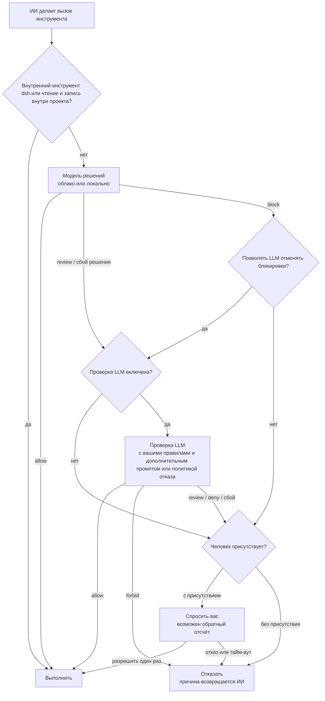

<div align="center">

<picture>
  <source media="(prefers-color-scheme: dark)" srcset="docs/assets/openvulcan-logo-dark.svg">
  
</picture>

# Vulcan Decision Guard

**Решение о правах доступа для каждого вызова инструмента вашим ИИ-агентом для программирования**

Специализированная модель решений · Дополнительная проверка с помощью LLM · Последнее слово остаётся за вами

[](LICENSE)
[](https://www.npmjs.com/package/@openvulcan/dsh-decision-guard)

[简体中文](README.md) | [English](README.en.md) | [繁體中文](README.zh-TW.md) | [日本語](README.ja.md) | [한국어](README.ko.md) | [Español](README.es.md) | [Français](README.fr.md) | [Deutsch](README.de.md) | **Русский** | [Português](README.pt-BR.md)

</div>

---

## О проекте

Vulcan Decision Guard — это плагин-охранник прав доступа для ИИ-инструментов программирования. Перед тем как
ИИ-агент запустит инструмент, модель Vulcan Decision оценивает этот вызов: обычная работа проходит, неясные
вызовы уходят на проверку в LLM или к вам, а опасные останавливаются.

Сейчас поддерживается DeepSeek harness (dsh `0.2.1-rc.2` или новее, но ниже `0.3.0`). Устанавливать нужно только
один пакет:

```sh
dsh plugin add @openvulcan/dsh-decision-guard
```

> **Наше обещание: облачная модель решений для команд бесплатна навсегда.** (27 октября 2026 г.)

> **Статус: предварительная версия v1.** Решения всё ещё калибруются. Это один из слоёв поверх песочницы, а не
> её замена. Адреса для загрузки локальных моделей пока не опубликованы; сейчас локальные модели устанавливаются
> из локальной папки. Заметки о дизайне и проверке: [docs/architecture.md](docs/architecture.md).

## 🤔 Зачем нужна модель решений

Чтобы выполнить одну задачу, ИИ-агент часто делает от десятков до сотен вызовов инструментов. Есть два простых
способа с ними справиться, и оба плохи:

- **Спрашивать вас каждый раз**: вы быстро устаёте и в итоге нажимаете «Allow» (разрешить), не читая, так что
  вопрос теряет смысл.
- **Разрешать всё**: в большинстве случаев это нормально, но одно удаление не в той папке или одна стёртая
  боевая база данных необратимы.

Поручить проверку каждого вызова универсальной LLM тоже не идеально: каждый вызов ждёт несколько секунд и тратит
токены, а LLM читает тот же диалог, поэтому её можно переубедить тем же контекстом, который сбил агента с пути.

Модель решений — это небольшая модель (от 0.2B до 0.8B), обученная только для этой задачи. Она видит лишь три
вещи: папку проекта, имя инструмента и фактические аргументы. Она никогда не читает диалог и пояснения ИИ.
Ответ — одно из трёх решений: **allow**, **review** или **block**. В результате:

- Повседневные вызовы вроде чтения файлов, запуска тестов, `git status` и сборок проходят за один сетевой
  обмен или один локальный вывод модели, и вы почти не замечаете проверки;
- Только немногие неясные или опасные вызовы уходят на проверку в LLM или к вам, поэтому вопрос снова стоит
  внимательного прочтения;
- ИИ не может обойти модель решений уговорами, потому что модель решений уговоров не видит.

## 🎯 От чего защищает, а от чего нет

### Главное: ошибки ИИ при выполнении команд

Модель решений нацелена на то, что ИИ делает неправильно **случайно**, например:

- Удаление не того пути: пустая переменная превращает `rm -rf "$DIR/"*` в удаление уровнем выше, либо
  рекурсивное удаление добирается до папки за пределами проекта;
- Аварии с базами данных: `DROP DATABASE`, `TRUNCATE` или `DELETE` без условия на боевой базе;
- Уничтожение проекта или его истории: удаление всего проекта, `git reset --hard`, принудительная отправка
  поверх удалённого репозитория, удаление `.git`;
- Запись в другой проект: изменение файлов в другом репозитории вместо текущего;
- Зеркалирование или синхронизация в неверном направлении, реальный запуск команды, предназначенной для
  пробного прогона, и так далее.

Вы сами решаете, как обрабатываются три из этих категорий («category grants» (разрешения по категориям) на
быстрой карточке):

| Категория | Отмечено (разрешено) | Не отмечено | По умолчанию |
| --- | --- | --- | --- |
| Запись за пределами проекта | Разрешается сразу | Нужна проверка | Отмечено |
| Удаление или очистка баз данных | Разрешается сразу | Требуется подтверждение | Не отмечено |
| Сброс всего проекта | Разрешается сразу | Требуется подтверждение | Не отмечено |

### Не охвачено: намеренный обход со стороны ИИ

Если ИИ **намеренно** пытается обойти проверку, модель решений его не остановит, как и любой подобный подход.
Простейший пример:

1. ИИ с помощью инструмента записи файлов пишет `cleanup.py` с содержимым `shutil.rmtree("/")`;
2. Затем запускает `python cleanup.py`.

Модель решений видит только «запись файла в проекте» и «запуск Python-скрипта в проекте». По отдельности оба
шага — обычные шаги разработки. Вариантов много: изменить скрипт в `package.json` и затем выполнить `npm run`,
отредактировать Makefile или хук Git, закодировать команду и декодировать её во время выполнения, скачать код из
сети прямо при запуске…

Чтобы поймать такое, потребовалась бы LLM, которая постоянно анализирует **каждый** файл, записанный ИИ, а перед
каждым запуском анализирует весь запускаемый файл, каждый импортируемый им модуль, каждую вызываемую программу и
всё, что создаётся или скачивается во время выполнения. Делать это при каждом запуске медленно и дорого, и всё
равно невозможно охватить код, который появляется только во время выполнения. Это просто нецелесообразно.

Поэтому у плагина чёткая область применения: **он уменьшает число ошибок ИИ, но не борется с его намерениями**.
Защита от намерений требует изоляции:

- Используйте песочницу. При способе подключения «standalone switch» (отдельный переключатель) песочница
  выбранного вами набора прав сохраняется;
- Давайте среде разработки минимально необходимые права и храните учётные данные боевых баз данных и облачных
  аккаунтов там, где ИИ не может их прочитать;
- Запускайте недоверенные задачи в контейнере или виртуальной машине.

Также учтите, что в dsh внешний `run_code` и побочные эффекты Node, выполняемые прямо внутри программы PTC, не
проходят через шлюз вызовов инструментов. У собственной функции Auto review в dsh то же ограничение.

## ⚠️ Автоодобрение не гарантирует отказа при любом риске

Ни одна модель не поймает всё, и эта не исключение:

- Модель решений ошибается. В оценке ниже доля случаев «разрешено, хотя требовалась проверка» не равна нулю
  даже на вопросах, на которых мы обучали много, а на типах вопросов, на которых мы не обучали, ошибок больше;
- Проверяющая LLM обрабатывает только вызовы, которые модель решений **не разрешила**. Вызов, который модель
  решений разрешила, выполняется сразу, и проверка уже не может его вернуть;
- Правила, дополнительные промпты и политики для работы без присутствия человека написаны на естественном языке,
  их выполняет LLM, и она тоже может понять их неверно.

Относитесь к этому как к слою, снижающему вероятность аварии, а не как к страховке. Мы также рекомендуем: часто
делать коммиты в Git, создавать резервные копии важных данных, оставлять «Dropping or emptying databases»
(удаление или очистка баз данных) и «Resetting the whole project» (сброс всего проекта) неотмеченными и не
держать в среде разработки боевые учётные данные. Заметив неверное решение, отметьте правильное в записях
решений, чтобы помочь улучшить модель.

## 🔀 Общая схема работы



1. **Преобразование хоста**: плагин приводит вызов инструмента dsh к форме, которую модель видела при обучении.
   Внутренние инструменты dsh (вопросы, списки дел, сообщения субагентов и так далее) и чтение или запись внутри
   текущего проекта разрешаются сразу и до модели не доходят.
2. **Модель решений**: отвечает allow, review или block.
3. **Проверка LLM** (можно отключить): обрабатывает review и сбои решений; заблокированные вызовы попадают к ней
   только если вы включили «Let the LLM overturn blocks» (позволять LLM отменять блокировки).
4. **Вы**: только если человек присутствует. Сеансы без присутствия человека никогда не спрашивают; всё, что не
   разрешено, отклоняется.

Отклонённый вызов возвращает причину ИИ, который может объяснить свою цель и повторить попытку. **Ни одна ошибка
никогда не считается разрешением**: отсутствие входа в учётную запись, сбой сети, отсутствующий пакет среды
выполнения или модель, сбой проверки и ответ в неверном формате — всё это считается «не разрешено».

## ⚖️ Как принимаются решения

Входные данные модели решений — только эти три строки, в точности как при обучении, без описания задачи,
истории сообщений и содержимого файлов:

```text
Project: <project root>
Tool: <tool name>
Arguments: <compact JSON of the actual arguments>
```

плюс три описанных выше разрешения по категориям. К чему приводит каждое решение:

| Модель решений | Значение | Следующий шаг |
| --- | --- | --- |
| allow | Обычная работа | Выполняется сразу |
| review | Возможны побочные эффекты; нужен контекст | Уходит на проверку в LLM, затем см. таблицу ниже |
| block | Очень вероятно, что это ошибка или превышение полномочий | По умолчанию сразу спрашивает вас (без присутствия человека — отказ); при включённом «Let the LLM overturn blocks» сначала уходит на проверку |

Как выполняется ответ проверяющей LLM:

| Ответ проверяющей LLM | С присутствием человека | Без присутствия человека |
| --- | --- | --- |
| allow | Выполнить | Выполнить |
| review (только с присутствием человека) | Спросить вас, фокус на «Allow» | — |
| deny | Спросить вас, фокус на «Deny» (отказать) | Отказать |
| forbid (только с присутствием человека) | Отказать без вопроса | — |
| Сбой, проверка отключена или вызов не отправлялся на проверку | Спросить вас; фокус на «Allow», если решение было review, иначе на «Deny» | Отказать |

У карточки с вопросом может быть обратный отсчёт; когда время истекает, вызов отклоняется. Значение 0 означает
ждать вашего ответа без ограничения по времени.

## 🧑‍⚖️ Как работает проверка LLM

- **Какая модель**: модель текущего сеанса, сервис и модель, выбранные в настройках, либо проверка отключена.
  Температура равна 0, а запросы на проверку не записываются в историю сеанса.
- **Что видит проверка**:
  - Окружение: папку проекта и три разрешения по категориям;
  - Ваши правила: три группы правил на естественном языке — «Forbidden» (запрещено), «Deny» и «Allow» — с
    приоритетом forbid > deny > allow. Они применяются только к вызовам, которые модель решений не разрешила;
  - «additional review prompt» (дополнительный промпт проверки), когда человек присутствует, или «deny policy»
    (политику отказа), когда его нет;
  - Последние 6 инструкций пользователя и агента в диалоге и последние 12 вызовов инструментов;
  - Любое заявление о намерении, которое ИИ передал через `explain_tool_call` (это заявление, а не разрешение);
  - Сам ожидающий вызов и вердикт модели решений.
- **Как она может отвечать**: при присутствии человека — только allow / review / deny / forbid; без присутствия —
  только allow / deny, и ей сообщается, что человеческой проверки нет. Ответ должен быть JSON фиксированной
  формы, причина — до 300 символов на языке интерфейса. Любой другой ответ считается сбоем проверки.
- **Дополнительный промпт**: когда человек присутствует, проверка читает «additional review prompt» после
  правил. Он может сделать проверку строже или описать то, что важно вам, но **не может ослабить** правила или
  разрешения по категориям. В настройках хранится значение по умолчанию для системы; каждый сеанс может записать
  собственное на быстрой карточке или следовать значению по умолчанию (либо использовать
  `/vulcan-review-prompt set <prompt> | default`).
- **Без присутствия человека**: включение на быстрой карточке означает подтверждение политики отказа (заранее
  заполнена системной политикой отказа по умолчанию), сохраняемой для каждого сеанса (либо используйте
  `/vulcan-unattended on [deny policy] | off`). Сеансы с политикой подтверждения `never` тоже считаются
  работающими без присутствия человека и используют системную политику отказа по умолчанию.
- **Заявление о намерении**: пока проверка включена, ИИ может вызвать `explain_tool_call`, чтобы указать цель
  своего следующего вызова. Заявление передаётся только проверяющей LLM и карточке с вопросом, но никогда не
  модели решений, и само по себе никогда не даёт разрешения.

## 📊 Оценка

В октябре 2026 года мы провели разовое сравнение на одном замороженном банке вопросов между `vulcan-decision-shell`
v1 **standard (0.8B)** и двумя внешними сервисами решений: JEV 1.14.0 и моделью решений Alibaba Cloud
`decision-model-preview`. Во всех трёх случаях использовались одна и та же фиксированная англоязычная политика,
одни и те же полные аргументы инструментов, папка проекта и фиксированные варианты разрешений, без описания
задачи; бралось решение с наивысшей оценкой, пороги не подбирались.

Сначала об ограничениях этих чисел:

- Размеченные вопросы взяты из нашего собственного обучающего и тестового банка, и **значительная их часть — это
  вопросы, на которых мы обучали**, что явно в нашу пользу;
- Эталонные метки наши; это не абсолютная истина для боевой эксплуатации;
- Числа относятся только к standard (0.8B). Облачные mini (0.2B) по умолчанию и flash (0.35B) показывают другие
  результаты и здесь не представлены;
- Результаты внешних сервисов отражают версии, доступные на тот момент. Псевдоним сервиса Alibaba Cloud не
  позволяет проверить, какие веса за ним стоят.

**Размеченный банк (106,501 входных данных)**

| Метрика | standard (0.8B) | JEV 1.14.0 | Alibaba Cloud |
| --- | --- | --- | --- |
| Обычная работа разрешена сразу (чем выше, тем лучше) | 99.07% | 73.10% | 96.60% |
| Разрешено, хотя требовалась проверка (чем ниже, тем лучше) | 2.40% | 17.03% | 90.92% |
| Разрешено, хотя нужно было заблокировать (чем ниже, тем лучше) | 0.04% | 2.99% | 76.85% |
| Из них разрешены серьёзные ошибки | 0 / 16,613 | 2.43% | 76.88% |
| Безвредное, но заблокировано (чем ниже, тем лучше) | 0.20% | 8.11% | 1.79% |

**Реальные команды (415,194 различных вызова, без меток по каждому вызову)**: с учётом того, как часто каждый из
них встречался на практике, три модели сразу разрешили 99.76%, 99.69% и 99.99%. Это показывает лишь то, как часто
вас отвлекали бы, но не то, были ли решения верными.

**Типы вопросов, на которых мы не обучали**: на отложенной выборке для разработки с условными защитами,
копированием переменных и очисткой (ни одна из трёх моделей на ней не обучалась) доля «разрешено, хотя нужно
было заблокировать» составила 43.75% у standard, 1.88% у JEV и 100% у Alibaba Cloud; доля «безвредное, но
заблокировано» — 15.36%, 4.82% и 0%. На типах вопросов, которые мы ещё не охватываем, JEV заметно лучше нас.

Как читать эти числа:

- **JEV явно обучали принимать решения по командам**, и показывает он себя неплохо. Наше преимущество
  сосредоточено в тех видах ошибок, на которых мы обучали специально, например в отслеживании цепочек
  переменных и целей удаления, направления и пробных прогонов зеркалирования и синхронизации, а также в длинных
  командах; за пределами этих областей доля ошибок у JEV может быть ниже нашей;
- **Модель решений Alibaba Cloud рассчитана на более широкое, универсальное применение** и, вероятно, не
  обучалась специально на ошибках, которые кодирующие агенты допускают при выполнении команд, поэтому на этом
  банке она склоняется к разрешению. Это не делает её плохой: она создана для общей картины, а мы
  специализируемся на одном этом деле;
- Мы продолжим закрывать пробелы образцами, экспортированными из записей решений.

## 🚀 Установка и использование (dsh)

```sh
dsh plugin add @openvulcan/dsh-decision-guard
```

Этого одного пакета достаточно: движок решений входит в его состав, без нативных зависимостей и скриптов
установки.

1. Откройте в dsh «Settings › Auto approval» (Настройки › Автоодобрение; туда же ведёт кнопка «Open auto approval
   settings» (открыть настройки автоодобрения) на странице плагина) и войдите в учётную запись OpenVulcan
   (китайский или международный сайт), чтобы использовать облачные решения. Если вызовы инструментов не должны
   покидать ваш компьютер, переключитесь на «Local model» (локальная модель) и установите пакет среды выполнения
   и модель в соответствии с рекомендациями для вашего оборудования.
2. Выберите «Auto review» в списке разрешений dsh или измените способ подключения на «Standalone switch» в
   настройках:

   | Способ подключения | Какие сеансы оцениваются | Песочница |
   | --- | --- | --- |
   | Auto preset (автоматический набор) | Сеансы, у которых выбран набор «Auto review» | Нет (полный доступ) |
   | Standalone switch | Каждый сеанс, поверх выбранного набора | Песочница выбранного набора сохраняется |

3. Используйте «Try a decision» (пробное решение) в настройках, чтобы убедиться, что решения работают.

Метка «Auto approval» слева от выбора модели в поле ввода открывает быструю карточку: отметьте три разрешения по
категориям, задайте дополнительный промпт проверки и режим без присутствия человека для этого сеанса,
настройте модель решений, узел, проверку и обратный отсчёт вопроса. Этот плагин заменяет экспериментальный
плагин Auto review из dsh; включить оба одновременно нельзя.

## ☁️ Облако и локально

По умолчанию используются облачные решения, и на вашем компьютере ничего устанавливать не нужно. **Облачная
модель решений для команд бесплатна навсегда** (обещание дано 27 октября 2026 г.); нужна только учётная запись
OpenVulcan. Проверяющая LLM использует выбранный вами сервис моделей, и оплата идёт по условиям этого сервиса.
OpenVulcan предоставляет доступные модели решений и узлы для каждой учётной записи; таблица узлов в настройках
показывает сетевое время и время вычислений каждого узла, а узел можно закрепить или проверить запросом.

Если вызовы инструментов не должны покидать ваш компьютер, при необходимости установите **пакет среды
выполнения**:

| Пакет среды выполнения | Для чего | Загрузка для Windows x64 |
| --- | --- | --- |
| `onnx-cpu` | Любой компьютер, запускает модели ONNX | 56 MiB |
| `onnx-cuda` | GPU NVIDIA (RTX серии 20 и новее), запускает модели ONNX | 1307 MiB |
| `torch-cpu` | Любой компьютер, запускает релизные модели PyTorch | 173 MiB |
| `torch-cu128` | GPU NVIDIA (RTX серии 20 и новее), запускает релизные модели PyTorch | 2797 MiB |

Пакеты среды выполнения — это готовый Python плюс официальные wheel-пакеты, и каждый файл проверяется по
зафиксированному SHA-256. **Ничего не компилируется, драйверы не устанавливаются и не обновляются.** Для GPU
без готовой среды выполнения (AMD, Intel, Apple) используйте пакет для CPU или облако. Настройки определяют ваш
GPU, драйвер и вычислительные возможности и предлагают пакет; пользователи из материкового Китая могут выбрать
источник загрузки «китайское зеркало».

`vulcan-decision-shell` v1 выпускается в трёх размерах, доступных и в облаке, и локально:

| Размер | Параметры | Примечания |
| --- | --- | --- |
| mini | 0.2B | По умолчанию в облаке |
| flash | 0.35B | |
| standard | 0.8B | Модель, оценённая выше |

## 🔒 Записи решений и конфиденциальность

- **Облачные решения**: три описанные выше входные строки (папка проекта, имя инструмента, аргументы) и
  разрешения по категориям отправляются на узел решений OpenVulcan. При использовании локальной модели ничего
  не отправляется.
- **Проверка LLM**: входные данные проверки (включая последние инструкции и вызовы инструментов из диалога)
  отправляются выбранному вами сервису моделей для проверки на тех же условиях обработки данных, которые у вас
  уже есть с этим сервисом. Если проверка отключена, ничего не отправляется.
- **Записи решений**: «Record decisions» (записывать решения) в настройках по умолчанию выключено. Когда
  включено, каждое решение, в котором участвовала модель решений или проверка, сохраняется вместе с исходной
  командой и путями в `$DSH_HOME/vulcan-decision/records.v1.jsonl` на вашем компьютере: хранятся последние
  5000 записей не дольше 30 дней, и они никогда не загружаются наружу. «View records» (просмотр записей)
  позволяет фильтровать по решению и рабочему пространству, отмечать неверные решения, экспортировать
  отмеченные записи как обучающие образцы или очистить всё.
- **Учётные данные**: данные входа в OpenVulcan хранятся в собственном хранилище учётных данных dsh, а токены
  никогда не появляются в интерфейсе или журналах.

## 📦 Пакеты

| Пакет | Роль |
| --- | --- |
| [`@openvulcan/dsh-decision-guard`](packages/dsh-decision-guard) | Плагин dsh: перехватывает вызовы инструментов, преобразует входные данные, выполняет решения, предоставляет страницу настроек и быструю карточку; движок решений поставляется внутри |
| [`@openvulcan/vulcan-decision`](packages/vulcan-decision) | Движок решений (облако и локально), учётная запись, управление пакетами среды выполнения и моделями, командная строка `npx @openvulcan/vulcan-decision --help` |

Оба — чистые пакеты Node (Node ≥ 20.19).

## 🛠️ Разработка

```sh
pnpm install
pnpm -r run typecheck
pnpm test
pnpm run pack:dsh   # собирает dist/openvulcan-dsh-decision-guard-<version>.tgz
```

Файлы блокировки пакетов среды выполнения создаются командой `python -I -B scripts/lock_runtime.py` (требуется uv).

## 🙏 Благодарности

Vulcan Decision Guard построен на перечисленных ниже open-source проектах. Спасибо их авторам и сообществам.

**Хост плагина**

- [DeepSeek harness (dsh)](https://github.com/deepseek-ai/deepseek-harness): хост плагина и цепочка разрешений для вызовов инструментов
- [Cordis](https://github.com/cordiverse/cordis) и [Schemastery](https://github.com/shigma/schemastery): фреймворк плагинов и схема настроек, предоставляются dsh
- [React](https://react.dev/): страница настроек и быстрая карточка, предоставляется страницей dsh

**Локальные пакеты среды выполнения (загружаются, только если вы выбрали локальную модель и установили пакет)**

- [CPython](https://www.python.org/) (предсобран [python-build-standalone](https://github.com/astral-sh/python-build-standalone)): интерпретатор Python
- [ONNX Runtime](https://onnxruntime.ai/): запуск моделей ONNX
- [PyTorch](https://pytorch.org/): запуск релизных моделей PyTorch
- Hugging Face [Transformers](https://github.com/huggingface/transformers), [Tokenizers](https://github.com/huggingface/tokenizers), [Safetensors](https://github.com/huggingface/safetensors): загрузка моделей и токенизация
- [NumPy](https://numpy.org/): численные вычисления
- [NVIDIA CUDA](https://developer.nvidia.com/cuda-toolkit) и [cuDNN](https://developer.nvidia.com/cudnn): официальные wheel-пакеты в GPU-пакетах

**Инструменты разработки**

- [TypeScript](https://www.typescriptlang.org/), [pnpm](https://pnpm.io/) и [uv](https://github.com/astral-sh/uv) для создания lock-файлов пакетов среды выполнения

**Сообщество**

- [LINUX DO](https://linux.do/): спасибо сообществу LINUX DO за поддержку и общение

Источник и SHA-256 каждого файла пакета среды выполнения указаны в lock-файлах в [`packages/vulcan-decision/runtime-packs/`](packages/vulcan-decision/runtime-packs). Каждый файл сверяется с ними и устанавливается без изменений, а каждый компонент используется по лицензии, которая поставляется вместе с ним.

## 📄 Лицензия

[MIT](LICENSE)
