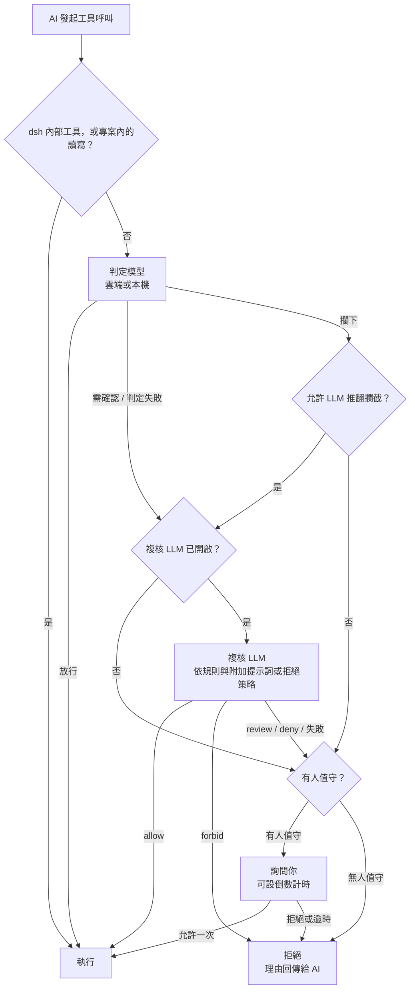

<div align="center">

<picture>
  <source media="(prefers-color-scheme: dark)" srcset="docs/assets/openvulcan-logo-dark.svg">
  
</picture>

# Vulcan Decision Guard

**為 AI 編碼代理的每一次工具呼叫做權限判定**

專用判定模型 · 可選 LLM 複核 · 你保有最終決定權

[](LICENSE)
[](https://www.npmjs.com/package/@openvulcan/dsh-decision-guard)

[简体中文](README.md) | [English](README.en.md) | **繁體中文** | [日本語](README.ja.md) | [한국어](README.ko.md) | [Español](README.es.md) | [Français](README.fr.md) | [Deutsch](README.de.md) | [Русский](README.ru.md) | [Português](README.pt-BR.md)

</div>

---

## 關於專案

Vulcan Decision Guard 是 AI 編碼工具的權限守衛外掛。AI 代理每次呼叫工具前，先由 Vulcan Decision 判定模型
判斷這次呼叫：一般操作直接放行，拿不準的交給複核 LLM 或由你確認，危險的攔下。

目前支援 DeepSeek harness（dsh `0.2.1-rc.2` 及以上、`0.3.0` 以下），只需安裝一個套件即可使用：

```sh
dsh plugin add @openvulcan/dsh-decision-guard
```

> **我們承諾：雲端指令判定模型永久免費提供。**（2026 年 10 月 27 日）

> **狀態：v1 預覽版。** 判定仍在校準，它是沙盒之上的一道防線，不能取代沙盒。本機模型可從 Hugging Face
> 或魔搭國內站下載，也可從本機資料夾安裝；魔搭國際站稍後發布。設計與驗證記錄請見
> [docs/architecture.md](docs/architecture.md)。

## 🤔 為什麼需要判定模型

AI 代理完成一項任務往往要呼叫幾十到幾百次工具。對這些呼叫只有兩種簡單做法，兩種都不好：

- **每次都問你**：很快就會疲乏，最後不看內容就按「允许」，詢問因此失去意義。
- **全部放行**：絕大多數時候沒事，但一次刪錯資料夾或誤清正式環境資料庫就無法挽回。

讓通用 LLM 逐條審查也不理想：每次呼叫都要等幾秒、花一次 token，而且它讀的是同一段對話，容易被帶偏代理的
同一段上下文說服。

判定模型是只為這一件事訓練的小模型（0.2B 到 0.8B）。它只看三樣東西：專案目錄、工具名稱、實際參數，不讀對話，
不讀 AI 的解釋，然後給出三個結論之一：**放行**、**需確認**、**攔下**。這樣一來：

- 讀取檔案、執行測試、`git status`、建置這類日常呼叫在一次網路往返或一次本機推論內直接放行，你幾乎感覺不到它；
- 只有少數拿不準或危險的呼叫才交給複核 LLM 或你，詢問因此重新變得值得認真看；
- AI 無法用一段說詞讓判定模型放行，因為判定模型根本看不到說詞。

## 🎯 防範什麼，不防範什麼

### 重點防範：AI 執行指令時的失誤

判定模型針對的是 AI **無意中**做錯的事，例如：

- 刪錯路徑：變數為空導致 `rm -rf "$DIR/"*` 刪到上一層，或遞迴刪除了專案之外的資料夾；
- 誤操作資料庫：對正式環境資料庫執行 `DROP DATABASE`、`TRUNCATE`、不帶條件的 `DELETE`；
- 毀掉專案或原始碼歷史：刪除整個專案、`git reset --hard`、強制推送覆蓋遠端、刪除 `.git`；
- 寫到別的專案裡：本該修改目前專案，卻改了另一個儲存庫的檔案；
- 鏡像或同步方向寫反、把預演參數當真執行，等等。

其中三類操作由你決定預設怎麼處理（快捷卡中的「类别授权」）：

| 類別 | 勾選（授權） | 不勾選 | 預設 |
| --- | --- | --- | --- |
| 專案外的寫入 | 直接放行 | 需確認 | 勾選 |
| 刪除或清空資料庫 | 直接放行 | 必須確認 | 不勾選 |
| 重設整個專案 | 直接放行 | 必須確認 | 不勾選 |

### 不防範：AI 刻意繞過

如果 AI **有意**繞過檢查，判定模型攔不住，任何同類方案也攔不住。最簡單的例子：

1. AI 先用寫檔工具寫一個 `cleanup.py`，裡面是 `shutil.rmtree("/")`；
2. 再執行 `python cleanup.py`。

判定模型看到的只是「在專案裡寫一個檔案」和「執行專案裡的一個 Python 腳本」，兩步單獨看都是正常的開發操作。
同樣的手法還有很多：修改 `package.json` 裡的腳本再 `npm run`、修改 Makefile 或 Git 掛鉤、把指令編碼後再解碼執行、
執行時從網路下載程式碼……

要攔住這類繞過，就必須讓 LLM **全程**分析 AI 寫下的每一個檔案，並在每次執行前完整分析要執行的檔案、它匯入
的所有模組、它會呼叫的其他程式，以及執行時才產生或下載的內容。每次執行都要做一遍，又慢又貴，而且仍然無法
涵蓋執行時才出現的程式碼。這本身是不切實際的。

所以本外掛的定位很明確：**減少 AI 的失誤，不對抗 AI 的惡意**。對抗惡意要靠隔離：

- 使用沙盒。接入方式選「独立开关」時會保留你所選權限預設的沙盒；
- 給開發環境最小權限，不要把正式環境資料庫、雲端帳號的憑證放在 AI 讀得到的地方；
- 在容器或虛擬機器裡執行不信任的任務。

另外，dsh 中外層 `run_code` 以及 PTC 程式內直接產生的 Node 副作用不經過工具呼叫閘門，這與 dsh 內建的 Auto
review 限制相同。

## ⚠️ 自動核准不保證拒絕一切風險

沒有任何模型能做到零漏判，本外掛也不例外：

- 判定模型會出錯。下面的評測裡，即使在大量訓練過的題目上，「應確認卻直接放行」也不是零；在沒訓練過的題型上
  錯誤更多；
- 複核 LLM 只處理判定模型**沒有放行**的呼叫。判定模型已經放行的呼叫會直接執行，複核救不回來；
- 規則、附加提示詞與無人值守策略都是自然語言，由 LLM 理解執行，同樣可能理解有偏差。

請把它當作降低事故機率的一層，而不是保險。建議同時做到：經常提交 Git、為重要資料做備份、「删除或清空数据库」
和「重置整个项目」保持不勾選、不在開發環境裡放正式環境憑證。發現判錯時，在判定記錄裡標記正確結論，幫助改進模型。

## 🔀 整體流程



1. **宿主換算**：外掛把 dsh 的工具呼叫換算成模型訓練時見過的形狀。dsh 內部工具（提問、待辦事項、子代理通訊等）
   與目前專案內的讀寫直接放行，不進入模型。
2. **判定模型**：給出放行、需確認或攔下。
3. **複核 LLM**（可關閉）：處理需確認與判定失敗的呼叫；被攔下的呼叫只有在你開啟「允许 LLM 推翻拦截」後才交給它。
4. **你**：只在有人值守時出現。無人值守的工作階段從不詢問，未放行即拒絕。

被拒絕的呼叫會把理由回傳給 AI，AI 可以說明目的後重試。**任何錯誤都不會被當作放行**：未登入、網路失敗、
執行套件或模型缺失、複核失敗或回答格式不符，一律按未放行處理。

## ⚖️ 判定邏輯

判定模型的輸入只有下面三行，與訓練格式完全一致，不補充任務描述、歷史訊息或檔案內容：

```text
Project: <專案根目錄>
Tool: <工具名稱>
Arguments: <實際參數的精簡 JSON>
```

再加上上面的三項類別授權。各結論的處理方式：

| 判定模型 | 含義 | 下一步 |
| --- | --- | --- |
| 放行 | 一般操作 | 直接執行 |
| 需確認 | 可能有副作用，需要看上下文 | 交複核 LLM，再依下表處理 |
| 攔下 | 很可能是失誤或越權 | 預設直接詢問你（無人值守時拒絕）；開啟「允许 LLM 推翻拦截」後先交複核 |

複核 LLM 的結論如何執行：

| 複核 LLM 的結論 | 有人值守 | 無人值守 |
| --- | --- | --- |
| allow | 執行 | 執行 |
| review（僅有人值守時可答） | 詢問你，預設焦點「允许」 | — |
| deny | 詢問你，預設焦點「拒绝」 | 拒絕 |
| forbid（僅有人值守時可答） | 拒絕，不詢問 | — |
| 失敗、複核已關閉或未送複核 | 詢問你；判定為需確認時預設焦點「允许」，否則「拒绝」 | 拒絕 |

詢問卡片可設倒數計時，逾時按拒絕處理；設為 0 表示一直等你回答。

## 🧑‍⚖️ LLM 複核方式

- **用哪個模型**：目前工作階段的模型、設定頁指定的服務與模型，或關閉。溫度為 0，複核請求不寫入工作階段記錄。
- **複核看到什麼**：
  - 環境：專案目錄與三項類別授權；
  - 你寫的規則：「绝对禁止」「拒绝」「允许」三組自然語言規則，優先順序 forbid > deny > allow，只作用於判定模型
    沒有放行的呼叫；
  - 有人值守時的「复核附加提示词」，或無人值守時的「拒绝策略」；
  - 對話中最近 6 條使用者與代理指令、最近 12 次工具呼叫；
  - AI 透過 `explain_tool_call` 給出的意圖說明（只是聲明，不是授權）；
  - 待判定的呼叫本身，以及判定模型給出的結論。
- **能怎麼回答**：有人值守時只能答 allow / review / deny / forbid，無人值守時只能答 allow / deny，並被告知不存在
  人工複核。回答必須是固定形狀的 JSON，理由最多 300 字元，依介面語言撰寫。格式不符即視為複核失敗。
- **附加提示詞**：有人值守時，複核在規則之後讀取「复核附加提示词」。它可以讓複核更嚴格、說明你在意的事項，
  但**不能放寬**規則或類別授權。設定頁儲存系統預設值，每個工作階段可以在快捷卡中另寫一段或跟隨預設值（也可用
  `/vulcan-review-prompt set <提示詞> | default`）。
- **無人值守**：在快捷卡中開啟時確認一段拒絕策略（預先填入系統預設拒絕策略），依工作階段儲存（也可用
  `/vulcan-unattended on [拒絕策略] | off`）。工作階段核准策略為 `never` 時同樣按無人值守處理，使用系統預設拒絕策略。
- **說明意圖**：複核開啟時，AI 可以呼叫 `explain_tool_call` 說明下一次呼叫的目的。說明只交給複核 LLM 並顯示在
  詢問卡片上，不交給判定模型，也不能單獨構成授權。

## 📊 評測

2026 年 10 月，我們用同一個凍結的題庫，對 **`vulcan-decision-shell-v1`**（0.8B）與兩個外部判定服務
做了一次性比較：JEV 1.14.0 與阿里雲判定模型 `decision-model-preview`。三者使用同一套固定英文策略、同樣完整的
工具參數、專案目錄與固定授權選項，不補充任務描述，取最高分結論，不調門檻。

先說清楚這組數字的限制：

- 有標籤的題目來自我們自己的訓練與測試題庫，**其中很大一部分是我們訓練過的題**，這對我們明顯有利；
- 參考標籤是我們定義的，不等於正式環境的絕對真值；
- 數字只代表 `vulcan-decision-shell-v1`。預設的雲端 `vulcan-decision-shell-v1-mini`（0.2B）與 `vulcan-decision-shell-v1-flash`（0.35B）表現不同，這裡不代表它們；
- 外部服務的結果只代表測試當時的版本。阿里雲的服務別名無法核對背後的權重版本。

**有標籤題庫（106,501 筆輸入）**

| 指標 | `vulcan-decision-shell-v1` | JEV 1.14.0 | 阿里雲 |
| --- | --- | --- | --- |
| 正常操作直接放行（越高越好） | 99.07% | 73.10% | 96.60% |
| 應確認卻直接放行（越低越好） | 2.40% | 17.03% | 90.92% |
| 應攔下卻直接放行（越低越好） | 0.04% | 2.99% | 76.85% |
| 其中嚴重誤操作直接放行 | 0 / 16,613 | 2.43% | 76.88% |
| 無害卻攔下（越低越好） | 0.20% | 8.11% | 1.79% |

**真實指令（415,194 筆不同呼叫，沒有逐筆標籤）**：按實際出現頻次計，三者直接放行的比例分別是 99.76%、99.69%、
99.99%。這只說明日常使用中被打擾的多寡，不說明判得對不對。

**我們沒有訓練過的題型**：在一組條件保護、變數複製與清理的開發保留題上（三方都沒訓練過），應攔下卻直接放行的
比例是 `vulcan-decision-shell-v1` 43.75%、JEV 1.88%、阿里雲 100%；無害卻攔下的比例是 `vulcan-decision-shell-v1` 15.36%、JEV 4.82%、阿里雲 0%。
在這類我們尚未涵蓋的題型上，JEV 明顯比我們好。

怎麼理解這些數字：

- **JEV 明顯針對指令判定做過訓練**，並不是表現不好。我們的優勢集中在專門訓練過的那幾類失誤上，例如變數鏈與
  刪除目標追蹤、鏡像同步的方向與預演、長指令；離開這些範圍，JEV 的誤判率可以比我們低；
- **阿里雲的判定模型面向更廣的通用用途**，很可能沒有專門針對編碼代理執行指令的失誤做訓練，所以在這個題庫上
  傾向於放行。這不是它做得不好，而是它考量的是整體，我們只專精這一件事；
- 我們會持續用判定記錄匯出的樣本補足沒有涵蓋到的題型。

## 🚀 安裝與使用（dsh）

```sh
dsh plugin add @openvulcan/dsh-decision-guard
```

只需要這一個套件，判定引擎已經打包在裡面，沒有原生相依套件和安裝腳本。

1. 開啟 dsh 的「设置 › 自动审批」（外掛頁的「打开自动审批设置」按鈕也會跳到這裡），登入 OpenVulcan 帳號
   （中國站或國際站）即可使用雲端判定。需要呼叫內容不出本機時，切到「本机模型」，依硬體建議安裝執行套件與模型。
2. 在 dsh 的權限選擇器中選擇「自动审查」，或在設定頁把接入方式改為「独立开关」：

   | 接入方式 | 判定範圍 | 沙盒 |
   | --- | --- | --- |
   | 自动预设 | 目前預設為「自动审查」的工作階段 | 無（完全權限） |
   | 独立开关 | 所有工作階段，疊加在所選預設之上 | 保留所選預設的沙盒 |

3. 用設定頁的「试判定」確認判定可用。

輸入框模型選擇器左側的「自动审批」標籤會開啟快捷卡：勾選三項類別授權，設定本工作階段的複核附加提示詞與無人值守，
調整判定模型、節點、複核與詢問倒數計時。本外掛取代 dsh 內建的實驗外掛 Auto review，兩者不能同時啟用。

## ☁️ 雲端與本機

預設使用雲端判定，本機不安裝任何執行函式庫。**雲端指令判定模型永久免費提供**（2026 年 10 月 27 日承諾），只需
登入 OpenVulcan 帳號；複核 LLM 使用你自己選定的模型服務，按該服務的規則計費。可用的判定模型與節點由
OpenVulcan 依帳號提供；設定頁的端點表顯示各
節點的網路與運算耗時，可以鎖定節點，也可以對單一節點做請求測試。

需要呼叫內容不出本機時，可以視需要安裝一個**執行套件**：

| 執行套件 | 適用 | Windows x64 下載量 |
| --- | --- | --- |
| `onnx-cpu` | 任意電腦，執行 ONNX 模型 | 56 MiB |
| `onnx-cuda` | NVIDIA 顯示卡（RTX 20 系列及以上），執行 ONNX 模型 | 1307 MiB |
| `torch-cpu` | 任意電腦，執行 PyTorch 發布版模型 | 173 MiB |
| `torch-cu128` | NVIDIA 顯示卡（RTX 20 系列及以上），執行 PyTorch 發布版模型 | 2797 MiB |

執行套件是預先編譯的 Python 與官方 wheel，每個檔案依鎖定的 SHA-256 驗證；**不編譯任何東西，也不安裝或更新驅動程式**。
沒有現成執行函式庫的顯示卡（AMD、Intel、Apple）使用 CPU 執行套件或雲端。設定頁會偵測顯示卡、驅動程式與運算能力並給出
建議；中國大陸網路可選「国内镜像」下載來源。

`vulcan-decision-shell-v1` 有三個系列，雲端與本機都可用：

| 系列 | 模型名稱 | 參數量 | 說明 |
| --- | --- | --- | --- |
| mini | `vulcan-decision-shell-v1-mini` | 0.2B | 雲端預設 |
| flash | `vulcan-decision-shell-v1-flash` | 0.35B | |
| standard | `vulcan-decision-shell-v1` | 0.8B | 上面評測的模型，基於 Qwen3.5-0.8B-Base |

## 🔒 判定記錄與隱私

- **雲端判定**：把上面三行輸入（專案目錄、工具名稱、參數）與類別授權傳送到 OpenVulcan 判定節點。選「本机模型」時
  不傳送。
- **複核 LLM**：把複核輸入（含最近的對話指令與工具呼叫）傳給你選定的複核模型服務，與你和該服務之間原有的
  資料關係相同。關閉複核則不傳送。
- **判定記錄**：設定頁的「记录判定」預設關閉。開啟後，判定模型或複核參與的每次決定連同原始指令與路徑儲存在
  本機 `$DSH_HOME/vulcan-decision/records.v1.jsonl`，保留最近 5000 筆、最長 30 天，不上傳。「查看记录」可依結論與
  工作區篩選、標記判錯的結論、把已標記的記錄匯出為訓練樣本，或全部清除。
- **憑證**：OpenVulcan 登入憑證儲存在 dsh 自己的憑證儲存區中，介面與日誌不顯示權杖。

## 📦 組成

| 套件 | 作用 |
| --- | --- |
| [`@openvulcan/dsh-decision-guard`](packages/dsh-decision-guard) | dsh 外掛：攔截工具呼叫、換算輸入、執行結論，提供設定頁與快捷卡；發布時內含判定引擎 |
| [`@openvulcan/vulcan-decision`](packages/vulcan-decision) | 判定引擎（雲端與本機）、帳號、執行套件與模型管理、命令列 `npx @openvulcan/vulcan-decision --help` |

兩者都是純 Node 套件（Node ≥ 20.19）。

## 🛠️ 開發

```sh
pnpm install
pnpm -r run typecheck
pnpm test
pnpm run pack:dsh   # 產生 dist/openvulcan-dsh-decision-guard-<版本>.tgz
```

執行套件鎖定檔由 `python -I -B scripts/lock_runtime.py` 產生（需要 uv）。

## 🙏 致謝

Vulcan Decision Guard 建立在以下開源專案之上，感謝這些專案的作者與社群。

**外掛宿主**

- [DeepSeek harness（dsh）](https://github.com/deepseek-ai/deepseek-harness)：外掛宿主與工具呼叫的權限鏈路
- [Cordis](https://github.com/cordiverse/cordis) 與 [Schemastery](https://github.com/shigma/schemastery)：外掛框架與設定 Schema，由 dsh 提供
- [React](https://react.dev/)：設定頁與快捷卡介面，由 dsh 的頁面提供

**本機執行包（僅在選用本機模型並安裝執行包時下載）**

- [CPython](https://www.python.org/)（[python-build-standalone](https://github.com/astral-sh/python-build-standalone) 預先編譯）：Python 直譯器
- [ONNX Runtime](https://onnxruntime.ai/)：執行 ONNX 模型
- [PyTorch](https://pytorch.org/)：執行 PyTorch 發布版模型
- Hugging Face [Transformers](https://github.com/huggingface/transformers)、[Tokenizers](https://github.com/huggingface/tokenizers)、[Safetensors](https://github.com/huggingface/safetensors)：模型載入與分詞
- [NumPy](https://numpy.org/)：數值計算
- [NVIDIA CUDA](https://developer.nvidia.com/cuda-toolkit) 與 [cuDNN](https://developer.nvidia.com/cudnn)：GPU 執行包中的官方 wheel

**開發工具**

- [TypeScript](https://www.typescriptlang.org/)、[pnpm](https://pnpm.io/)，以及產生執行包鎖定檔的 [uv](https://github.com/astral-sh/uv)

**模型**

- [Qwen3.5-0.8B-Base](https://huggingface.co/Qwen/Qwen3.5-0.8B-Base)：`vulcan-decision-shell-v1` 的基礎模型

**社群**

- [LINUX DO](https://linux.do/)：感謝 LINUX DO 社群的支持與交流

執行包中每個檔案的來源與 SHA-256 請見 [`packages/vulcan-decision/runtime-packs/`](packages/vulcan-decision/runtime-packs) 下的鎖定檔；安裝時逐一校驗、原樣安裝，各元件依其隨包附帶的授權條款使用。

## 📄 授權條款

[MIT](LICENSE)
